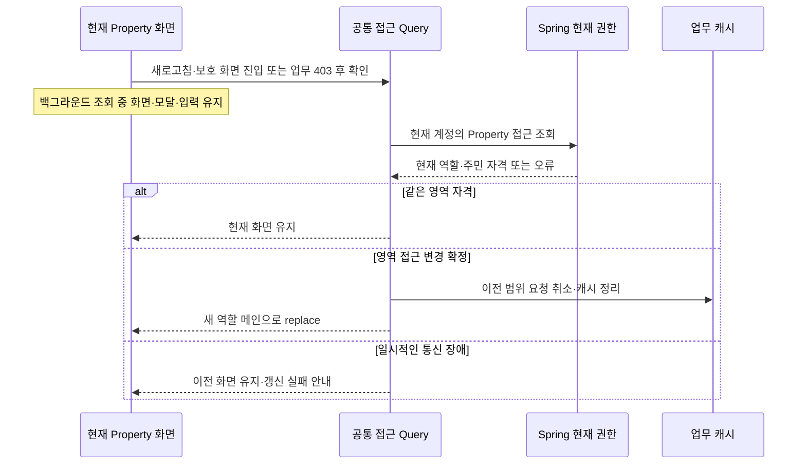

# Client 관리 레이아웃 설계

작성일: 2026-10-09. 수정일: 2026-10-24. 공통 사이드바·관리 헤더·페이지 조합·권한 확인·메뉴 연결을 설명합니다. 전체 진행 상태는 [프로젝트 현황](../../docs/projectOverview.md#4-현재-개발-상태)에서 관리합니다. 세대·주민·통장·정산의 상세는 각 화면 문서를 참조합니다.

기본 진입은 [서비스 진입](serviceEntry.md), 권한은 [관리 영역 접근 API](../../docs/managementAccessApi.md), 업무 정책은 [도메인 규칙](../../docs/domainRules.md)을 따릅니다.

### 현재 조회 연결

`GET /api/properties/{propertyId}/management-context`로 현재 관리자 참여와 활성 관리대상을 확인합니다. 등록 당시 역할이나 등록 요청 ID에 의존하지 않으며 임시 대시보드에는 업무 데이터와 관리 작업을 제공하지 않습니다. 관리비는 실제 설정·세대·청구 API를 사용합니다.

일반 `/start`는 서버 목록으로 기본 대상을 결정하며 [서비스 진입 설계의 현재 조회 연결](serviceEntry.md#현재-조회-연결)을 따릅니다. 브라우저 등록 기록 없이도 현재 관리자 참여로 연결됩니다.

## 1. 공통 레이아웃과 경로

관리 영역의 공통 범위는 `/manage/[propertyId]/...`입니다. `propertyId`는 실제 관리대상 UUID입니다. 로그인 후 기본 도착지는 `/manage/[propertyId]/dashboard`로 정하며, 대시보드는 사이드바의 여러 메뉴 중 하나입니다. 세대 목록·주민 목록과 다른 업무 페이지는 대시보드와 나란히 관리 영역 아래에 배치합니다.

### 라우팅 파일과 화면의 관계

| 구성 | 책임 |
| --- | --- |
| `app/(main)/manage/[propertyId]/layout.tsx` | 관리 영역 전체의 공통 레이아웃 연결 |
| 메뉴별 `app/.../page.tsx` | 해당 URL을 화면 슬라이스의 공개 API에 연결 |
| 메뉴별 `screens/<업무 그룹>/<화면 슬라이스>/ui/...Page.tsx` | 단일 진입 화면의 본문 구성. 복수 진입 UI는 `ui/<진입 UI>/`로 구분하며 단독 화면은 업무 그룹 생략 |

`app`의 `page.tsx`와 `screens`의 화면 컴포넌트는 한 페이지의 라우팅 연결과 본문을 나눈 것입니다. 각 업무 화면은 자기 화면 슬라이스를 사용하며 사이드바가 화면 컴포넌트를 직접 가져와 교체하지 않습니다.

아래는 공통 레이아웃과 일부 업무 라우트의 배치 예시입니다. 전체 메뉴의 현재 경로·연결 상태는 메뉴별 목적지 표를 따릅니다.

```text
src/app/(main)/manage/[propertyId]/
├── layout.tsx                 ← 모든 관리 메뉴의 공통 틀
├── dashboard/
│   └── page.tsx               ← 대시보드 메뉴
├── households/
│   └── page.tsx               ← 세대 목록 메뉴, 구현
├── residents/
│   └── page.tsx               ← 주민 목록 메뉴, 구현
└── billing/
    └── monthly/
        ├── page.tsx           ← 목록·탭
        ├── settings/page.tsx  ← 설정 편집
        ├── [month]/[unitId]/page.tsx ← 세대 상세
        └── history/[month]/page.tsx ← 월 이력 상세

src/screens/management-dashboard/
├── index.ts
└── ui/
    └── managementDashboardPage.tsx
```

대시보드는 진입 UI가 하나이므로 [UI 폴더 규칙](../AGENTS.md#컴포넌트-폴더-구조)에 따라 `ui/`에 바로 배치합니다. 스타일이 없는 현재 대시보드에는 빈 CSS 파일을 만들지 않습니다.

`세대 관리 → 세대 목록`의 화면 기준 경로는 `screens/household/unit-list/`입니다. 라우팅 파일은 그 화면의 `index.ts`를 통해 연결합니다. 진입 UI 배치와 편집·수정·삭제의 역할은 [세대 목록 설계](unitList.md)에서 관리합니다.

후속 메뉴도 각자의 `screens` 공개 API를 연결합니다. 주민 목록은 `screens/household/resident-list`의 공개 API를 연결하며 [주민 목록](residentList.md)을 따릅니다. 관리비는 `screens/billing`의 공개 API와 `ui/billing-page/billingPage.tsx`를 연결하며 탭을 별도 사이드바 하위 메뉴나 형제 화면 슬라이스로 나누지 않습니다.

- `layout.tsx`는 Client 조합 경계인 `managementShell.tsx`로 본문을 연결합니다. 이 조합은 `widgets/management-layout`의 현재 권한 확인과 메뉴 슬롯을 `widgets/service-header`에 전달하며 두 Widget은 서로를 직접 참조하지 않습니다. 라우터의 `layout.tsx`는 Server Component로 유지합니다.
- `ManagementLayout`은 인증·현재 접근 확인, 사이드바, 모바일 메뉴 버튼과 본문 영역을 조합합니다. 전용 조회 API로 현재 관리자 역할을 검증합니다. 메뉴 목록·드롭다운·링크의 JSX와 스타일은 각각의 컴포넌트가 담당합니다.
- 하위 `page.tsx`는 해당 `screens`의 공개 API로 본문을 연결합니다. 관리대상 안에서 페이지를 바꾸면 공통 틀은 유지하고 `children`으로 들어오는 본문만 바꿉니다.
- 본문의 `main` 영역은 공통 레이아웃에서 한 번 제공합니다. 대시보드 화면 안에 별도의 `main`을 중첩하지 않습니다.
- 루트 레이아웃이나 기존 `/start` 화면에 관리자 사이드바를 붙이지 않습니다. 관리자 레이아웃은 관리 경로 하위에만 적용합니다.

라우팅 파일은 Server Component를 기본으로 유지하고 클릭, 펼침 상태, 현재 경로와 브라우저 인증 처리가 필요한 Widget 내부에 Client 경계를 둡니다. 현재 Access Token은 브라우저 메모리에 있으므로 Next.js 라우팅 파일에서 임의로 인증정보를 추정해 업무 API를 호출하지 않습니다.

## 2. 컴포넌트 분리와 메뉴 링크

### 컴포넌트 구조

```text
src/widgets/management-layout/
├── index.ts
└── ui/
    ├── managementLayout.tsx
    ├── managementLayout.module.css
    ├── _components/
    │   └── management-sidebar/
    │       ├── managementSidebar.tsx
    │       ├── managementSidebar.module.css
    │       ├── sidebar-dropdown/
    │       │   ├── sidebarDropdown.tsx
    │       │   └── sidebarDropdown.module.css
    │       └── sidebar-link/
    │           ├── sidebarLink.tsx
    │           └── sidebarLink.module.css
    └── _constants/
        └── managementNavigation.ts
```

| 구성 | 책임 |
| --- | --- |
| `ManagementLayout` | 현재 접근 확인, PC / 모바일 배치와 `children` 본문 조합 |
| `ServiceHeader` | 시작·관리 화면이 공유하는 모아홈 로고, 프로필·계정 메뉴와 알림 표시 |
| `ManagementSidebar` | PC 사이드바·모바일 드로어가 공유하는 메뉴 목록, 그룹과 단일 링크 배치 |
| `SidebarDropdown` | 상위 그룹의 펼침 버튼, 열림 상태·화살표·하위 목록과 접근성 처리 |
| `SidebarLink` | 메뉴 목적지의 Next.js `Link`, 현재 페이지 강조와 준비 중 표시 |
| `managementNavigation` | 메뉴 ID·이름·아이콘·그룹 자식·목적지 경로·이동 가능 상태 |

단일 진입 UI인 `ManagementLayout`은 `ui/`에 TSX와 CSS Module을 함께 두고, 내부 보조 컴포넌트는 `_components/` 아래의 컴포넌트별 폴더에 둡니다. 사이드바 전용 드롭다운과 링크는 `management-sidebar` 내부에 두고 별도 파일로 구현합니다. `ManagementSidebar`는 이 컴포넌트를 조합하며 펼침 동작과 각 링크의 표현을 한 파일에 작성하지 않습니다.

Widget 외부에는 `ManagementLayout`의 공개 API를 제공합니다. 페이지는 공통 레이아웃이 적용된 경로 아래에 본문을 연결하므로 사이드바를 페이지마다 가져오지 않습니다. Widget이 상위 레이어의 `screens`를 참조하지 않으며 링크는 URL로 페이지를 연결합니다.

### 메뉴별 목적지

표의 목적지는 `/manage/[propertyId]` 뒤에 붙이는 경로이며 준비 중인 메뉴도 실제 경로의 준비 안내 화면으로 연결합니다. 2026-10-24 후속 요청으로 회계 메뉴를 숨기고 정산 / 마감을 단일 링크로 연결했습니다. 관리비 부과도 단일 진입과 본문 탭으로 구현했습니다. 모든 이동 항목에 자신의 목적지를 정의하고 현재 관리대상 UUID를 넣어 실제 링크를 만듭니다.

| 상위 그룹 | 이동 항목 | 목적지 | 연결 |
| --- | --- | --- | --- |
| 없음 | 대시보드 | `/dashboard` | 연결됨 |
| 세대 관리 | 세대 목록 | `/households` | 연결됨 |
| 세대 관리 | 주민 목록 | `/residents` | 연결됨 |
| 세대 관리 | 가입 요청 | `/join-requests` | 연결됨 |
| 세대 관리 | 승인 관리 | `/invitations` | 연결됨 |
| 없음 | 관리비 부과 | `/billing/monthly` | 연결됨 |
| 통장 관리 | 통장 거래 | `/banking/transactions` | 연결됨 |
| 통장 관리 | 월별 수납 현황 | `/banking/monthly` | 연결됨 |
| 통장 관리 | 지출 내역 | `/banking/expenses` | 연결됨 |
| 통장 관리 | 동별 잔고·정산 | `/banking/balances` | 연결됨 |
| 없음 | 정산 / 마감 | `/closing/monthly` | 연결됨 |
| 차량 관리 | 차량 내역 | `/vehicles` | 준비 안내 화면 연결 |
| 차량 관리 | 차량 승인 | `/vehicles/approvals` | 준비 안내 화면 연결 |
| 없음 | 공지사항 | `/notices` | 준비 안내 화면 연결 |
| 없음 | 설정 | `/settings` | 연결됨 |

정산 / 마감은 드롭다운이나 별도 하위 메뉴 없이 월별 정산 화면으로 이동합니다. 본문에서 월 요약·점검·Excel을 제공합니다. 회계 그룹과 별도 통장 대사·보고서 준비 메뉴는 현재 내비게이션에서 제외했고 기존 회계 경로는 후속 설계로 보존합니다. 실제 마감 확정·잠금은 후속입니다. [월별 정산 화면](monthlySettlement.md)을 참조합니다.

2026-10-17 통장 관리 메뉴를 활성화하고 기존 입금·지출 상위 메뉴를 통합했습니다. 업로드는 통장 거래 페이지의 버튼으로 제공합니다. 페이지·분류·배분과 모바일 상세는 [통장 관리 화면](bankingManagement.md)을 따릅니다. 동별 상세 원장과 `/banking/balances/details/[panel]`의 모바일 잔고 상세는 공통 헤더의 `<`로 조회 월을 유지한 동별 잔고·정산 목록에 복귀합니다. 조회·오류·대상 없음도 같은 복귀 경로를 사용합니다. 이전 `/payments/*` 주소는 호환용으로 유지합니다.

세대 관리 등 상위 그룹은 `SidebarDropdown`의 버튼으로 여닫고 각 하위 항목은 `SidebarLink`로 연결합니다. 차량 관리는 정산 / 마감 아래·공지사항 위에 배치하고 같은 그룹 구조를 사용하며 `차량 내역`·`차량 승인`을 하위 항목으로 표시합니다. 두 항목은 준비 배지를 유지하고 공통 캐릭터 안내 화면으로 이동합니다. 차량 업무 기능·API는 아직 없습니다. 차량 요청·승인 흐름은 [공통 기획](../../docs/residentCommunication.md#관리자-차량-관리)을 참조합니다. 대시보드·관리비 부과·정산 / 마감·공지사항·설정처럼 하위 항목이 없는 메뉴는 단일 링크로 배치합니다. 상위 그룹을 펼치는 동작과 하위 페이지로 이동하는 동작을 구분합니다.

2026-10-18 사용자 요청으로 현재 페이지가 속한 그룹을 닫아도 드롭다운 버튼의 아이콘·이름·화살표는 Primary, 배경은 옅은 Primary로 강조합니다. 펼침 여부와 현재 경로 판정을 분리하며 PC·모바일 드로어·아이콘만 표시하는 접힌 사이드바에 같은 기준을 적용합니다. 하위 상세 경로도 해당 그룹에 포함하고 다른 페이지로 이동하면 이전 그룹의 위치 강조를 해제합니다. 그룹을 펼치면 기존 배경과 하위 링크의 현재 페이지 강조를 사용합니다.

### 관리비 부과 (2026-10-10)

- `/manage/[propertyId]/billing/monthly`의 단일 메뉴 안에 `월별 부과·관리비 설정·부과 이력·기존 잔액 인계` 탭을 제공합니다. 탭과 월은 URL에 반영하고 탭은 방향키·Home·End로 이동합니다. 좁은 화면은 탭을 줄바꿈하고 탭 영역에 가로·세로 스크롤바를 만들지 않습니다.
- 새 초기 설정은 최종 `등록하고 관리 시작`에서 잔액 인계와 운영 시작을 함께 확정하고 지정한 첫 부과월부터 청구를 생성합니다. 인계 정보 없이 등록한 이전 결과는 내부 `기존 잔액 인계` 탭에서 관리 시작을 확정합니다. 관리비 부과는 사이드바 단일 메뉴와 본문 내부 탭을 유지합니다.
- 화면에서 `부과 방식 / 스케줄 자동 확정` 설명은 제거합니다. PC 설정 편집의 목록 복귀 문구는 `목록`으로 통일하며 모바일 상세 복귀는 [모바일 상세페이지 절대 규칙](../AGENTS.md#모바일-상세페이지-절대-규칙)을 따릅니다.
- 월별 목록과 이력은 실제 [관리비 API](../../docs/billingApi.md)를 조회합니다. 검색·표시 개수(10/20/50)·페이지네이션은 공통 ListToolbar / Pagination을 사용하며 필터 후 페이지를 조정합니다. 합계는 검색·페이지와 독립적인 전체 월 합계입니다.
- 월별 목록은 동·호수·별칭·대표 주민 이름으로 검색하고 `전체 동` 기본값의 동 필터를 함께 적용합니다. 동 구분이 없으면 동 필터와 동 열을 숨깁니다. 동 선택지는 해당 월 청구의 동명으로 구성하고 월 변경 시 동 선택을 초기화합니다. 대표 주민 열은 API의 현재 대표 이름을 표시하며 값이 없으면 `—`로 표시합니다.
- 월별 목록과 부과 상세(PC 모달·모바일 페이지)는 API 반환 순서와 무관하게 동 번호, 같은 동의 호수 번호 순으로 오름차순 정렬합니다. 동 구분이 없으면 호수 번호 순으로 정렬합니다.
- 월 선택은 `shared/ui/month-picker`에서 연도·12개월을 직접 선택합니다. 기본 브라우저 달력을 사용하지 않고 외부 클릭·포커스 이탈·Escape로 닫습니다.
- 별도 상세 열을 두지 않습니다. 행 클릭과 호수·부과월의 키보드 버튼으로 PC에서는 기존 ClientModal을 열고, 모바일에서는 독립 페이지로 이동합니다.
- 상세·로딩·오류 모달은 상단 X, 바깥 클릭 또는 Escape로 닫으며 하단 닫기 버튼을 두지 않습니다. 모바일 상세 페이지는 공통 헤더의 `<` 뒤로가기로 복귀하며 본문·푸터의 목록 버튼을 제공하지 않습니다.
- 세대 상세: `/billing/monthly/[month]/[unitId]`, 월 이력 상세: `/billing/monthly/history/[month]`. 각 페이지는 API를 재조회하므로 직접 진입·새로고침을 지원하고 목록 복귀 시 탭·월을 유지합니다.
- 관리비 설정 탭은 현재 항목·금액·자동 부과 일정과 다음 달 적용 예정 설정을 읽기 전용으로 보여줍니다. `이번 달 납부기한`은 서버 한국시간 기준월의 실제 월말, `설정 변경 적용월`은 기준월의 다음 달로 표시합니다. 예를 들어 2026년 10월에는 `10월 31일 / 2026년 11월`입니다. 최초 등록월을 설정 변경의 적용월로 표시하지 않습니다. 변경 적용은 `다음 달부터`로 표시합니다. `설정하기`는 `/billing/monthly/settings` 편집 페이지로 이동하며 모바일에서는 전체 너비로 표시합니다.
- 모바일 목록·이력의 검색창은 한 줄 전체를 사용하고 필터·초기화 버튼은 그 아래에 배치합니다. 부과일은 왼쪽, 납부기한은 오른쪽 끝에 정렬합니다. 월별 목록과 부과 상세의 표는 다른 세대 화면처럼 `동 / 호수` 열로 구분하고 동 없음이면 호수만 표시합니다.
- 편집 초기값은 마지막 예약 설정 또는 현재 설정입니다. 필수 수정 사유·항목·정수 금액·합계 범위를 확인하고 버전 토큰과 다음 달 적용월을 PUT으로 보냅니다. 실패 시 입력을 유지하고 성공 시 관련 쿼리를 무효화한 뒤 관리비 설정 탭으로 돌아가 토스트를 표시합니다.
- 설정 편집의 현재 적용 항목은 항목 수와 세대당 합계로 요약하고 처음에는 접어둡니다. 요약을 누르면 항목명은 왼쪽, 금액은 오른쪽인 목록을 펼치며 다음 달 설정 편집 영역은 아래에 유지합니다. 펼침·접힘 시 목록 높이와 투명도를 180ms로 전환하고 화살표도 함께 회전합니다. 공통 애니메이션·접근성 기준은 [Client UI 규칙](../AGENTS.md#4-ui--design)을 따릅니다.
- 모바일 설정 편집은 본문 `목록` 버튼을 표시하지 않고 상단 탐색으로 돌아갑니다. `항목 추가`는 전체 너비로 표시합니다. PC의 본문 `목록` 버튼은 유지합니다.
- Query key에 계정·관리대상·월·세대를 포함합니다. 설정은 1분마다 및 창으로 돌아올 때 서버에서 다시 조회해 월 전환 후 납부기한·변경 적용월을 갱신합니다. 다른 범위 응답은 거부하고 조회 실패를 빈 목록이나 예시로 대체하지 않습니다. 금액 응답은 문자열이며 합계는 BigInt를 사용합니다.
- 화면은 `screens/billing/ui/`의 billing-page·billing-detail-page·billing-settings-page로 구분하고 공통 내부 UI는 `_components/`, 조회 Hook은 `_hooks/`에 둡니다. API 기능은 `features/billing-management`, 공유 도메인 타입은 `entities/billing`입니다.
- 단위 검증은 `tests/billingModel.spec.ts`, 화면/API 연결·오류·모바일 재진입은 `tests/billingFlow.spec.ts`에서 확인합니다. 브라우저 테스트는 API를 모의 처리하며 실제 저장·스케줄·중복 방지는 Server PostgreSQL 테스트에서 확인합니다.
- 수납 상태·환급·주민 공개 화면·회계 전표는 후속 구현입니다. 업무 정책은 [도메인 규칙](../../docs/domainRules.md#5-관리비-부과--청구), 서버 처리는 [Server 관리비 설계](../../server/docs/billing.md)를 참조합니다.

### 링크 연결과 구현 상태

`managementNavigation`은 메뉴 설정 데이터만 관리합니다. 그룹에는 자식 목록을, 이동 항목에는 목적지와 이동 가능 상태를 정의합니다. 컴포넌트는 이 데이터를 순회해 구성하고 메뉴마다 조건문과 이동 핸들러를 반복하지 않습니다.

이동 가능한 항목은 `SidebarLink` 안에서 실제 `href`를 가진 Next.js `Link`로 렌더링합니다. 예를 들어 세대 목록의 완성된 주소는 `/manage/{실제 관리대상 UUID}/households`입니다. 링크를 누르면 해당 URL의 `page.tsx`가 연결한 본문으로 이동하며 공통 레이아웃은 유지됩니다. 링크의 새 탭 열기와 브라우저 기본 동작도 유지합니다.

현재 연결은 위 표와 `managementNavigation`을 따릅니다. 준비 중 항목은 없는 주소나 `#`로 이동하지 않습니다. 공지사항 메뉴는 준비 안내 화면에 연결했으며 공지사항·명부 발송의 업무 기능은 [주민 안내 서비스 기획](../../docs/residentCommunication.md)에 따른 후속 범위입니다. 주민 공유 코드·개인 링크는 [초대 화면](memberManagement.md#공통-계약과-구현-범위)에서 구현 범위와 전달 동작을 관리합니다.

## 3. 펼침과 현재 페이지 표시

- `SidebarDropdown`의 상위 메뉴 버튼은 클릭 / Enter / Space로 하위 목록을 펼치거나 접습니다. 여러 그룹을 각각 여닫을 수 있게 합니다.
- 초기에는 현재 경로에 해당하는 그룹을 펼칩니다. 현재 구현 대상인 대시보드는 단일 링크이므로 다른 그룹은 접힌 상태에서 시작합니다.
- 페이지가 바뀌면 `SidebarDropdown`은 해당 페이지의 그룹을 펼치고 `SidebarLink`는 현재 링크를 강조합니다. 경로 비교는 실제 메뉴 경로와 구간을 사용해 다른 메뉴 이름의 일부가 우연히 일치하는 것으로 선택하지 않습니다.
- `SidebarLink`는 선택한 링크에 `aria-current="page"`를, `SidebarDropdown`은 펼침 버튼에 `aria-expanded`와 `aria-controls`를 제공합니다. 닫힌 하위 항목은 포커스 / 접근성 탐색에서 제외합니다.
- 각 그룹의 열림 상태는 해당 `SidebarDropdown`에서 관리하며 공통 레이아웃이 유지되는 동안 보존합니다. 메뉴 펼침을 기억하기 위한 별도 브라우저 영속 기록은 만들지 않습니다.
- 아이콘, 선택 표시, 배경·글씨·테두리는 기존 브랜드와 전역 색상 토큰을 사용합니다. 펼친 상위 메뉴는 연한 회색 배경과 본문색 글씨를, 현재 하위 메뉴는 연한 파란색 배경·파란 굵은 글씨·왼쪽 표시선을 사용해 구분합니다. 하위 목록은 상위 메뉴보다 들여쓰며 PC와 모바일에 같은 표현을 적용합니다. 펼침 애니메이션은 짧게 적용하고 `prefers-reduced-motion`에서는 생략합니다.

기존 `shared/ui/form-controls`의 Dropdown은 값을 선택하는 입력입니다. 메뉴 탐색의 펼침 처리는 별도 `SidebarDropdown`으로 분리합니다. 기존 Button을 공개 API로 재사용하며 사이드바의 조합 코드에 입력 Dropdown의 업무를 추가하지 않습니다. 로그아웃은 헤더의 계정 메뉴가 담당합니다.

## 4. PC와 모바일

PC에서는 기존 모아홈 헤더 아래 왼쪽 사이드바와 오른쪽 본문을 배치합니다. 헤더와 본문에는 관리할 곳 선택 드롭다운이나 별도 관리할 곳 표시 띠를 두지 않습니다. 로그아웃은 기존 프로필 메뉴에서 제공하고 PC 사이드바에는 표시하지 않습니다.

사용자 요청에 따라 PC 사이드바 맨 아래에 문구 없이 `<>` 아이콘만 있는 접기·펼치기 버튼을 제공합니다. 펼친 사이드바에서는 버튼을 오른쪽에 정렬하고 접힌 상태에서는 중앙에 둡니다. 버튼은 메뉴 목록의 스크롤과 분리해 하단에 유지하며 모바일 드로어에는 표시하지 않습니다. 현재 구현은 펼침 너비 248px, 접힘 너비 72px이며 접으면 상위 메뉴 아이콘만 표시하고 본문 너비를 넓힙니다. 아이콘에는 메뉴 이름을 접근성 이름과 툴팁으로 제공하며, 접힌 그룹 아이콘을 누르면 사이드바와 해당 하위 목록을 함께 펼칩니다. 접기 전 그룹의 펼침 상태는 유지합니다. 접힘 상태는 공통 레이아웃이 유지되는 동안 보존하고 새로고침 시 기본 펼침으로 시작합니다. 너비 전환 모션은 모션 감소 설정에서 생략합니다.

767px 이하의 관리 화면에서는 헤더의 프로필 버튼 하나로 오른쪽 드로어를 엽니다. 프로필·실제 사용자 이름, 전체 관리 메뉴와 하단 로그아웃을 하나의 드로어에 모읍니다. 관리 메뉴용 버튼이나 두 번째 서랍을 만들지 않습니다. 시작 화면은 기존 계정 메뉴와 640px 기준을 유지합니다. 사용자 이름에는 `관리자`를 덧붙이지 않습니다.

드로어는 오른쪽 화면 밖에서 왼쪽으로 들어오고 닫을 때는 오른쪽으로 나갑니다. 닫기 버튼·Escape·바깥 배경·브라우저 뒤로가기로 닫으며 열린 동안 배경 스크롤과 포커스를 제한합니다. 메뉴를 열 때 같은 URL의 임시 이력을 추가해 뒤로가기가 본문 페이지를 벗어나지 않게 합니다. 메뉴의 링크로 이동할 때는 이 기록을 대체하며, 화면 크기 변경·이탈 시에도 모션과 스크롤 잠금을 정리합니다. 모션 감소 설정에서는 즉시 표시·닫습니다.

PC와 모바일은 같은 `ManagementSidebar`, `SidebarDropdown`, `SidebarLink`와 메뉴 설정을 사용합니다. 모바일에서는 메뉴 목록만 스크롤하고 프로필과 하단 로그아웃을 유지합니다. 준비 중인 메뉴도 링크를 누르면 해당 안내 화면으로 이동하고 모바일 드로어를 닫습니다.

### 화면 용어

화면에는 `관리대상` 대신 `관리할 곳`을 사용합니다. 이름 입력은 `건물·단지 이름`, 등록 정보 확인 영역은 `건물·단지 정보`, 완료 제목은 `관리할 곳이 등록되었습니다!`로 표시합니다. 내부 Property 식별자와 API 계약은 유지합니다.

## 5. 현재 권한 확인과 화면 상태

관리 화면은 세션 확인 뒤 현재 관리 권한 API를 조회하며 확인 전에는 이름과 본문을 숨깁니다. URL과 응답의 대상 ID가 다르면 잘못된 응답으로 처리합니다. 접근 거부에는 최근 선택을 폐기하고 접근 불가 상태를, 일시 장애에는 재시도를 제공합니다.

관리대상 직접 접근은 현재 관리 권한 조회를 거칩니다. 아래는 구현한 처리 기준입니다.

| 상태 | 레이아웃 처리 |
| --- | --- |
| 세션 / 현재 관리 권한 확인 중 | 이전 관리대상 이름·본문을 숨기고 확인 상태 표시 |
| 권한 확인 성공 | 확인한 대상의 사이드바와 하위 본문 표시 |
| 인증 거부 / 계정 이용 불가 | 기존 인증 흐름에 따라 로그인으로 이동 |
| 현재 관리 권한 없음 | 이전 본문을 숨기고 접근 거부 및 서비스 재진입 동작 제공 |
| 네트워크 / 내부 조회 장애 | 이전 본문을 숨기고 해당 조회 재시도 제공 |
| 관리대상 ID 형식 오류 | API를 호출하지 않고 잘못된 접근 상태와 서비스 재진입 동작 제공 |

현재 화면의 재진입 동작은 `/start`로 연결해 목록을 새로 확인합니다. 별도 `/entry`는 후속 범위입니다. 거부된 ID를 최근 기록에서 제거할 때는 현재 사용자와 제거 대상 ID가 같은지 확인해 늦은 응답이 다른 선택을 지우지 않도록 합니다. 실패를 빈 목록으로 처리해 `/start`로 자동 이동하지 않습니다.

관리대상 ID 변경, 새 진입, 새로고침과 브라우저 기록 복원에서는 현재 권한을 다시 확인합니다. 이전 대상의 쿼리 결과를 새 대상의 화면에 잠시 표시하지 않습니다. 기존 등록 완료 화면에서 적용한 `pagehide` 숨김과 `pageshow.persisted` 재검증 원칙을 관리 레이아웃에도 적용해 로그아웃 전 화면을 그대로 복원하지 않습니다.

동일 관리대상 안에서 공통 레이아웃이 유지되는 동안에도 후속 업무 API는 Server에서 각 요청의 현재 권한을 검증해야 합니다. 레이아웃의 확인 결과를 업무 API의 권한 증명으로 사용하지 않습니다.

## 6. 임시 대시보드의 범위

대시보드 본문은 공통 `StateMessage`의 기능 준비 중 그림과 `새로운 기능을 준비하고 있어요!` 문구를 표시합니다. 인사말, 청구·수납·미수·지출 카드, 처리할 일, 일정, 최근 입금과 공지 본문을 채우지 않습니다. 시안의 금액·건물명·사용자명·건수를 실제 데이터처럼 넣지 않습니다.

주민 등록·상세·역할 수정과 가입 요청 처리를 연결했습니다. 설정은 본문의 등록·참여 진입과 관리자의 계좌 정보 정정을 제공합니다. 월별 정산 조회는 전용 화면·API로 연결하며 실제 마감·회계와 대시보드 통계는 후속입니다.

## 7. 구현 시 검증

- 관리 경로에서 공통 사이드바가 표시되고 `/start`와 공개 화면에는 표시되지 않음.
- 대시보드 본문은 기능 준비 중 안내를 표시하고 가상 업무 데이터가 없음.
- 각 메뉴 그룹의 클릭·키보드 펼침 / 접힘, 준비 중 항목의 안내 화면 이동과 현재 링크 표시.
- 메뉴 설정·사이드바 조합·드롭다운 동작·링크 표시가 각각의 파일과 스타일로 분리됨.
- 모든 이동 항목에 자신의 목적지 경로가 정의되고 활성 항목이 현재 관리대상 UUID를 포함한 실제 `Link`로 연결됨.
- 후속 하위 페이지 연결 시 메뉴별 URL과 화면 슬라이스로 이동하고 동일 레이아웃에서 본문만 교체되며 해당 그룹이 펼쳐짐.
- PC 메뉴 스크롤, 긴 이름, 320px / 390px 모바일의 가로 넘침과 열기·닫기·포커스·스크롤 복원.
- 직접 URL 접근, 주민 역할 / 다른 사용자 / 권한 종료의 거부, 조회 중과 장애 시 이전 본문 숨김.
- 관리대상 변경과 로그아웃 후 뒤로가기 / bfcache 복원에서 계정·대상 정보가 섞이지 않음.

현재 메뉴·반응형·목록 / 현재 권한 연결과 조회 실패 / 계정 격리 / 캐시 복원 검증은 `tests/managementLayout.spec.ts`와 기존 등록 테스트에 작성했습니다. 후속 업무 메뉴는 해당 기능 구현 시 검증합니다. 실행 명령은 [Client AGENTS.md](../AGENTS.md)를 따릅니다.

### 부과 상세와 공실 제외 (2026-10-12)

부과 기준은 [도메인 규칙](../../docs/domainRules.md#확정-정책-공실-제외와-상세-청구-삭제-2026-10-12)을 따릅니다. 2026-10-12 후속 요청에 따라 PC 상세 모달과 모바일 상세 페이지에서 `청구 삭제` 버튼과 확인창을 제거합니다. 당월·과거·예정 상세는 항목·합계 조회만 제공합니다. 모바일 복귀는 헤더의 `<`를 사용하며 PC의 닫기 동작은 유지합니다. 동·세대 삭제와 공실 전환에 따른 부과 제외는 기존 자동 연동을 따릅니다.

## 기존 잔액 인계 탭 (2026-10-17)

사용자 최종 지시에 따라 관리비 부과는 단일 사이드바 메뉴와 본문 내부 탭을 유지합니다. 월별 부과·관리비 설정·부과 이력에 기존 잔액 인계를 추가하고 인계를 포함하지 않은 이전 등록 완료 화면에서도 같은 탭으로 이동합니다. 새 초기 설정은 등록과 인계를 함께 확정한 뒤 월별 부과로 이동합니다. 공통 CalendarPicker·AmountInput·DataTable·FileDropzone으로 기준일·첫 부과월·세대/계좌 잔액을 입력합니다. 엑셀 검증 후 편집 내용을 검토·저장한 뒤 별도로 확정합니다. 저장 중 입력을 잠그고 실패 시 입력을 유지합니다. 확정 수납 전 인계 정정은 취소 이력과 새 작업으로 처리합니다. API·정책은 [관리비 계약](../../docs/billingApi.md#기존-잔액-인계)을 따릅니다.


## 역할·가입 요청 연결 (2026-10-17)

현재 주민 목록·상세·수정은 `역할` 표기를 사용하고 기존 상세/수정 레이아웃 안에 배치합니다. 가입 요청 메뉴는 미연결 주민 조회·검색·페이지네이션·참여 링크 복사를, 승인 관리는 실제 신청 조회·승인·거절을 제공합니다. 현재 주민 상세에는 가입·코드 발급 영역이 없습니다. 개인 초대는 가입 요청의 미연결 주민 행에서 발급·재열기·재발급·철회합니다. 설정은 본문의 등록·참여와 계좌 변경 버튼을 제공하며 관리자 관리·참여자 표·초대 신청을 넣지 않습니다. 자세한 화면 동작은 [역할·가입 화면](memberManagement.md)을 따릅니다.

### 설정의 계좌 변경 (2026-10-18)

설정은 등록·참여와 관리계좌 진입을 제공합니다. 관리소장과 부담당자는 통장 추가·기존 정보 정정·기본 지정·사용 종료를 구분해 처리합니다. PC는 공통 모달, 모바일은 `/settings/accounts` 독립 페이지를 사용합니다. 계좌 입력·보안·저장 상태와 사용 종료 표시는 [통장 화면](bankingManagement.md#다중-통장-화면-2026-10-18)을 따릅니다.

## 공통 조회 오류 화면 (2026-10-24)

목록·상세·설정의 조회 실패는 shared/ui/server-connection-error의 RequestError로 통일합니다. 기존 serverError.webp 이미지와 카드·버튼을 사용하고 서버 장애·권한 부족·대상 없음의 안내만 구분합니다. 업무 입력 검증과 저장 실패는 입력을 유지하는 기존 폼 안내를 사용합니다. 권한 없는 내용을 이전 조회값으로 표시하지 않습니다. 관리자 메뉴는 ADMIN / MANAGER가 동일하게 사용하며 부담당자의 주민 관리자 승격과 관리소장 명부 수정·삭제를 제한합니다.

## 동적 권한 확인과 화면 보존 설계 (2026-10-25)

상태: 미구현 설계. 업무 규칙은 [도메인 규칙](../../docs/domainRules.md#초대-인증서비스-복귀역할-변경의-후속-확정-방향-2026-10-25), 조회 보완안은 [공유 API](../../docs/managementAccessApi.md#8-동적-권한을-위한-최소-조회-보완안-2026-10-25), 오류 복귀는 [서비스 진입](serviceEntry.md#오류-복귀와-공개-랜딩-분리-설계-2026-10-25)을 따릅니다. 이 절은 기존 최초 진입 확인을 확장하며 아직 동작한다고 기록하지 않습니다.

### 현재 코드의 제약

- `src/features/enter-service/model/useManagementAccess.ts`에 실제 함수 useManagementEntry/useManagementContext/useResidentProperties가 있습니다. useManagementAccess라는 이름의 Hook이 따로 구현된 것은 아닙니다. 공통 옵션은 staleTime 0, refetchOnMount always, 포커스·재연결 자동 조회 false이며 주기 조회는 없습니다.
- `src/widgets/management-layout/ui/managementLayout.tsx`는 session.isFetching 또는 property.isFetching이면 ManagementFrame과 children을 로딩 상태로 교체합니다. 같은 화면에서 재시도 등으로 조회가 다시 실행되면 업무 컴포넌트·모달·입력을 제거할 수 있습니다. 주기 조회 도입 여부와 별개의 상태 처리 문제입니다.
- `src/screens/resident-home/ui/residentHomePage.tsx`는 현재 주민 목록만 조회하고 401/ACCOUNT_UNAVAILABLE 때 로그인으로 보냅니다. 관리자 승격 감지·특정 Property 자동 전환은 없습니다.
- `src/app/providers/appProviders.tsx`는 브라우저 QueryClient를 하나 생성하고 세션을 복원합니다. `src/entities/session/model/useSession.ts`는 조회를 공유하며 포커스·재연결 재조회를 꺼 둡니다. 역할 조회를 위해 Refresh Rotation을 주기 실행할 필요는 없습니다.
- `src/entities/session/api/authenticatedApi.ts`는 ACCESS_TOKEN_EXPIRED에서만 세션 재발급 후 원 요청을 한 번 재시도합니다. 403은 현재 호출부로 전달하며 역할 재조회가 자동 연결돼 있지 않습니다.

### 공통 Query와 가드의 책임

기존 enter-service 슬라이스에서 접근 Query를 공통화합니다. 후보 함수 usePropertyAccess를 같은 모델 파일에 추가하거나 실제 복잡도가 커질 때만 분리합니다. 기존 useManagementContext는 필요한 화면의 호환 구독으로 재사용하고 독립 타이머·중복 API 호출을 만들지 않습니다. Query key 제안은 `['property-access', userId, propertyId]`입니다. 세션·대상이 확정됐을 때만 enabled이며 같은 계정·대상의 레이아웃과 화면이 결과를 공유합니다.

관리 레이아웃은 ADMIN/MANAGER 영역을, 주민 영역 가드는 RESIDENT와 실제 주민 자격을 확인합니다. 신규 `widgets/resident-layout`는 후속 주민 화면에서도 공유될 때 검토할 후보이며 현재 존재하지 않습니다. 주민 홈 한 곳에만 필요한 단계에서는 기존 화면과 enter-service 조합으로 처리합니다. app 라우터 경계에서 상위 조합을 하고 같은 FSD 레이어의 슬라이스를 직접 참조하지 않습니다.

현재 `/resident`는 여러 참여 대상을 나열하며 선택한 Property ID가 없습니다. 다른 Property의 관리자 역할을 보고 현재 주민 화면에서 강제로 이동시키면 안 됩니다. 구현 전에 활성 대상 식별을 정리해야 합니다. 제안은 초대 완료·명시적 대상 선택에서 실제 Property ID를 진입 상태로 전달하고 서버 검증 후 사용하며, 대상 문맥이 없으면 기존 `/start`로 목적지를 결정하는 것입니다. 주민 홈의 다중 대상 선택 UI·ID 전달 형식은 확인 필요이며 임의로 첫 대상의 역할을 전역 역할로 정하지 않습니다.

### 상태와 화면 수명

| 상태 | 화면·입력·권한 처리 |
| --- | --- |
| 최초 검증 결과 없음 | 보호된 업무 화면을 열지 않고 로딩 또는 최초 실패 재시도 |
| 현재 역할·영역 자격 확인 | 기존 업무 화면 유지 |
| 백그라운드 재조회 중 | isFetching만으로 children 제거 금지. 최초 isPending/검증 부재와 구분 |
| 재조회 네트워크/서버 장애 | 이전 확인 결과와 입력 유지, 갱신 실패 안내·재시도. 권한 회수로 처리 금지 |
| 업무 403 후 같은 영역 자격 확인 | 해당 업무 접근 불가만 안내. 메인으로 자동 이동하지 않음 |
| 영역 자격 변경 확정 | 즉시 이전 영역 데이터 표시·요청을 중단하고 해당 범위 정리 후 replace |
| 현재 참여 종료 확정 | 해당 대상 데이터 정리 후 다른 현재 참여 또는 `/start` |
| 인증 만료/계정 이용 불가 확정 | 기존 세션 정리·로그인 흐름. 단순 갱신 장애와 구분 |

재조회 오류와 이전 성공 데이터가 함께 존재할 수 있으므로 error만 보고 검증 결과를 폐기하지 않습니다. 무제한 캐시를 권한 증명으로 쓰는 것은 아니며 업무 API가 매 요청 현재 서버 권한을 검사합니다. 로그아웃·계정 변경·bfcache 복원의 기존 개인정보 숨김과 재검증은 유지합니다.

### 재조회·취소·캐시 범위

최신 사용자 의도는 새로고침하거나 보호된 화면에 진입했을 때 현재 권한을 확인하고, 맞지 않는 영역이면 해당 역할의 메인으로 이동하는 것입니다. 최초 로그인 후 진입·새로고침·직접 URL 접근·보호 영역 이동에서 현재 계정과 Property를 확인합니다. 같은 레이아웃을 공유하는 Client 경로 이동은 재마운트가 보장되지 않으므로 필요한 진입 검증을 공통 경계에서 수행합니다. 업무 API의 403이 발생하면 원인을 구분하기 위해 일회성 권한 재확인을 사용할 수 있습니다. 가만히 열린 화면의 변경 감지는 이번 요구사항이 아니며 30초 주기·탭/앱 활성화·네트워크 복구만을 이유로 한 자동 권한 조회는 필수 구현에서 제외합니다. 현재 꺼진 포커스·재연결 옵션을 자동으로 켜지 않습니다.

1. 403 신호를 받으면 같은 userId/propertyId의 접근 조회를 한 번 공유합니다. 접근 조회 자체의 403을 다시 같은 조회로 보내는 재귀 루프는 막습니다.
2. 새로운 접근 결과와 현재 영역 자격을 비교합니다. RESIDENT→MANAGER는 같은 대상 대시보드, MANAGER→RESIDENT는 검증된 주민 메인으로 이동합니다. ADMIN→MANAGER 인계는 같은 관리 영역이므로 메뉴·관리소장 전용 행동을 다시 계산하고 불필요한 입력 초기화는 피하는 안을 권합니다.
3. 실제 상실한 접근 범위의 업무 Query를 취소하고 캐시를 제거합니다. 현재 접근 판정·세션·다른 Property 캐시는 전역 삭제하지 않습니다. 확인된 새 역할 스냅샷으로 목적지를 결정해 정리 도중 이전 Query가 다시 요청하지 않게 합니다.
4. 진행 중 요청의 늦은 성공이 이전 캐시·화면 상태를 다시 채우지 못하도록 요청 취소와 계정·대상·접근 세대 비교를 함께 적용합니다. 새 역할이 확인된 뒤 이전 화면을 그대로 보여주며 이동을 기다리지 않습니다.

현재 키 예시는 billing의 `['billing', userId, propertyId, kind]`, 주민 명부의 `['property-residents', userId, propertyId]`, 초대의 `['resident-invitations', userId, propertyId]`, 미연결 명부의 `['unlinked-residents', userId, propertyId]`입니다. resident-properties는 계정 단위 목록이므로 변경 대상의 항목을 새로 조회합니다. `balance-download-account-balances`처럼 userId가 없는 파생 키도 존재하므로 키 문자열의 propertyId 포함 여부만으로 전부 제거하는 구현은 피합니다. 각 실제 키·화면 로컬 상태·업무 캐시 소유 범위를 점검해 정리 함수를 작성하고 로그아웃의 기존 전체 정리와 구분합니다.

`src/shared/api/customApiTypes.ts`의 CustomApiOptions에는 호출자 signal이 없습니다. `customApi.ts`는 내부 timeout signal만 fetch에 전달합니다. 따라서 cancelQueries를 호출했다고 실제 HTTP 요청까지 취소된 것으로 간주할 수 없습니다. 구현 시 optional signal 전달과 timeout 결합, authenticatedApi를 통한 전파를 추가하고 호출자 취소를 NETWORK_ERROR로 잘못 표시하지 않게 설계해야 합니다. 세션 복원·Refresh Rotation·이미 전송된 저장 요청은 역할 Query처럼 무작정 취소하지 않습니다. 클라이언트 취소가 서버 트랜잭션 취소를 보장하지 않으므로 쓰기는 서버에서 권한·멱등성을 검증합니다.



### 수정 파일과 검증 계획

수정 대상은 기존 `features/enter-service/api/managementAccessApi.ts`·`managementAccessApiTypes.ts`·`model/useManagementAccess.ts`, `widgets/management-layout/ui/managementLayout.tsx`, `screens/resident-home/ui/residentHomePage.tsx`, `entities/session/api/authenticatedApi.ts`, `shared/api/customApiTypes.ts`·`customApi.ts`입니다. 공통 가드·정리 함수는 실제 재사용 책임에 맞춰 enter-service와 상위 조합에 둡니다. 신규 권한 DB·프런트 전역 Permission 프레임워크는 추가하지 않습니다.

기존 `tests/managementLayout.spec.ts`·`onboardingFlow.spec.ts`·`authenticatedApi.spec.ts`·`customApi.spec.ts`·`sessionRestore.spec.ts`를 재사용하고 다음 항목을 보강합니다.

- RESIDENT→MANAGER, MANAGER→RESIDENT, ADMIN→MANAGER 인계, 주민 관계 없는 외부 MANAGER, 다른 Property의 다른 역할.
- 새로고침·직접 주소·보호 화면 진입에서 변경 반영, 같은 대상 중복 조회 합치기, 403 재조회 재귀 방지.
- 역할 변화 없는 업무 403은 현재 화면 유지, 일시 실패는 입력 유지, 최초 실패는 미검증 업무 비노출.
- 같은 화면의 수동 재조회·실패 후 재시도에서 모달·입력·파일·선택 유지, 실제 접근 상실 때만 이전 화면 제거. 브라우저 새로고침에 따른 정상 문서 재생성과 구분.
- 느린 이전 요청의 응답·취소가 새 계정/Property 캐시를 오염하지 않음, 상실 범위만 제거, 세션 Rotation 취소 방지.
- 이전 영역 URL 재접근과 서버 API 직접 호출의 권한 거부. 실제 주민 업무 API가 없는 범위는 구현 전 테스트 대상으로 구분.

이 문서 정리에서는 테스트를 실행하지 않습니다. 구현 재개 후 Client 규칙에 따라 `npm run lint`, `npx --no-install tsc --noEmit`, `npm run build`, `npm test`와 영향 화면의 PC·모바일 확인이 필요합니다.

### 후속 필수 과제의 재확인 범위

2026-10-25 추가 요구사항으로 **권한 재조회 중 업무 화면 유지**와 **공통 HTTP AbortSignal 전달**을 후속 필수 구현 과제로 지정합니다. 두 항목은 현재 미구현이며 구현 착수 시 실제 코드를 다시 확인해야 합니다. 이번 추가 요청은 기존 설계 문서만 수정하며 코드·테스트·Migration·도메인 문서는 변경하지 않습니다. Redis 초대 저장 이전과 별개의 Client·HTTP 개선 작업이며 위 계획에 함께 포함합니다.

이번 소스 재확인에서 설치된 `@tanstack/react-query`와 `@tanstack/query-core`는 모두 **5.104.1**입니다. package.json의 버전 범위만 보고 판단하지 않았습니다. 실제 설치 소스 `node_modules/@tanstack/query-core/src/queryObserver.ts`·`query.ts`에서 다음을 확인했습니다. 아래 상태 정의와 요청 합치기는 현재 설치 버전의 동작이며 의존성 변경 시 다시 확인합니다.

| 상태·동작 | 확인 결과와 설계에 미치는 영향 |
| --- | --- |
| isPending | status가 pending인 경우. 최초 실패 뒤에도 무조건 true인 상태가 아니므로 최초 검증 여부를 이것만으로 판단하지 않음 |
| isFetching | fetchStatus가 fetching인 경우. 최초 조회와 백그라운드 재조회 모두 포함 |
| isLoading | isPending && isFetching. 최초 로딩 표현에 사용하되 현재 계정·대상의 검증 여부와 함께 판단 |
| isRefetching | isFetching && !isPending. 정상 데이터 재조회뿐 아니라 기존 오류 뒤 재조회도 포함하므로 권한 보유의 근거가 아님 |
| isRefetchError | 오류와 기존 데이터가 함께 존재할 수 있음. 이미 확인한 같은 범위의 화면을 즉시 제거하면 입력 손실 가능 |
| 진행 중인 동일 Query | 재조회 취소를 요청하지 않으면 기존 진행 Promise를 공유하는 경로 존재 |
| 포커스·연결 복구 | 내부적으로 refetch의 cancelRefetch false 사용 |
| 명시적 refetch | 기본 cancelRefetch true 경로가 있어 기존 데이터가 있으면 취소·재시작 가능. 공통 접근 갱신은 false로 진행 요청 공유 |

최초 검증 상태는 현재 userId/propertyId에 종속된 성공 결과와 그 결과의 유효성을 기준으로 관리합니다. 이전 계정·대상의 데이터, placeholderData나 다른 화면의 성공으로 보호 화면을 열지 않습니다. 동일 역할·영역이면 부모 key나 조건 분기를 바꾸지 않고 ManagementFrame/주민 업무 서브트리를 계속 마운트합니다. 현재 session.isFetching 분기도 같은 원칙으로 검토하되 인증 만료·계정 이용 불가의 확정 결과는 별도 처리합니다.

공통 접근 갱신은 동일 계정·대상의 Query key와 진행 중 Promise를 공유합니다. 진입 확인·수동 재조회·업무 403 후 확인이 겹치면 같은 실행 중 요청을 취소하고 새 요청을 만들지 않습니다. 사용자 코드에서 타이머·독립 조회를 만들지 않고, 필요하면 같은 이벤트 배치의 갱신 요청을 합칩니다. 같은 역할의 업무 403과 접근 조회 자체의 403을 구분해 무한 조회를 막습니다. 동시에 다른 userId/propertyId의 요청을 하나로 합치지는 않습니다.

### HTTP 요청 취소의 구현 방법

현재 전송 수단은 브라우저 **fetch**입니다. Axios를 사용한 것으로 가정하지 않습니다. 다음은 실제 변경할 파일과 책임입니다. 표의 코드는 아직 구현하지 않았습니다.

| 실제 파일 (`client/src/` 기준) | 후속 변경 |
| --- | --- |
| `shared/api/customApiTypes.ts` | CustomApiOptions에 optional `signal?: AbortSignal` 추가. 기존 호출은 그대로 허용 |
| `shared/api/customApi.ts` | 호출자 signal과 기존 AbortSignal.timeout을 결합해 fetch에 전달. fetch와 response.text의 취소도 같은 기준으로 처리 |
| `shared/api/index.ts` | 취소 판별을 여러 계층에서 공유해야 할 때만 공개 helper 추가 |
| `entities/session/api/authenticatedApi.ts` | signal 전달 유지, 취소를 인증 오류로 처리하지 않음. Refresh 뒤 원 요청 재전송 전 취소·현재 계정 확인 |
| `features/enter-service/api/managementAccessApi.ts`, `model/useManagementAccess.ts` | queryFn의 signal→업무 API→authenticatedAPI→customAPI→fetch 전달 |
| `features/billing-management/api/billingApi.ts`, `screens/billing/ui/_hooks/useBillingData.ts` | 현재 인자 없는 조회 함수를 QueryFunctionContext의 signal이 전달되는 형태로 확장 |
| `widgets/banking-workspace/api/`와 실제 useQuery 호출부 | 통장·잔고·상세 조회에도 optional signal 전달. 저장 함수는 조회와 분리 |
| `widgets/management-layout/ui/managementLayout.tsx`, `screens/resident-home/ui/residentHomePage.tsx` | 최초 검증·백그라운드 갱신·실제 권한 변경을 분리, 취소 자체로 오류 화면을 띄우지 않음 |

구현 순서는 아래와 같습니다.

1. signal이 없으면 기존 method·headers·body·credentials·no-store·timeout·반환 타입·HTTP 오류 의미를 유지합니다. 시작부터 aborted인 호출은 fetch 전에 취소로 종료합니다.
2. 호출자 signal을 기존 timeout 대신 단순 덮어쓰지 않습니다. 지원 런타임을 확인해 AbortSignal.any로 두 신호를 결합하는 안을 우선 검토합니다. 미지원 대상에는 AbortController와 once listener를 이용한 동등한 결합을 사용하고 finally에서 listener를 정리합니다. 먼저 발생한 취소 원인을 기록해 뒤늦은 caller abort가 이미 발생한 timeout을 바꾸지 않게 합니다.
3. queryFn의 `{signal}`을 모든 조회 계층에 전달합니다. API helper의 두 번째 인자 등은 optional 옵션으로 확장해 기존 인자 없는 호출과 호환합니다. signal을 쿼리 파라미터·요청 본문·헤더로 직렬화하지 않습니다.
4. fetch 호출·본문 읽기 전후의 정상 caller 취소는 AbortError 또는 공통 취소 판별이 가능한 형태로 전달합니다. `catch`에서 모든 오류를 NETWORK_ERROR로 감싸는 현재 로직을 분리합니다. 정상 취소는 오류 토스트·장애 화면·개발 실패 로그·인증 재발급의 대상에서 제외합니다.
5. timeout은 정상 취소로 숨기지 않습니다. 기존 NETWORK_ERROR 계약을 유지하는 것이 기본안이며 별도 timeout 코드 변경은 이번 설계에 추가하지 않습니다. HTTP 401/403/500 및 서버 업무 code는 ApiError로 유지하고 호출자 취소와 구분합니다.
6. 요청 signal이 중단되면 해당 QueryFn이 성공 데이터를 반환하거나 수동 setQueryData/화면 state를 갱신하지 않게 합니다. signal을 지원하지 않는 기존 helper·수동 Promise도 남을 수 있으므로 계정·대상·접근 세대 일치 검사를 방어로 유지합니다.
7. 같은 Access 만료로 여러 요청이 공유하는 restoreSession은 한 조회의 취소로 중단하지 않습니다. 취소한 호출은 공유 재발급을 마친 뒤에도 원 조회를 다시 보내지 않으며, 재전송 시에는 현재 계정·원 signal을 다시 확인합니다. 정상 401 갱신 1회 정책은 유지합니다.

취소 신호 판별의 세부 helper 배치는 실제 재사용 범위에 따라 정합니다. 단지 error.name 문자열 하나만으로 timeout·모든 HTTP 오류를 묶지 않습니다. 정상 취소를 RequestError의 서버 장애로 표현하지 않는지 실제 화면 catch 호출부도 함께 점검합니다.

### Query 소유 범위와 처리 순서

아래는 실제 확인된 Query key와 후속 정리 기준입니다. 아직 완성된 키 등록·정리 구현이 있다는 의미는 아닙니다.

| Query key·출처 | 취소·무효화·제거 기준 |
| --- | --- |
| `['property-access', userId, propertyId]` (설계안) | 새 접근 판정 보존. 오래된 다른 범위의 조회만 취소, 업무 캐시와 함께 무조건 제거하지 않음 |
| `['management-context', userId, propertyId]` | 호환 접근 구독을 공통 결과와 일치시킴. 기존 역할로 재실행하는 루프 방지 |
| billing, property-residents, resident-invitations, unlinked-residents, membership-requests | 실제 key[1]의 userId·key[2]의 propertyId 및 상실한 업무 영역을 함께 확인해 진행 조회 취소 후 제거 |
| banking-workspace, banking-balances, bank-account-detail | 같은 계정·대상 접두사 및 월·통장·상세 후속 인자를 포함한 하위 Query를 같은 범위로 처리 |
| `['resident-properties', userId]`, 본인 관리자 대상 목록 | 계정 단위 참여 목록은 대상 종료·역할 변경 후 무효화/재조회. 다른 대상의 정상 목록을 전역 삭제하지 않음 |
| `['balance-download-account-balances', propertyId, month, generatedAt, accountId]` | 현재 userId 없는 파생 키. 후속 구현에서 키 소유자 또는 meta 등 명시적 소유 범위를 보완한 뒤 정확히 처리 |
| 세션 Query·공유 Refresh, Mutation | Property 조회 정리의 취소 대상에서 제외. 로그아웃·계정 변경의 기존 보안 처리는 별도 적용 |

캐시 정리는 새 접근 결과 확정→이전 업무 조회 enabled 차단과 화면 표시 중단→해당 범위 cancelQueries 대기→관련 캐시 제거→새 역할 메인 replace 순서로 설계합니다. 현재 접근 결과가 그대로면 이 정리를 실행하지 않습니다. 단순 목록 값 갱신은 invalidateQueries로 처리하며 이미 권한을 상실한 업무를 무효화만 해 자동 재조회시키지 않습니다. Query key의 문자열 부분 일치나 업무 prefix만으로 모든 사용자를 제거하는 방식은 금지합니다.

Mutation은 서버 결과 조회가 별도인 흐름으로 둡니다. 저장·승인·입금 확정 요청은 클라이언트 취소만으로 실패/롤백/미실행으로 표시하지 않습니다. 이미 보낸 요청 UUID·expectedRole·revision 등 기존 멱등/동시성 조건을 유지하고, 결과 불명확 시 해당 사용자·대상의 실제 서버 처리 결과를 조회합니다. 권한 종료로 결과 조회도 거부되면 확인 불가로 처리하며 임의로 실패를 확정하거나 새 UUID로 재저장하지 않습니다. 삭제·승인 등 모든 API에 같은 멱등성 계약이 있다고 추정하지 않습니다.

### 필수 구현 순서와 선행 검증

| 순서 | 작업 | 구분·의존 관계 |
| --- | --- | --- |
| 1 | 공통 HTTP 옵션에 AbortSignal 전달 지원 | 후속 필수 구현. 기존 호출 호환·취소/timeout/HTTP 오류 구분 검증 |
| 2 | 최초 권한 조회와 백그라운드 UI 상태 분리 | 후속 필수 구현. 수동 재조회로 업무 서브트리·모달·입력 보존을 먼저 검증 |
| 3 | 사용자·Property별 Query key·캐시 정리 규칙 정립 | 후속 필수 구현. 소유자 없는 키 보완·범위 취소·늦은 응답 차단 검증 |
| 4 | 기존 Spring 권한 조회를 활용한 공통 접근 검사 | 후속 구현. API 보완안과 활성 주민 Property 문맥 확인 필요 |
| 5 | 역할 변경 시 이전 조회 취소·역할별 메인 이동 | 후속 구현. 1~4의 검증 후 상실 영역만 정리 |
| 6 | 새로고침·화면 진입 확인과 업무 403 후 일회성 재확인 연결 | 후속 구현. 같은 역할의 업무 거부와 영역 권한 상실을 구분하며 중복 조회·재귀 방지 |
| 7 | 모달·입력 보존 및 진입 시 역할 변경 통합 테스트 | 필수 검증. 새로고침·직접 URL·Client 영역 이동·수동 재시도·403 확인 |

30초 주기 조회·SSE·WebSocket은 후속 선택 기능으로만 분류하며 이번 단계에서 추가하지 않습니다. 탭/앱 활성화·네트워크 복구 자동 권한 확인 역시 필요성이 생길 때 검토합니다. 같은 화면에서 아무 행동도 하지 않으면 역할 변경을 즉시 감지하지 못할 수 있다는 제한을 수용합니다. 서버의 현재 권한 검사는 계속 필요하며 이미 표시된 자료의 즉시 제거를 보장하지 않습니다. 관리자 권한 회수와 동시에 열린 화면의 자료를 가려야 하는 별도 요구가 생기면 실시간 알림의 연결·재연결·실패 조건부터 다시 설계합니다.

이 순서는 Redis 저장 이전과 독립적으로 추적합니다. 단기 코드의 TTL·소진 정책을 이 작업을 이유로 변경하지 않습니다. 전체 배포 완료 판단은 Redis 검증과 Client·HTTP 검증을 모두 충족한 뒤에만 합니다.

### 테스트 시나리오와 배포 전 완료 기준

기존 테스트 파일만 설계상 대상으로 지정하며 이번 요청에서 테스트 코드를 수정하거나 실행하지 않습니다.

| 기존 테스트 | 추가 검증 기준 |
| --- | --- |
| `tests/customApi.spec.ts` | signal 생략 호출 호환, 시작 전/헤더 대기/본문 읽기 중 취소, timeout만 발생한 경우, 401/403/500과 정상 취소 구분, 오류 로그·toast 제외 |
| `tests/authenticatedApi.spec.ts`, `sessionRestore.spec.ts` | signal 전파, 취소 시 Refresh 미시작, 공유 Refresh 도중 하나만 취소, 완료 뒤 취소된 원 조회 재전송 금지, 정상 만료 1회 재시도 유지 |
| `tests/managementLayout.spec.ts` | 최초 미검증 화면 비노출, 같은 역할의 수동 재조회에서 업무 DOM 연속성 유지, 일시 실패→재시도 중 모달·입력·파일·필터·페이지·스크롤 유지 |
| `tests/onboardingFlow.spec.ts` | 실제 존재하는 임시 주민 홈의 접근 상태 유지와 승격/강등 이동, 다중 Property 역할 분리. 미구현 주민 업무 폼을 이미 있는 테스트처럼 취급하지 않음 |
| `tests/paymentFlow.spec.ts`, `bankingFlow.spec.ts` | 실제 관리자 업무 폼·파일 선택·모달 입력 상태를 수동 재조회·재시도에서도 유지, 실제 권한 상실 시에만 정리·이동 |
| 접근·HTTP 통합 | 지연된 이전 Property 조회 취소, 취소 직전/직후 늦은 성공 응답, 수동 setQueryData 방지, 다른 Property/계정·세션 Query 비영향 |
| 진입·조회 통합 | 새로고침·직접 URL·같은 레이아웃의 Client 경로 이동에서 현재 권한 확인, 수동 재조회·403 확인이 겹쳐도 같은 범위의 동시 요청 공유. 타이머·포커스·연결 복구 자동 권한 조회가 추가되지 않음 |
| Mutation 통합 | 클라이언트 대기 취소 뒤 서버 성공/실패/조회 거부를 각각 확인, 같은 요청 UUID 유지, 중복 저장·가짜 롤백 표시 없음 |

완료 기준은 위 테스트의 실제 통과, 같은 역할에서 업무 컴포넌트 언마운트 없음, 정상 취소의 장애 미표시, 상실 권한의 늦은 응답 비노출, 기존 조회 호환, Mutation 결과 조회 원칙 유지입니다. 구현·검증 전에는 두 기능을 제공 중이라고 기록하지 않습니다. 30초 주기는 이번 완료 기준에 포함하지 않습니다. 구현 재개 후 필수 lint·타입 검사·프로덕션 빌드·Playwright 명령과 실제 실패/미실행 사유를 기록하고 PC·모바일의 작업 중 화면을 확인한 뒤 배포합니다.
