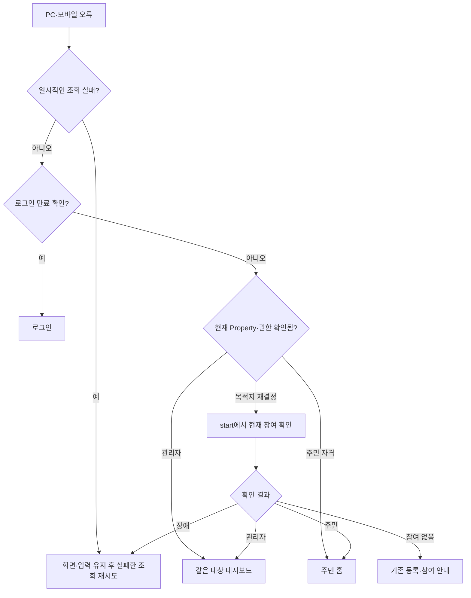

# Client 서비스 진입 설계

작성일: 2026-10-05. 수정일: 2026-10-24. **상태: 본인 관리대상 목록 / 현재 관리 권한 API 연결 구현.** 별도 `/entry` 경로 분리는 후속 범위입니다.

업무 기준은 [도메인 규칙의 로그인 이후 진입 기준](../../docs/domainRules.md#로그인-이후-진입-기준), 조회 계약은 [관리 영역 접근 API](../../docs/managementAccessApi.md)를 참조합니다. 사용자 / 관리대상 참여 관계는 [ERD](../../docs/erd.md), 세션 복원은 [보안 설계](../../docs/securityDesign.md#9-후속-구현과-검증)를 따릅니다. 사이드바와 하위 페이지의 공통 틀은 [관리 레이아웃 설계](managementLayout.md)에서 관리합니다.

## 1. 현재 구현과 이번 연결 범위

현재 랜딩의 시작하기, 로그인된 상태의 `/login`과 `/login/callback`은 `/start`로 이동합니다. 일반 `/start`에서 서버의 현재 관리대상 목록을 조회해 기본 목적지를 결정합니다.

### 현재 조회 연결

- `GET /api/users/me/managed-properties`로 현재 관리할 수 있는 대상을 조회합니다. 등록 조회 ID나 브라우저 기록이 없어도 DB에 현재 관리자 참여가 있으면 진입합니다.
- 최근 선택이 현재 목록에 있으면 그 대상을, 없으면 서버 정렬의 첫 대상을 선택해 대시보드로 이력을 교체합니다. 관리대상이 없으면 현재 주민 참여도 조회하고, 승인된 주민 참여가 있으면 `/resident`로 이동합니다. 두 목록이 모두 비어 있을 때 시작 화면을 표시하며 조회 장애는 재시도를 제공합니다.
- 명시적인 등록 단계·완료 확인과 미확인 제출 복구는 자동 이동에서 제외합니다. 관리대상이 있다는 이유로 추가 등록을 차단하지 않습니다.
- 관리 경로 직접 접근 / 새로고침은 `GET /api/properties/{propertyId}/management-context`로 현재 관리자 역할을 확인합니다. 확인 전에는 이름·메뉴·본문을 표시하지 않습니다.
- 최근 선택은 [최근 선택 기록](#4-최근-선택-기록) 기준으로 현재 관리 권한 조회 성공 후에만 보관합니다. 등록의 `requestId`는 완료 확인과 미확인 제출 복구에만 사용합니다.

```text
로그인 / 랜딩의 시작하기
    ↓
/start: 세션과 현재 관리자 목록 조회
    ↓
관리대상 없음 → 현재 주민 참여 조회 → 있으면 /resident, 없으면 시작 화면
대상 있음 → /manage/{propertyId}/dashboard → 현재 관리 권한 확인
조회 실패 → 재시도
```

목적지 결정은 `features/enter-service`에서 공유합니다. 주민 홈·승인 대기·별도 관리대상 선택 화면은 이번 단계에 추가하지 않습니다. 별도 `/entry`는 후속으로 분리할 수 있으며 현재 라우트는 만들지 않았습니다.

## 2. URL과 진입점

관리 영역은 `/manage/[propertyId]/...` 아래에 둡니다. `/manage/[propertyId]/dashboard`는 로그인 후 기본 도착지이자 대시보드 메뉴의 목적지입니다. 세대 목록·주민 목록 등 다른 메뉴는 각자의 URL과 페이지를 가지며 대시보드와 같은 공통 레이아웃을 사용합니다. 현재 연결된 업무 메뉴와 준비 중 메뉴는 [관리 레이아웃](managementLayout.md#메뉴별-목적지)에서 관리합니다. 진입 문서에서는 기본 목적지·현재 권한·등록 복구만 다룹니다.

| 화면 | URL | Client 화면 슬라이스 |
| --- | --- | --- |
| 만들기 / 주민으로 참여하기 | `/start` — 기존 경로 | `screens/start/` — 기존 슬라이스 |
| 관리자 대시보드 — 임시 구현 | `/manage/[propertyId]/dashboard` | `screens/management-dashboard/` |
| 세대 목록 — 연결됨 | `/manage/[propertyId]/households` | 기준: `screens/household/unit-list/`, [구조 검증](unitList.md#6-구조와-동작-검증) |
| 주민 목록 | `/manage/[propertyId]/residents` | `screens/household/resident-list` |
| 관리 업무 | `/manage/[propertyId]/...` | 메뉴별 화면 슬라이스, 관리 레이아웃의 경로 표 참조 |

전체 메뉴별 목적지와 링크 연결 기준은 [관리 레이아웃 설계](managementLayout.md#2-컴포넌트-분리와-메뉴-링크)에서 관리합니다. 공통 레이아웃의 `children`에는 현재 URL의 본문이 들어오며 사이드바에서 대시보드 화면 안의 내용을 교체하지 않습니다.

`propertyId`는 관리대상 UUID이며 등록의 `requestId`와 구분합니다. URL과 최근 기록은 대상을 식별할 뿐 권한을 부여하지 않습니다. 실제 관리 화면은 해당 대상의 현재 관리 권한을 확인한 뒤 표시합니다.

| 진입점 | 연결 방식 |
| --- | --- |
| 랜딩의 로그인 사용자용 시작하기 | `/start`로 연결 |
| `/login`의 정상 세션 확인 | `/start`로 이력 교체 |
| `/login/callback`의 본인 정보 확인 성공 | `/start`로 이력 교체 |
| 일반 `/start` 직접 접근 | 같은 목록 조회 / 목적지 결정 사용, 대상이 있을 때 대시보드로 이력 교체 |
| `/manage/[propertyId]/...`의 구현된 메뉴 페이지 직접 접근 | 공통 레이아웃에서 지정한 대상의 현재 관리 권한 확인 |

주민용 후속 경로, 승인 대기 화면과 독립 관리대상 선택 화면은 이번에 만들지 않습니다. 관리자 목록의 빈 배열을 주민 참여나 승인 대기 요청까지 없다는 증거로 사용하지 않습니다.

## 3. 처리 책임과 FSD 배치

`features/enter-service`에서 API 호출, 최근 선택과 계정 / 대상별 조회를 공유합니다. 등록 결과를 사용하던 임시 진입 Hook과 별도 등록 성공 ID 영속 기록은 제거했습니다.

| 위치 | 책임 |
| --- | --- |
| `screens/start/ui/startPage.tsx` | 세션 / 관리대상 조회 조합, 확인 중 / 오류 표시와 최종 라우터 이동 |
| `features/enter-service/api/managementAccessApi.ts` | 기존 authenticatedAPI로 관리 영역 접근 API 호출, 응답 자료형·내용 검증 |
| `features/enter-service/api/managementAccessApiTypes.ts` | 관리 영역 조회 자료형. 호출 함수와 분리한 타입 전용 파일 |
| `features/enter-service/model/` | 공통 목적지 결정, 사용자별 최근 선택 기록과 공유 조회 상태 |
| `entities/session/` | 기존 세션 복원 / 본인 정보 조회 재사용 |
| `widgets/management-layout/` | 현재 대상의 권한 확인과 공통 사이드바 / 본문 조합, 내부 사이드바·드롭다운·링크 분리 |
| `app/(main)/manage/[propertyId]/layout.tsx` | 공통 관리 레이아웃 연결 |
| `app/(main)/manage/[propertyId]/dashboard/page.tsx` | 임시 대시보드 화면 연결 |
| 메뉴별 `app/(main)/manage/[propertyId]/.../page.tsx` | 해당 메뉴의 화면 슬라이스 공개 API에 연결 |

`app`의 메뉴별 `page.tsx`는 URL 연결을, `screens`는 해당 페이지의 본문을 담당합니다. 메뉴 링크는 URL로 이동하고 Widget은 상위 레이어의 화면 컴포넌트를 직접 가져오지 않습니다. 사이드바 내부 파일과 책임 분리는 [관리 레이아웃 설계](managementLayout.md#2-컴포넌트-분리와-메뉴-링크)를 따릅니다.

API 호출은 기존 `entities/session`을 사용할 수 있는 Feature에 둡니다. 같은 레이어의 `entities/property`가 `entities/session` 내부를 직접 참조하는 구조를 만들지 않습니다. 요청 / 응답 타입은 [Client 타입 배치 규칙](../AGENTS.md#타입-배치)에 따라 호출 코드 옆의 타입 전용 파일에 두며 별도의 타입 슬라이스를 추가하지 않습니다.

각 슬라이스는 필요한 함수 / Hook / 컴포넌트만 `index.ts`로 공개합니다. `useManagementEntry`는 서버 목록과 최근 ID로 대상을 결정하고 화면이나 Widget을 참조하지 않습니다. 라우터 이동과 표시 상태는 상위 화면에서 조합합니다. Query 키에는 현재 사용자 ID를 포함하고 단건은 관리대상 ID도 포함해 계정이나 대상이 바뀌어도 이전 조회 결과가 섞이지 않도록 합니다.

## 4. 최근 선택 기록

최근 선택 보관은 아래의 브라우저 구현을 사용합니다. 새 DB 컬럼이나 최근 선택 API를 추가하지 않습니다.

- `localStorage`의 `moahome.management.recent-property.{userId}`에 관리대상 UUID 한 개만 저장합니다. 이름, 역할, 주소, 계좌, 등록 본문과 토큰은 저장하지 않습니다.
- 해당 관리대상의 현재 관리 권한 조회가 성공한 뒤 갱신합니다. 등록 성공이나 대시보드 이동을 시도한 시점만으로 저장하지 않습니다.
- 같은 사용자의 서버 목록에 포함된 ID만 기본 선택에 사용합니다. 형식 오류, 대상 없음이나 현재 권한 해제이면 해당 ID의 기록을 폐기하고 도메인 규칙의 대체 선택을 적용합니다.
- 저장소 차단 시 목록의 기본 순서로 진입할 수 있게 하며 기록 저장 실패로 관리 화면 진입 자체를 막지 않습니다.
- 계정마다 키를 분리합니다. 로그아웃 시 화면·세션·쿼리 상태는 폐기하고, UUID 편의 기록은 같은 사용자의 다음 로그인에서 재검증할 수 있도록 유지합니다. 다른 계정의 기록을 대신 읽거나 표시하지 않습니다.
- 늦은 접근 거부 응답이 다른 선택을 지우지 않도록 사용자와 현재 기록의 ID가 모두 같은 경우에만 제거합니다.

## 5. 확인 중 / 오류와 이력 이동

| 상태 | 진입 처리 |
| --- | --- |
| 세션 / 목록 조회 중 | 확인 상태를 표시하고 목적지 선택 보류 |
| 목록 조회 성공 | 공통 도메인 기준으로 목적지 결정 |
| 목록의 실제 빈 배열 | `/start` 표시 허용 |
| 인증 거부 / 계정 이용 불가 | 기존 인증 흐름으로 로그인 이동 |
| 일시 장애 / 잘못된 응답 | 이전 정보를 표시하지 않고 명시적 조회 재시도 |

응답의 UUID, 이름, 역할과 목록 형태를 확인한 뒤 목적지를 결정합니다. 원문 메시지를 그대로 노출하지 않습니다. 진행 중인 세션 Rotation을 재시도로 취소하지 않으며 이미 진행 중인 같은 조회를 공유합니다.

기본 목적지로의 이동은 목록 결과를 확인한 뒤 `router.replace`를 사용합니다. 별도 `/entry` 경로는 없습니다. 브라우저 뒤로가기 / bfcache 복원은 이전 화면을 숨기고 로그인과 대상 권한을 다시 확인하는 [관리 레이아웃 기준](managementLayout.md#5-현재-권한-확인과-화면-상태)을 적용합니다.

## 6. 기존 등록 흐름과 연결

일반 `/start` 접근과 명시적인 `/start?registration=...` 등록 단계는 구분합니다. 관리 가능한 대상이 생겼다는 이유로 모든 등록 단계를 일괄 이동시키지 않습니다. 여러 관리대상 등록을 허용하는 기존 정책을 회원당 한 곳 제한으로 바꾸지 않습니다.

- 유효한 기본 정보 / 동·세대 / 계좌 / 관리비 / 등록 확인 단계는 기존 초안과 단계 검증을 사용합니다. 다른 관리대상이 있더라도 명시적인 추가 등록 흐름을 차단하지 않습니다. 추가 등록 버튼 배치는 해당 화면 작업에서 정합니다.
- 미확인 제출 ID가 있으면 기존 결과 확인·같은 ID 복구를 먼저 수행합니다. 목록의 다른 관리대상이 보인다는 이유로 진행 중인 등록 복구를 건너뛰지 않습니다.
- 등록 성공 시에는 기존 완료 페이지를 유지하며 일반 `/start`의 자동 분기로 즉시 대시보드에 보내지 않습니다. 완료 정보 조회와 읽기 전용 다시 보기는 [등록 설계](propertyRegistration.md)를 따릅니다.
- 완료 페이지의 이동은 성공 결과의 `property.id`를 사용합니다. `managementStart`가 있으면 `/billing/monthly?tab=monthly`의 `관리비 부과 보기`, 이전 결과이면 `?tab=opening`의 `기존 잔액 인계 · 관리 시작 설정`으로 연결합니다. 이동 후 레이아웃이 현재 관리 권한을 확인합니다.
- 등록 성공 시 사용자별 관리대상 목록을 무효화 / 갱신해 이후 일반 `/start`가 새 대상을 포함한 목록을 확인하게 합니다. 계좌가 포함된 초안과 제출 본문의 기존 폐기 기준은 유지합니다.
- 잘못된 `registration` 값은 등록 예외로 취급하지 않고 일반 진입 검증을 적용합니다. 완료 주소와 요청 ID가 있다는 사실만으로 관리 권한을 부여하지 않습니다.

## 7. 검증 범위

`tests/managementLayout.spec.ts`와 등록 테스트에서 서버 목록·현재 권한, 직접 주소·새로고침·뒤로가기·bfcache, 로그아웃·계정 변경, 최근 기록 폐기·조회 재시도와 등록 복구·추가 등록 예외를 확인합니다. 실행 결과는 실제 명령을 기준으로 보고합니다.

임시 주민 홈은 아래 2026-10-24 절의 구현 범위를 따르며 주민 세부 업무·본인 전체 신청 상태 조회는 후속입니다. 주민 가입 신청·관리자의 승인·거절은 [역할·가입 화면](memberManagement.md)을 따릅니다. `/entry` 분리는 확정된 개발 작업이 아닙니다.

## 관리할 곳 추가·참여 진입 (2026-10-17)

설정 본문의 `등록 및 참여` 버튼은 `/properties/add`로 연결합니다. 이 경로는 기존 `screens/start`의 StartPage를 additional 모드로 재사용하며 현재 관리대상이 있어도 대시보드로 자동 이동하지 않습니다. 정상 로그인 확인과 기존 등록·초대 API 권한 검증은 유지합니다. 일반 `/start`의 현재 관리대상 자동 진입 기준은 유지합니다.

추가 화면은 기존 헤더·안내·카드·등록 단계를 재사용합니다. 안내는 `등록 및 참여`로 표시하고 만들기는 `/properties/add?registration=basic`의 실제 등록, 코드 참여는 PC에서는 현재 화면의 공통 모달을 열고 모바일에서는 `/invitations`로 연결합니다. 일반 `/start`도 PC에서는 같은 모달을 열며 모바일에서만 `/join`으로 이동합니다. 2026-10-18 후속 사용자 요청으로 미리보기 분기를 제거했으며 두 등록 경로 모두 같은 PropertyRegistrationFlow와 최종 등록 API를 사용합니다. 이전 `preview=manager` 주소도 실제 등록 흐름을 엽니다.

위 `/invitations`는 주민 공통·개인 코드와 기존 외부 부담당자 코드를 입력합니다. PC 최초·추가 화면과 코드 입력 주소 직접 접근은 같은 폼의 모달, 모바일은 독립 페이지를 사용합니다. 가입 링크의 fragment는 자동 검증해 코드 입력 없이 신청·확인으로 연결합니다. [주민 초대 화면](memberManagement.md#공통-계약과-구현-범위)을 참조합니다.

등록 단계 이동·입력 오류 복귀·취소·완료 조회 실패는 진입 경로를 유지합니다. 완료 URL도 `/properties/add?registration=complete&requestId={UUID}`를 사용합니다. 초안 수명 관리는 두 등록 경로를 동일하게 처리하고 새로고침에서만 복원하며 이탈·취소·로그아웃에서는 폐기합니다. 설정은 본문에 등록·참여 버튼을 제공하며 관리자 관리·초대 신청을 넣지 않습니다. 2026-10-18 요청의 관리자 계좌 변경은 [관리 화면 설계](managementLayout.md#설정의-계좌-변경-2026-10-18)를 따릅니다.

## 임시 주민 홈 (2026-10-24)

`/resident`는 관리자 레이아웃·사이드바를 사용하지 않고 본인의 현재 RESIDENT 참여에 대한 관리대상 이름과 준비 안내만 표시합니다. 실제 공지·관리비·차량 화면을 제공하는 것으로 표시하지 않습니다. 새로고침에서 세션과 현재 주민 참여를 다시 확인하며 로그인 전이나 조회 중에는 가입한 곳을 표시하지 않습니다. 참여가 없으면 참여·승인 대기 안내를 표시합니다. 임의로 관리자 권한을 추측하지 않으며 직접 관리자 주소에 접근해도 기존 관리 권한 검증을 거칩니다.

개인 초대로 즉시 가입한 뒤 `주민 홈으로`를 누르면 이 화면으로 이동합니다. 일반 승인 대기·정보 수정 검토 중에는 가입 완료로 이동시키지 않습니다. 관리 권한이 있는 계정의 기존 기본 관리대상 진입은 유지하고, 관리대상이 없는 승인 주민은 재로그인 후 `/start`에서 이 화면으로 이동합니다. 조회 계약은 [접근 API](../../docs/managementAccessApi.md)를 따릅니다.

## 오류 복귀와 공개 랜딩 분리 설계 (2026-10-25)

상태: 설계·미구현. 업무 규칙은 [도메인 규칙](../../docs/domainRules.md#초대-인증서비스-복귀역할-변경의-후속-확정-방향-2026-10-25), 동적 접근 관리는 [레이아웃 설계](managementLayout.md#동적-권한-확인과-화면-보존-설계-2026-10-25)를 기준으로 합니다. 모바일 공개 랜딩 자체를 차단하는 요구로 확대하지 않습니다. 별도 `/entry`나 `proxy.ts`를 추가하지 않고 현재 `/start`를 재사용합니다.

### 실제 소스와 수정 대상

아래 경로는 `client/src/` 기준입니다.

| 실제 파일 | 현재 동작 | 변경 설계 |
| --- | --- | --- |
| `screens/not-found/ui/notFoundPage.tsx`, `app/not-found.tsx` | 전역 404의 홈 링크가 `/`. PC·모바일 동일 | 확인된 서비스 메인 또는 `/start` 복귀 |
| `shared/ui/server-connection-error/requestError.tsx`, `serverConnectionError.tsx` | 조회별 재시도, 403/404 안내 | 조회 재시도 유지. 자동 역할 이동은 공통 접근 경계가 판단 |
| `widgets/management-layout/ui/_components/management-access-state/managementAccessState.tsx` | 모든 비로딩 상태에 시작 링크 | 통신 장애와 접근 종료를 구분하고 필요한 복귀만 제공 |
| `screens/login/ui/loginPage.tsx` | `/`·`/#service` 링크 존재 | 서비스 로그인·복귀에서 공개 랜딩으로 보내는 링크 검토·조정 |
| `screens/login-callback/ui/loginCallbackPage.tsx` | 브랜드 링크 `/`, 성공 후 `/start` | 성공 분기 유지, 오류 브랜드·복귀도 서비스 흐름 사용 |
| `widgets/service-header/ui/serviceHeader.tsx` | 기본 homeHref `/start` | 공통 목적지 전달 유지 |
| `app/(main)/manage/[propertyId]/managementShell.tsx` | 관리자 로고→같은 대상 대시보드, 모바일 상세 뒤로가기 | 재사용. 상세 목록 문맥 유지 |
| `screens/resident-home/ui/residentHomePage.tsx` | 주민 로고→`/resident`, 401→로그인 | 주민 진입·복귀 재사용 |
| `features/logout/ui/logoutButton.tsx` | 로그아웃 후 `/login` | 유지. 공개 랜딩으로 바꾸지 않음 |
| `screens/start/ui/startPage.tsx`, `features/enter-service/model/useManagementAccess.ts` | 관리자 최근 유효/첫 대상→주민 목록→시작 흐름 | 목적지 재결정 재사용, 장애를 대상 없음으로 대체하지 않음 |

`app/error.tsx`·`app/global-error.tsx`·`proxy.ts`·`middleware.ts`·PWA manifest/service worker는 현재 소스/정적 파일 목록에서 찾지 못했습니다. 설치형 앱의 실제 실행 주소·네이티브 래퍼는 확인 필요입니다. `app/error.tsx`를 추가한다면 렌더링 예외 경계와 조회/저장 실패를 구분하고 reset으로 저장 API를 자동 재전송하지 않습니다. 파일 후보이며 현재 구현이 아닙니다.

### 서비스 복귀 결정

공통 목적지 결정은 기존 `features/enter-service`의 책임으로 두며, 순수 경로 결정 함수 후보 `lib/serviceDestination.ts`를 검토합니다. 현재 세션·검증된 Property 접근 결과로만 목적지를 고르고 최근 기록을 권한 증명으로 사용하지 않습니다. 공유 컴포넌트는 도메인 조회를 새로 소유하지 않고 결정된 href나 행동을 전달받습니다.



업무 403 후 같은 역할·같은 영역 자격이 확인되면 현재 위치에서 접근 불가를 안내합니다. 역할 변경으로 영역이 맞지 않을 때만 replace 이동합니다. 삭제된 개별 자료는 원래 목록으로, Property 접근이 종료되면 다른 현재 참여 또는 `/start`로 복귀합니다. 모바일 상세의 본문·푸터 목록 버튼 금지와 헤더 `<` 복귀 규칙은 유지합니다.

공개 `/` 직접 방문은 PC·모바일 모두 기존 랜딩을 표시합니다. 설치형 앱의 기본 실행 주소는 `/start` 또는 로그인으로 설정하는 설계이며 화면 너비·User-Agent만으로 루트 전체를 차단하지 않습니다. 로그인 전 서비스 404의 복귀도 로그인 흐름을 사용하며 임의의 외부 return URL은 허용하지 않습니다.

### 초대 링크와 OAuth의 실제 연결

현재 `features/member-management/ui/invitationCodeForm.tsx`는 fragment를 브라우저에서 읽고 비로그인이면 `/login`을 별도 탭으로 엽니다. 로그인 시도 후 원래 탭 focus 또는 `로그인 확인`에서 새로고침해 같은 fragment로 검증합니다. `loginCallbackPage.tsx`는 성공 후 `/start`로 이동합니다. 자동으로 원래 탭의 초대로 redirect하는 공통 returnTo 구현이 있는 것으로 기록하지 않습니다.

기존 별도 탭 흐름에서 원래 링크가 유지되는지 모바일·카카오톡 브라우저까지 검증합니다. 로그인 후 원래 초대의 Redis를 반드시 재검증하며 OAuth 중 만료되면 가입시키지 않고 만료·재발급을 안내합니다. 원문 코드를 쿼리·로그·localStorage/sessionStorage에 복사하는 신규 복귀 방식을 추가하지 않습니다. 설치형 앱에서 별도 탭 복귀가 불가능하면 서버 OAuth 상태에 바인딩한 단기 복귀 핸들 등 별도 설계를 먼저 검토해야 하며 현재 지원으로 간주하지 않습니다.

저장 응답 유실은 조회 재시도와 구분합니다. 기존 등록 requestId, 역할 expectedRole, 초대 revision·동일 계정 완료 상태를 유지합니다. request UUID가 있는 업무는 같은 요청을 재사용하고, 모든 API에 멱등성이 있다고 추정하지 않습니다. 새 requestId를 만들어 중복 저장을 재시도하지 않습니다.

### 구현 순서와 검증 계획

1. 공통 복귀 판단을 기존 enter-service에서 정리하고 404·로그인·콜백·관리 접근 오류의 링크를 연결합니다.
2. [후속 필수 구현 순서](managementLayout.md#필수-구현-순서와-선행-검증)에 따라 HTTP signal 지원·최초/백그라운드 상태 분리·계정/Property Query 범위를 먼저 검증한 뒤 공통 접근 검사와 역할 전환을 연결합니다. 새로고침·보호 화면 진입 시 확인과 업무 403 후 일회성 재확인을 연결합니다. 30초 주기와 포커스·재연결 자동 권한 조회는 필수 구현에 넣지 않습니다.
3. 기존 `tests/stateMessages.spec.ts`, `serverConnectionError.spec.ts`, `authFlow.spec.ts`, `managementLayout.spec.ts`, `onboardingFlow.spec.ts`를 확장합니다.

검증 항목은 PC/모바일 공개 랜딩 직접 접근·서비스 404 복귀·로그아웃·세션 만료·같은 역할의 업무 403·Property 종료·삭제 자료 목록 복귀·네트워크 오류 입력 유지·초대 코드/링크 로그인 후 복귀·OAuth 중 만료입니다. 설치형 앱 실행은 실제 환경이 확인된 뒤 별도 검증합니다. 이 절은 설계이며 관련 브라우저 테스트·Client 빌드를 실행한 것으로 기록하지 않습니다.

추가 필수 과제인 업무 화면 유지와 AbortSignal 전달은 현재 미구현이며 착수 시 코드를 재확인합니다. 정상 caller 취소는 일반 조회 장애·401·403·500과 구분하고, 권한을 그대로 유지한 재조회에서 모달·입력·파일·필터·페이지·스크롤이 보존돼야 합니다. 실제 권한 상실이 확인되면 이전 범위 요청과 캐시를 정리한 후 이동합니다. Mutation 대기 취소는 서버 처리 실패의 근거가 아니며 결과가 불명확하면 기존 요청 식별자를 유지해 실제 서버 결과를 확인합니다. 변경 파일·구현 방법·필수 구현 순서·테스트·배포 완료 기준은 [Client 공통 접근 설계](managementLayout.md#후속-필수-과제의-재확인-범위)를 기준으로 하고 여기서 중복 정의하지 않습니다.
