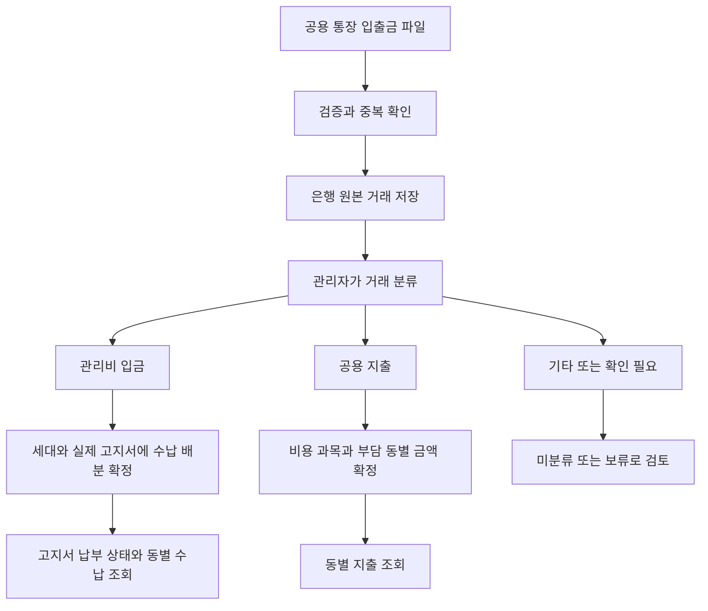

# 공용 통장 거래 분류와 동별 수입 지출 설계

작성일: 2026-10-16. 상태: **사용자 요구를 반영한 설계 문서**. 통장 거래 화면의 분류, 출금 수집과 동별 지출 배분은 아직 구현하지 않았습니다.

공용 통장 하나로 여러 동을 관리합니다. 관리자가 은행 거래를 분류하면 관리비 입금은 해당 세대의 고지서 수납에, 지출은 비용 과목과 부담 동에 반영합니다. 전체와 동별 내역을 같은 원천 데이터에서 조회합니다.

업무 정책과 확정 여부는 [도메인 규칙](domainRules.md#공용-통장의-동별-거래-분류), 데이터 구조는 [ERD](erd.md#94-공용-통장-거래-분류-확장-설계안), 화면은 [Client 설계](../client/docs/bankingManagement.md), 저장·동시성은 [Server 설계](../server/docs/bankingManagement.md)에서 관리합니다. 이 문서는 업무 연결과 예시, 구현 범위를 설명합니다.

## 1. 사용자 요구와 설계 범위

| 구분 | 내용 |
| --- | --- |
| 사용자 선택 | 하나의 공용 통장으로 여러 동의 입출금을 관리 |
| 사용자 요구 | 입금을 동·호수의 고지서 수납에 연결하고 해당 동의 수납 내역에 표시 |
| 사용자 요구 | 출금을 청소비·관리비 등 비용 과목으로 분류하고 공동비용을 부담 동에 나누어 표시 |
| 사용자 요구 | 한 관리자가 여러 동의 전체 내역과 동별 내역을 조회 |
| 화면 설계안 | 통장 거래 행에서 상세를 열고 분류·확정, 동별 현황에서 집계 조회 |
| 후속 결정 | 균등 배분의 1원 나머지, 기타 입출금의 귀속, 지출 취소·재분류와 권한 |

여러 동이 같은 관리대상에 속하는 경우 기존 `Property → Building → Unit` 구조를 사용합니다. 2개 동이나 8개 동은 예시이며 개수를 고정하지 않습니다. 서로 다른 관리대상의 거래를 하나로 합치거나 관리대상 경계를 넘는 배분을 허용하는 요구는 포함하지 않습니다.

초기 등록의 최소 계좌 수와 기본 계좌 지정 계약은 유지합니다. 이번 운영 방식이 기존 계좌를 삭제하거나 모든 관리대상의 계좌 수를 DB에서 1개로 제한한다는 뜻은 아닙니다. 동별 별도 통장·동 간 정산·여러 통장 사이 이체는 이번 요구의 선행 기능으로 추가하지 않습니다.

## 2. 거래에서 업무로 이어지는 흐름

통장 거래 화면이 분류의 진입점이 되고 수납 확정은 기존 입금 도메인이, 지출 확정은 지출 도메인이 담당합니다. 관리자가 같은 거래를 각 메뉴에서 다시 입력하는 방식으로 만들지 않습니다. 기존 입금 확인·월별 수납 메뉴는 같은 수납을 조회·처리하는 화면으로 유지합니다.

파일 미리보기에서는 납부 상태를 바꾸지 않습니다. 실제 가져오기에서는 명단의 유일한 일치 입금을 자동 확정하고, 미일치 항목은 확인 필요로 유지합니다. 지출 확정은 별도 분류 단계이며 수납 초안과 확정의 차이는 [입금 API](paymentApi.md)를 따릅니다.

## 3. 관리비 입금 예시

예시 조건: 102동 201호의 2026년 10월 고지서가 60,000원이고 이전 수납은 없습니다.

1. 공용 통장의 입금 60,000원 거래를 선택합니다.
2. 입금자명이 명단의 이름·동호수와 한 세대에 일치하면 가져오기에서 자동 확정합니다. 나머지는 102동 201호를 지정합니다.
3. 입금 전액 60,000원을 누적 수납하며 미납·선입금을 계산합니다. 고지월별 반영액을 입력하지 않습니다.

| 조회 위치 | 결과 |
| --- | --- |
| 공용 통장 거래 | 원본 입금 60,000원 1건, 수납 연결 표시 |
| 102동 수납 내역 | 201호의 확정 수납 60,000원 |
| 201호 10월 고지서 | 유효 수납 배분 60,000원, 납부완료 |

누적 부과액 60,000원에 입금이 30,000원이면 일부납부입니다. 같은 달 추가 입금도 누적하고 남는 선입금은 다음 실제 청구에 자동 충당합니다. 여러 달 청구에 대한 배분, 초과입금의 선입금 잔액과 기존 수동 수납의 사후 원본 연결은 [기존 수납 계약](paymentApi.md#수동-등록확정취소)을 재사용합니다. 입금 전액과 고지서에 배분한 금액을 구분하고, 별도 납부 체크값을 만들지 않습니다.

102동 표시는 세대의 동 귀속을 뜻합니다. 공용 통장의 원본 거래를 복사해 가상의 102동 은행 거래를 생성하지 않습니다.

## 4. 공동지출 예시

예시 조건: 공용 통장에서 청소업체로 200,000원이 출금됐고 102동·103동이 절반씩 부담합니다.

1. 출금 거래를 선택하고 비용 과목을 청소비로 지정합니다.
2. 부담 동으로 102동과 103동을 선택합니다.
3. 균등 배분 결과를 확인한 뒤 지출을 확정합니다.

| 기록 | 금액 |
| --- | ---: |
| 은행 출금 원본 1건 | 200,000원 |
| 청소비 지출 상세 1건 | 200,000원 |
| 102동 청소비 부담액 | 100,000원 |
| 103동 청소비 부담액 | 100,000원 |

전체 지출은 200,000원입니다. 은행 원본·지출 상세·동별 배분을 더해 600,000원으로 집계하지 않습니다. 같은 공용 통장 안의 비용 배분만으로 동 간 대납금이나 미정산금을 자동 생성하지 않습니다.

한 출금에 청소비와 수선비가 함께 있다면 비용 과목별 지출 상세를 먼저 나누고 각 상세를 부담 동에 배분하는 구조를 제안합니다. 예를 들어 청소비 120,000원을 두 동에 60,000원씩, 수선비 80,000원을 102동에 전액 배분할 수 있습니다. 이 경우 102동 지출은 140,000원, 103동 지출은 60,000원입니다.

입력 방식은 선택 동 균등 배분과 동별 금액 직접 입력을 우선 제안합니다. 비율 입력·반복 배분 템플릿은 후속 검토입니다. 균등 배분의 나머지를 어느 동에 반영할지는 미정이며 저장 시 임의 반올림으로 합계 차이를 허용하지 않습니다.

## 5. 조회 금액과 잔액의 구분

| 지표 | 기준 |
| --- | --- |
| 은행 입금액·출금액 | 거래일 기준 원본 거래. 미분류·보류도 실제 입출금에 포함 |
| 동별 확정 수납액 | 선택 기간에 입금된 유효 확정 수납의 세대 귀속. 수동 수납 포함 여부와 은행 연결 여부를 확인 가능하게 표시하는 설계안 |
| 고지월 수납 반영액 | 해당 고지서에 유효하게 배분한 금액. 은행 거래월과 구분 |
| 동별 배분 지출액 | 선택 기간의 확정 지출 상세 중 해당 동의 부담액 |
| 기간 수지 | 동일한 기간 기준의 동별 확정 수납액 − 동별 배분 지출액. 손익이나 보유 잔액으로 표시하지 않음 |
| 최근 은행 확인 잔액 | 파일에 있는 거래 후 잔액과 그 거래 시점 |

지출일의 기본값은 원본 출금일을 사용하는 안이며 다른 지출일 허용 범위는 구현 전에 정합니다. 현재 수납 전체 취소와 월별 재계산은 기존 입금 계약을 유지합니다. 신규 동별 조회의 정정 반영, 지출 취소와 월 마감 후 정정은 해당 설계·정책을 따릅니다. 현재 조회의 유효 기록 합계와 과거 시점 확정 보고서를 같은 것으로 취급하지 않습니다.

동별 합계는 동에 귀속된 분류 완료 금액과 일치해야 합니다. 미분류 거래·기타 입출금·은행 원본과 연결되지 않은 수동 수납이 있으면 은행 전체 입출금과 동별 합계가 다를 수 있습니다. 차이를 숨기거나 임의의 동에 배분하지 않습니다.

동별 보유 잔액을 제공하려면 시작 시점의 동별 보유금, 이자·환급 등 기타 입출금의 배분과 모든 기간의 거래 범위를 정해야 합니다. 이번 설계에서는 수납·배분 지출·기간 수지를 우선 조회하고, 최근 은행 확인 잔액에는 기준일시를 함께 표시합니다.

## 6. 현재 구현과 필요한 확장

| 영역 | 현재 구현 | 필요한 확장 |
| --- | --- | --- |
| 계좌 | 초기 공용계좌 등록·번호 보호·기본 계좌 사용 | 기존 계좌를 거래 화면에서 조회. 운영 중 계좌 변경은 별도 정책 |
| 은행 파일 | 기본 계좌의 XLS·XLSX·UTF-8 CSV 입금 원본과 확인 필요 수납 저장, 은행 제목 뒤 머리글·적요 매핑 | 출금 원본 수집·저장용 입출금 구분·거래 조회 |
| 수납 | 실제 청구 배분·확정·보류·전체 취소·수동 수납 연결 | 통장 거래 상세에서 같은 수납을 조회·확정, 동별 귀속 집계 |
| 지출 | ERD 설계안만 존재 | 출금 연결·비용 과목·지출 상세·동별 배분·확정 |
| 조회 | 세대별 월별 수납 현황 | 전체·동별 수납 및 배분 지출 조회 |
| 회계·마감 | 후속 설계 | 업무 확정과 전표 연결, 통장 대사·월 마감은 별도 구현 |

거래 상태를 새 테이블에 중복 저장하는 `transaction_classifications`는 필수로 정하지 않습니다. 기존 수납 연결을 재사용하고 지출·기타 분류의 책임과 상태 표현을 함께 검토합니다. 저장 구조의 제안 범위는 [ERD](erd.md#94-공용-통장-거래-분류-확장-설계안)를 따릅니다.

## 7. 이전 참고안과의 차이

참고 자료는 사용자 제공 `moahome_banking_design_v0.1.md`입니다. 아래는 현재 저장소 기준과 비교한 내용이며 참고 문서의 모든 정책을 채택하지 않습니다.

| 참고안 | 이번 기준 |
| --- | --- |
| 계좌·업로드 수명주기 중심 | 거래 분류와 고지서·동별 비용 반영이 핵심. 업로드 이력은 지원 기능 |
| 동별 통장·계좌 간 이동 검토 | 하나의 공용 통장으로 여러 동 관리. 동별 은행 잔액과 동 간 정산은 이번 범위 밖 |
| 업로드 시 Payment 생성 금지 | 미리보기는 저장하지 않음. 실제 가져오기는 Payment를 생성하고 명단의 유일한 일치 입금을 자동 확정. 지출은 별도 확정 |
| 일시·잔액 등으로 유사 중복 수동 검토 | 현재 확정된 입금 중복 제외 기준 유지. 출금 중복 키·은행 정정 거래는 추가 결정 |
| ADMIN·MANAGER 처리 | 기존 입금은 ADMIN 전용. 신규 통장·지출의 상세 권한은 미정 |
| 거래 processing_status·import_batch_id 등이 기존 컬럼 | 현재 거래에는 없는 컬럼도 포함. 실제 ERD·Migration을 기준으로 확장 |
| numeric(18,2), 10MB·10,000행 예시 | 기존 원 단위 numeric(15,0), 5MB·5,000행 계약을 기준으로 검토. 자동 변경 없음 |
| PC 우측 Drawer와 별도 가져오기 경로 | 기존 공통 모달·모바일 상세와 `/banking/upload` 경로를 기준으로 화면 설계 |

## 8. 구현 전 결정과 진행 순서

아래 항목은 구현 범위에 영향을 줄 때 결정합니다.

- 균등 배분의 1원 나머지와 직접 입력의 허용 범위.
- 기타 입금·출금의 분류, 동 귀속과 공통 미배분 금액의 표시 방식.
- 지출 확정·취소·재분류 권한, 사유와 정정 이력.
- 수납 당시 동 귀속 보존과 세대 이동·동 삭제 후 과거 조회 방식.
- 동 없는 관리대상의 지출 귀속 표현. 가상 동을 자동 생성하지 않음.
- 출금 중복 키, 파일 행 오류의 전체 거절·부분 반영 범위, 지원 은행 양식과 매핑.

권장 진행 순서는 입출금 원본 확장·조회 → 기존 수납 분류 연결 → 비용 과목·동별 지출 배분 → 전체·동별 현황입니다. 필요한 공통 API는 구현 범위를 정한 뒤 통장 거래 계약 문서 하나에 모으고, 기존 수납 API와 같은 동작을 중복 정의하지 않습니다.

## 외부 비정기 입금 검토

2026-10-16 사용자 설명: 관리 중인 동의 세대가 아닌 외부 사람이 가끔 변동 금액을 입금하는 경우가 있습니다. 매달 동일 관리비를 부과하는 세대와 구분해야 합니다.

설계안은 세대 고지와 분리한 비정기 입금·정산 분류입니다. 입금 때 금액과 전기료 정산 같은 목적을 기록하고 실제 지출과 구분합니다. 은행의 양수 입금을 이름만으로 음수로 바꾸지 않습니다. **현재 세대 수납 API에는 외부 비정기 수입 확정 기능이 없으며 이 문단은 구현 완료를 의미하지 않습니다.** 외부 미일치 입금은 확인 필요로 유지합니다.
