# 모아홈 ERD v0.2 — Current Working Version

> 기준일: 2026-10-05
>
> 기준 문서: 기존 `빌라 관리비 관리 시스템 물리 ERD v0.1` + [도메인 규칙](domainRules.md)의 확정된 사용자 / 주민 설계와 관리대상 등록 정책
>
> DB 기준: PostgreSQL
>
> 인증 세션: Redis
>
> 목적: 개발 중 참고하는 테이블 / 컬럼 / 관계 / 제약 기준. 업무 정책과 확정 여부는 [도메인 규칙](domainRules.md)에서 관리한다.

---

## 0. 현재 버전에서 가장 중요한 결정

### 0.0 문서 상태와 적용 범위

이 문서는 전체 35개 엔티티의 현재 설계를 보관한다. 문서에 테이블 / 컬럼 / Enum / 제약이 있다는 이유만으로 전체 DDL이나 업무 정책이 확정되었거나 구현된 것으로 판단하지 않는다.

- **확정**: 도메인 규칙에서 사용자 결정으로 기록한 범위. 변경 시 정책과 ERD를 함께 갱신한다.
- **설계안**: 현재 제안된 구조. 구현 전 관련 정책과 실제 코드 / Migration을 대조한다.
- **미정**: 현재 기능 구현 전에 결정이 필요한 항목. 임의로 확정하지 않는다.
- **후속 검토**: 해당 기능을 구현할 때 검토할 항목. 현재 기능에 선행 요구사항으로 추가하지 않는다.

| 영역 | 상태 | 현재 적용 범위 |
| --- | --- | --- |
| 사용자 / 소셜 계정 | 확정 범위 있음 | 로그인 계정과 소셜 식별자 분리, 닉네임 필수, 계정에 전화번호 미저장. `system_role` Entity / Migration 구현, 기본값 USER |
| 주민 / 가입 승인 | 확정 범위 있음 | 주민 연락처 관리, 사전 등록과 승인 시 신규 등록 모두 지원, 주민 명부 재등록 시 소프트 삭제 해제, 관리자 승인 |
| 관리대상 / 동 / 세대 / 권한 | 확정 범위 있음 + 설계안 | Property 기준, 이름 최대 50자, 동 구분 저장, 초기 설정 전체 저장과 생성자 관리소장 자동 지정, 주민의 현재 세대 한 개 제한, 역할별 승인 / 변경 범위 |
| 가입 요청 입력 / 중복 / 재신청 | 확정 | 신청 전화번호 필수, 실명 입력 / 세대 관계 선택 없음, 같은 계정의 같은 세대 중복 대기 요청 제한, 다른 주민 신청 허용, 거절 후 재신청 / 재입주 재승인 |
| 부과 / 수납 / 은행 / 지출 / 회계 / 마감 / 감사 | 기존 기준 + 설계안 | 각 영역의 도메인 규칙을 유지하고 해당 기능 구현 전에 상세 정책 / DDL 확정 |
| 초기 관리계좌의 예금주 | 확정 | 예금주 이름 필수, 주민 명부 연결 선택, 주민 연결은 명부 등록 이후 가능 |
| 초기 계좌 / 기본 관리비 | 확정 | 공용계좌, 기본 계좌 정확히 1개, 사용 시작일은 등록 완료일, 기본 금액은 0원·음수를 허용하는 정수 |
| 최종 등록 API / 성공 결과 | Server 구현 | 전체 저장 계약과 중복 방지 / 응답 유실 결과 조회, property_registration_results의 원자적 저장. Client 기본 정보 화면 / 검증, 동·세대, 관리계좌와 관리비 항목 설정은 구현, 등록 정보 확인과 전체 제출은 후속 구현 |
| 연락처 변경 / 알림 발송 / 후속 확장 | 일부 구현 / 후속 검토 | 관리소장 명부·확인된 신청 연락처 수정 구현. 주민 직접 변경·발송은 후속 |

업무 규칙은 [domainRules.md](domainRules.md), 보안 코드와 인증 구현 기준은 [securityDesign.md](securityDesign.md), 작업 절차는 [AGENTS.md](../AGENTS.md)를 따른다. 차이가 발견되면 미정 정책을 추측해 코드나 ERD를 맞추지 않고 먼저 확인한다.

### 0.1 User / SocialAccount / Resident / PropertyMember 역할 분리

| 엔티티 | 의미 |
|---|---|
| `users` | 모아홈 서비스 로그인 계정 |
| `social_accounts` | 카카오 등 외부 소셜 로그인 계정과 User 연결 |
| `residents` | 특정 관리대상(Property)에 등록된 실제 주민 명단 |
| `unit_residents` | 주민이 어떤 세대(Unit)의 소유자/임차인/가족인지 기록 |
| `property_members` | User가 해당 Property에서 가지는 시스템 접근 권한 |

### 0.2 현재 전화번호 정책

현재 버전에서는 전화번호를 `users`나 `social_accounts`에 두지 않는다.

- `users.phone` 없음
- `social_accounts.phone` 없음
- `residents.phone_*` 사용
- 주민 대상 알림톡/SMS는 우선 `residents`의 전화번호를 사용
- 향후 계정 자체 휴대폰 인증/복구/공통 연락처 기능이 필요하면 `user_contacts` 같은 별도 엔티티 검토

### 0.3 User와 Resident 관계

`Resident`는 가입 전에도 존재할 수 있다.

```text
관리자가 주민명단 사전 등록 (선택)
    ↓
residents.user_id = NULL
    ↓
사용자 카카오 로그인
    ↓
users 생성 + social_accounts 생성
    ↓
가입 요청 / 관리자 승인
    ↓
기존 주민 확인 / 삭제된 명부 복구 / 필요한 주민 신규 등록
    ↓
residents.user_id = users.id 연결
    ↓
unit_residents 확인 / 필요한 관계 생성
    ↓
property_members 생성
```

동일 Property 안에서는 한 User가 여러 Resident로 중복 연결되지 않도록 한다.

```sql
UNIQUE(property_id, user_id)
WHERE user_id IS NOT NULL
```

단, 같은 User가 서로 다른 Property에서는 각각 별도의 Resident 레코드를 가질 수 있다.

---

# 1. 전체 도메인

```text
① 사용자 / 인증
② 관리대상 / 세대 / 주민 / 권한
③ 가입 / 초대
④ 관리비 부과
⑤ 수납 / 입금
⑥ 은행 거래
⑦ 지출
⑧ 회계
⑨ 월마감 / 통장대사
⑩ 감사로그
```

---

# 2. 전체 관계 요약

```text
USERS
 ├──< SOCIAL_ACCOUNTS
 ├──< PROPERTY_MEMBERS >── PROPERTIES
 ├──< PROPERTY_REGISTRATION_RESULTS >── PROPERTIES
 └──< RESIDENTS >────────── PROPERTIES
             │
             └──< UNIT_RESIDENTS >── UNITS
                                      │
                               BUILDINGS
                                      │
                                 PROPERTIES


PROPERTIES
 ├──< INVITATIONS
 ├──< MEMBERSHIP_REQUESTS
 ├──< REPRESENTATIVE_ASSIGNMENTS
 │
 ├──< BILLING_PERIODS
 │       └──< CHARGES
 │               ├──< CHARGE_ITEMS
 │               └──< PAYMENT_ALLOCATIONS >── PAYMENTS
 │
 ├──< FEE_TEMPLATES
 │       └──< FEE_TEMPLATE_ITEMS
 │
 ├──< BANK_ACCOUNTS
 │       ├──< IMPORT_BATCHES
 │       └──< BANK_TRANSACTIONS
 │                ├── PAYMENTS
 │                └── EXPENSES
 │
 ├──< EXPENSE_CATEGORIES
 ├──< VENDORS
 ├──< EXPENSES
 │       └──< EXPENSE_LINES
 │
 ├──< ACCOUNTS
 ├──< PROPERTY_ACCOUNT_MAPPINGS
 │
 ├──< ACCOUNTING_EVENTS
 │       └── JOURNAL_ENTRIES
 │               └──< JOURNAL_ENTRY_LINES
 │
 └──< FISCAL_PERIODS
         ├──< JOURNAL_ENTRIES
         ├──< BANK_RECONCILIATIONS
         └──< PERIOD_CLOSINGS
                  └──< CLOSING_CHECK_RESULTS


AUDIT_LOGS
 └── 주요 엔티티 변경 이력
```

---

# 3. 공통 설계 원칙

## 3.1 PostgreSQL 기준

- 주요 식별자: `uuid`
- 금액: `numeric(15,0)`
- 일시: `timestamptz`
- 날짜: `date`

## 3.2 Redis

DB에 `auth_sessions` 테이블을 만들지 않는다.

Redis 사용 대상:

- access/refresh 세션
- 로그인 임시 상태
- rate limit
- 필요 시 OAuth 일시 상태

## 3.3 Soft Delete

마스터/설정성 데이터는 보통:

```text
deleted_at
deleted_by
```

를 둔다.

반면 원본/회계/감사성 데이터는 삭제하지 않고 상태/취소/역분개로 이력을 보존한다.

삭제하지 않는 대표 엔티티:

- `payments`
- `payment_allocations`
- `import_batches`
- `bank_transactions`
- `accounting_events`
- `fiscal_periods`
- `journal_entries`
- `journal_entry_lines`
- `bank_reconciliations`
- `period_closings`
- `closing_check_results`
- `audit_logs`

## 3.4 민감정보

전화번호, 계좌번호, 입금자명 등은 원문 평문 저장을 피한다.

기본 패턴:

```text
*_encrypted
*_hmac
*_last4
```

감사로그 JSON에는 개인정보 원문을 넣지 않는다.

전화번호 저장에는 공통 `common/security/PhoneSecurity`를 재사용한다. 이 코드는 ERD의 별도 테이블이 아니며 전화번호 암호화 / 검색 / 마스킹용 값을 만든다. 휴대폰 소유 인증을 수행하지 않는다. 구현과 키 설정은 [보안 설계](securityDesign.md)의 전화번호 저장 절을 따른다.

---

# 4. 사용자 / 인증

## 4.1 users

### 목적

모아홈 서비스에 로그인하는 사용자 계정.

실제 주민명단과 분리한다.

### 컬럼

| 컬럼 | 타입 | Null | 설명 |
|---|---|---:|---|
| `id` | uuid | N | PK |
| `display_name` | varchar(50) | N | 카카오 닉네임 등 표시명. 공백만 있는 값도 허용하지 않음 |
| `profile_image_url` | varchar(500) | Y | 프로필 이미지 URL |
| `system_role` | varchar(20) | N | 플랫폼 역할: `USER / ADMIN`. 기존 계정 / 일반 가입 기본값 `USER`. Entity / 후속 Migration에 구현 |
| `status` | varchar(20) | N | `ACTIVE / SUSPENDED / WITHDRAWN` |
| `last_login_at` | timestamptz | Y | 마지막 로그인 |
| `created_at` | timestamptz | N | 생성시각 |
| `updated_at` | timestamptz | N | 수정시각 |
| `deleted_at` | timestamptz | Y | 소프트 삭제 |
| `deleted_by` | uuid | Y | FK → users.id |

### 현재 넣지 않는 정보

```text
실명 X
전화번호 X
동/호수 X
카카오 사용자 ID X
관리대상별 관리소장/부담당자/주민 역할 X
비밀번호 X
```

### 관계

```text
users 1 : N social_accounts
users 1 : N property_members
users 1 : 0..N residents
```

플랫폼 운영 권한은 `system_role`, 관리대상 업무 권한은 `property_members.role`로 분리한다. 플랫폼 `ADMIN`과 관리대상 `ADMIN`은 서로 다른 권한 범위이다. 플랫폼 관리자의 상세 기능과 부여 / 회수 절차는 해당 기능 구현 전에 결정하며, 플랫폼 역할을 관리대상 접근권한으로 대신 사용하지 않는다.

`User.systemRole`은 문자열 Enum으로 매핑하고, DB에는 NOT NULL / 기본값 `USER` / `USER` 또는 `ADMIN`만 허용하는 CHECK 제약을 둔다. 역할 추가 Migration은 기존 정상 / 정지 / 탈퇴 계정의 상태와 소셜 계정 연결을 유지하며 기본 역할을 추가한다. 새 계정의 소셜 프로필이나 가입 입력으로 `ADMIN`을 지정하지 않는다. 역할 지정 / 회수 API는 후속 구현 범위이다.

---

## 4.2 social_accounts

### 목적

카카오 등 외부 소셜 계정과 내부 `users`를 연결.

### 컬럼

| 컬럼 | 타입 | Null | 설명 |
|---|---|---:|---|
| `id` | uuid | N | PK |
| `user_id` | uuid | N | FK → users.id |
| `provider` | varchar(20) | N | 현재 `KAKAO` |
| `provider_user_id` | varchar(255) | N | 외부 Provider 사용자 고유 ID |
| `provider_email` | varchar(255) | Y | 제공받는 경우만 저장 |
| `created_at` | timestamptz | N | 생성 |
| `updated_at` | timestamptz | N | 수정 |
| `deleted_at` | timestamptz | Y | 소프트 삭제 |
| `deleted_by` | uuid | Y | FK → users.id |

### 제약

```sql
UNIQUE(provider, provider_user_id)
WHERE deleted_at IS NULL
```

### 현재 Provider

```text
KAKAO
```

향후 확장 가능:

```text
NAVER
GOOGLE
```

### 저장하지 않음

```text
access_token X
refresh_token X
phone_number X
```

OAuth 세션/토큰 상태는 Redis 영역으로 분리한다.

---

# 5. 관리대상 / 세대 / 주민 / 권한

## 5.1 properties

### 목적

빌라/공동주택 등 하나의 관리 단위.

### 컬럼

| 컬럼 | 타입 | Null | 설명 |
|---|---|---:|---|
| `id` | uuid | N | PK |
| `name` | varchar(50) | N | 관리대상명, 앞뒤 공백 제거 후 1~50자 |
| `address` | varchar(255) | N | 주소 |
| `address_detail` | varchar(255) | Y | 상세주소 |
| `property_type` | varchar(30) | Y | 빌라/아파트 등 |
| `has_buildings` | boolean | N | 동 구분 있음 / 없음, 등록 시 명시적으로 선택 |
| `status` | varchar(20) | N | `ACTIVE / INACTIVE` |
| `created_at` | timestamptz | N | 생성 |
| `updated_at` | timestamptz | N | 수정 |
| `deleted_at` | timestamptz | Y | 소프트 삭제 |
| `deleted_by` | uuid | Y | 삭제 처리자 |

### 핵심

모든 업무 테이블의 tenant 기준.

대부분의 조회는 `property_id`를 조건에 포함한다.

### 확정된 등록 범위

확정일: 2026-10-05. `name`의 최대 길이는 50자로 맞추고 `has_buildings`에 동 있음 / 없음 선택을 저장한다. 이름은 앞뒤 공백을 제거하고 공백만 있는 값을 허용하지 않는다. 동 구분은 건물 유형이나 현재 동 개수로 대신 판단하지 않는다.

기본 정보 입력과 단계 이동에서는 업무 레코드를 저장하지 않는다. 마지막 `관리 시작하기`에서 관리대상, 필요한 동, 세대, 관리계좌, 관리비 템플릿 / 항목과 생성자 참여를 하나의 DB 트랜잭션으로 저장한다. 초기 등록에는 세대 / 관리계좌 / 관리비 항목 각각 최소 1개가 필요하다. 초안 전용 테이블이나 `DRAFT` 상태를 추가하지 않는다.

`has_buildings = false`이면 동을 생성하지 않고 모든 세대의 `building_id`를 NULL로 둔다. `true`이면 최소 1개의 동이 필요하며 각 세대의 동이 동일한 관리대상에 속해야 한다. 이름 / 동 구분의 저장 제약과 관계 검증은 실제 Migration / Service 구현 시 이 기준에 맞춘다.

기본 정보 검증, 최종 저장과 중복 방지 / 결과 조회는 [관리대상 등록 API](propertyRegistrationApi.md)를 따른다. 관련 Entity와 등록 Migration은 구현했으며 저장 내부 흐름과 후속 FK 범위는 [Server 등록 설계](../server/docs/propertyRegistration.md)에서 관리한다. 관리 영역 접근 조회는 아래 `property_members`와 결합해 기존 `id`, `name`, 상태 / 삭제 정보를 읽으며 조회 전용 테이블을 추가하지 않는다. 저장된 동·세대의 삭제는 기존 `deleted_at` / `deleted_by`를 사용한다. 구현 범위와 연결 세대 처리는 [세대 관리 API](unitManagementApi.md#세대동-삭제)를 따른다. 동 구분 변경·비활성화와 후속 주민 / 청구 연계 정책은 확정하지 않는다.

---

## 5.2 buildings

### 목적

동이 있는 관리대상에서만 동 정보를 관리.

동이 없는 빌라는 `buildings`를 만들지 않는다.

### 컬럼

| 컬럼 | 타입 | Null | 설명 |
|---|---|---:|---|
| `id` | uuid | N | PK |
| `property_id` | uuid | N | FK → properties.id |
| `name` | varchar(50) | N | 예: 101동 / A동 |
| `sort_order` | int | N | 표시 순서 |
| `status` | varchar(20) | N | `ACTIVE / INACTIVE` |
| `created_at` | timestamptz | N | 생성 |
| `updated_at` | timestamptz | N | 수정 |
| `deleted_at` | timestamptz | Y | 소프트 삭제 |
| `deleted_by` | uuid | Y | 삭제 처리자 |

### 제약

```sql
UNIQUE(property_id, name)
WHERE deleted_at IS NULL
```

---

## 5.3 units

### 목적

관리비 부과와 주민 소속 기준이 되는 세대/호실.

### 컬럼

| 컬럼 | 타입 | Null | 설명 |
|---|---|---:|---|
| `id` | uuid | N | PK |
| `property_id` | uuid | N | FK |
| `building_id` | uuid | Y | FK → buildings.id |
| `unit_number` | varchar(30) | N | 문자·앞자리 0을 보존하는 호수 문자열 |
| `display_name` | varchar(50) | Y | 화면 표시명 |
| `floor` | smallint | Y | 층 |
| `status` | varchar(20) | N | `ACTIVE / VACANT / INACTIVE` |
| `created_at` | timestamptz | N | 생성 |
| `updated_at` | timestamptz | N | 수정 |
| `deleted_at` | timestamptz | Y | 소프트 삭제 |
| `deleted_by` | uuid | Y | 삭제 처리자 |

초기 등록의 동 이름 정리와 허용 상태는 [등록 API](propertyRegistrationApi.md#세대)를 따릅니다. 기존 상태 컬럼은 유지하며 초기 등록 입력에서는 `ACTIVE / VACANT`만 받습니다.

### 제약

동 있음:

```sql
UNIQUE(building_id, unit_number)
```

동 없음:

```sql
UNIQUE(property_id, unit_number)
WHERE building_id IS NULL
```

---

## 5.4 residents

### 목적

특정 Property에 등록된 실제 주민 명단.

관리자가 가입 전에 사전 등록할 수 있으며, 명부에 없는 신청자는 가입 승인 과정에서 신규 등록할 수도 있다.

같은 주민의 소프트 삭제된 명부 기록을 재등록할 때는 기존 ID를 유지하고 `deleted_at` / `deleted_by`를 함께 해제한다. 사용자 탈퇴 계정 복구나 과거 세대 관계 / 권한 자동 복구를 의미하지 않는다. 업무 기준은 [도메인 규칙](domainRules.md)의 확정된 사용자 / 주민 설계 결정을 따른다.

### 컬럼

| 컬럼 | 타입 | Null | 설명 |
|---|---|---:|---|
| `id` | uuid | N | PK |
| `property_id` | uuid | N | FK → properties.id |
| `name` | varchar(50) | N | 실제 주민명 |
| `phone_encrypted` | text | Y | 전화번호 암호화 |
| `phone_hmac` | char(64) | Y | 전화번호 대조/검색 |
| `phone_last4` | char(4) | Y | 마스킹 표시 |
| `user_id` | uuid | Y | 가입 승인 후 FK → users.id |
| `status` | varchar(20) | N | `ACTIVE / MOVED_OUT / INACTIVE` |
| `created_at` | timestamptz | N | 생성 |
| `updated_at` | timestamptz | N | 수정 |
| `deleted_at` | timestamptz | Y | 소프트 삭제 |
| `deleted_by` | uuid | Y | 삭제 처리자 |

### 구현 상태

`V20261010041826__create_resident_directory.sql`로 테이블과 목록 조회용 Entity를 구현했다. 조회 권한·연락처 끝 4자리·전체 명부 범위는 [주민 관리 API](residentManagementApi.md)를 따른다. 저장 상태를 목록 필터로 사용하지 않는다. 개별·엑셀 등록·상세·수정·삭제를 구현했으며 복구·계정 연결 API는 아직 구현하지 않았다. 기본 조회는 마스킹만 반환하고 명시적 공개 API에서만 전체 번호를 복호화한다. 연락처 수정 시 확인 연결된 가입 신청의 보호 연락처도 함께 변경하며 삭제 시 해당 대상의 주민 참여를 종료한다.

### 핵심 제약

```sql
UNIQUE(property_id, user_id)
WHERE user_id IS NOT NULL
```

### 핵심 의미

```text
User = 서비스 계정
Resident = 해당 Property에서의 실제 주민 기록
```

따라서 한 User가 다른 Property에서는 다른 Resident로 연결될 수 있다.

---

## 5.5 unit_residents

### 목적

주민이 어느 세대의 소유자/임차인/가족인지 기록.

### 컬럼

| 컬럼 | 타입 | Null | 설명 |
|---|---|---:|---|
| `id` | uuid | N | PK |
| `property_id` | uuid | N | FK |
| `unit_id` | uuid | N | FK → units.id |
| `resident_id` | uuid | N | FK → residents.id |
| `relation_type` | varchar(20) | N | `OWNER / TENANT / FAMILY / OTHER` |
| `is_household_rep` | boolean | N | 세대 대표 |
| `move_in_date` | date | Y | 입주일 |
| `move_out_date` | date | Y | 퇴거일 |
| `status` | varchar(20) | N | `ACTIVE / MOVED_OUT / INACTIVE` |
| `created_at` | timestamptz | N | 생성 |
| `updated_at` | timestamptz | N | 수정 |
| `deleted_at` | timestamptz | Y | 소프트 삭제 |
| `deleted_by` | uuid | Y | 삭제 처리자 |

### 원칙

퇴거는 데이터 삭제가 아니라 `status + move_out_date`로 이력 유지.

같은 관리대상 안에서 한 주민의 현재 세대는 하나로 제한하고, 같은 세대의 여러 주민은 허용한다. 과거 관계는 유지한다. 신청자에게 세대 관계를 선택받지 않고 관리자 명부의 관계 정보를 승인 과정에서 확인한다.

`is_household_rep`의 최초 지정과 변경 권한은 [확정된 세대 대표 지정과 변경](domainRules.md#확정된-세대-대표-지정과-변경)을 따른다. 주민 관계 테이블과 조회 API는 구현했으며 저장된 대표 여부를 표시한다. 개별·엑셀 등록에서 최초 주민을 대표로 자동 지정하며 이후 등록은 기존 대표를 유지한다. 엑셀의 최초 순서는 확정 도메인 정책을 따른다. 삭제·이동 시 관리소장이 남은 주민 중 대표를 직접 선택하는 승계를 구현했다. 별도의 임의 대표 변경 API는 아직 구현하지 않았다.

현재 관계 중복 방지 제약은 위 Migration에 적용했다. 같은 관리대상의 주민·세대만 관계를 맺도록 복합 FK도 적용했다:

```sql
CREATE UNIQUE INDEX unit_residents_active_resident_idx
    ON unit_residents(property_id, resident_id)
    WHERE status = 'ACTIVE' AND deleted_at IS NULL;
```

재입주 시 새 가입 요청과 승인을 거치며 과거 퇴거 관계를 덮어쓰거나 이전 접근권한을 자동 복구하지 않는다. 관리소장의 세대 이동은 기존 관계를 종료하고 새 현재 관계를 저장한다. 별도 재입주 흐름은 후속 범위이다.

---

## 5.6 property_members

### 목적

User가 특정 Property에서 가지는 시스템 권한.

Resident/세대 관계와 시스템 권한을 분리한다.

### 컬럼

| 컬럼 | 타입 | Null | 설명 |
|---|---|---:|---|
| `id` | uuid | N | PK |
| `property_id` | uuid | N | FK |
| `user_id` | uuid | N | FK |
| `role` | varchar(20) | N | `ADMIN`: 관리소장, `MANAGER`: 부담당자, `RESIDENT`: 주민 |
| `status` | varchar(20) | N | `ACTIVE / INACTIVE` |
| `joined_at` | timestamptz | N | 권한 시작 |
| `ended_at` | timestamptz | Y | 권한 종료 |
| `created_at` | timestamptz | N | 생성 |
| `updated_at` | timestamptz | N | 수정 |
| `deleted_at` | timestamptz | Y | 삭제 |
| `deleted_by` | uuid | Y | 삭제 처리자 |

### 예시

```text
User U001
Property P001 → ADMIN
Property P002 → RESIDENT
```

주민 가입 승인은 관리소장과 부담당자 모두 가능하고, 관리대상 역할 변경은 관리소장만 가능하다. 부담당자가 주민 가입을 승인하며 기본 `RESIDENT` 참여 권한을 반영하는 것은 관리자 역할을 부여 / 변경하는 기능과 구분한다. 플랫폼 관리자 권한과 역할별 상세 업무 범위는 [도메인 규칙](domainRules.md)을 따른다.

### 확정된 생성자 권한

확정일: 2026-10-05. 관리대상을 생성할 때 인증된 생성자의 `property_members`를 함께 저장한다. 생성자 참여의 `role`은 `ADMIN`, `status`는 `ACTIVE`, `joined_at`은 권한 부여 시각으로 설정한다.

`properties`와 생성자 참여는 같은 DB 트랜잭션에서 저장한다. 생성자 ID와 역할을 Client 입력으로 결정하지 않으며 `users.system_role`은 변경하지 않는다. 생성자 권한 부여는 주민 명부 / 세대 관계의 자동 연결을 의미하지 않는다.

`ADMIN`은 생성자 참여의 값이며 `role` 컬럼 전체의 기본값으로 설정하지 않는다. 이후 주민 승인과 부담당자 지정은 각각 해당 업무의 역할을 명시한다. 참여 중복 방지 제약은 실제 스키마 확정 시 함께 검토한다.

### 확정된 관리 영역 접근 조회의 데이터 범위

확정일: 2026-10-09. 관리자 기본 진입과 직접 주소 접근은 기존 `property_members`와 `properties`의 현재 값을 조회한다. 목록 / 현재 관리 권한 조회 API를 구현했다. 참여 중복 정리 정책이나 기존 DDL은 변경하지 않는다.

조회할 현재 참여 / 역할 / 대상 조건과 응답은 [관리 영역 접근 API](managementAccessApi.md), 기본 대상 선택 정책은 [도메인 규칙](domainRules.md#로그인-이후-진입-기준)을 따른다. 등록 성공 결과에 보관된 과거 역할을 현재 참여로 대체하지 않는다.

이미 구현된 컬럼으로 조회할 수 있으므로 새 Migration, 관리대상 접근 토큰 테이블과 사용자별 최근 선택 컬럼을 추가하지 않는다. 최근 선택의 브라우저 보관 설계는 [Client 서비스 진입 설계](../client/docs/serviceEntry.md#4-최근-선택-기록), 내부 조회 책임은 [Server 관리 영역 접근 설계](../server/docs/managementAccess.md)에서 관리한다.

---

## 5.7 representative_assignments

### 목적

빌라 전체 또는 특정 동 대표 주민 이력.

### 컬럼

| 컬럼 | 타입 | Null | 설명 |
|---|---|---:|---|
| `id` | uuid | N | PK |
| `property_id` | uuid | N | FK |
| `building_id` | uuid | Y | NULL이면 Property 전체 대표 |
| `resident_id` | uuid | N | FK |
| `representative_type` | varchar(30) | N | `PROPERTY / BUILDING` 등 |
| `started_at` | date | N | 대표 시작 |
| `ended_at` | date | Y | 대표 종료 |
| `status` | varchar(20) | N | `ACTIVE / ENDED` |
| `created_at` | timestamptz | N | 생성 |
| `updated_at` | timestamptz | N | 수정 |
| `deleted_at` | timestamptz | Y | 삭제 |
| `deleted_by` | uuid | Y | 삭제 처리자 |

---

## 5.8 property_registration_results

### 목적과 상태

최종 등록 API의 성공 결과와 중복 방지를 위한 저장 구조이며 Entity와 Migration을 구현했다. 단계별 입력 초안이나 처리 중 상태를 저장하는 테이블이 아니며, 관리대상과 관련 업무 데이터의 저장 성공 시에만 같은 트랜잭션에서 레코드를 생성한다.

### 컬럼 설계

| 컬럼 | 타입 | Null | 설명 |
| --- | --- | --- | --- |
| `user_id` | uuid | N | FK → users.id, 인증된 제출자, 복합 PK |
| `request_id` | uuid | N | Client 중복 방지 ID, 복합 PK |
| `request_fingerprint` | char(64) | N | 정규화한 제출 본문의 HMAC 지문, 개인정보 원문 저장 없음 |
| `fingerprint_key_version` | varchar(30) | N | 지문 생성 키 버전, 키 교체 후 기존 요청 비교에 사용 |
| `property_id` | uuid | N | FK → properties.id, 생성한 관리대상, UNIQUE |
| `response_snapshot` | jsonb | N | 최종 API 성공 응답 스냅샷, 계좌번호 / 예금주 / 제출 원문 / 인증정보 제외 |
| `created_at` | timestamptz | N | 최초 성공 등록 시각 |

### 제약과 처리

- `(user_id, request_id)`를 복합 PK로 두고 같은 사용자 / ID의 성공 결과가 둘 이상 생기지 않게 한다. 관리대상당 최초 등록 결과는 1개이다.
- 동일 키의 저장은 DB 트랜잭션 수준에서 직렬화하고, 요청이 겹친 상태에서 업무 데이터만 중복 생성되지 않도록 한다. 단순 사전 조회 또는 Redis TTL만으로 보장하지 않는다.
- HMAC 비교는 저장된 키 버전으로 수행하고 키 원문은 외부 설정으로 관리한다. 제출 본문이나 계좌번호를 평문 / JSON으로 보관하지 않는다.
- 성공 응답 스냅샷은 최초 결과를 유지한다. 요청자와 현재 관리대상 접근권한은 결과 반환마다 별도로 확인한다.
- 자동 TTL을 두지 않는다. 후속 삭제 / 탈퇴의 보존·정리 정책을 확정할 때 이 결과와 중복 방지의 수명을 함께 검토한다.
- GET에서 레코드가 없다는 것은 커밋된 성공 결과가 없다는 의미이며 아직 진행 중인 요청이 없음을 보장하지 않는다. 요청 실패 시 업무 데이터와 이 레코드를 함께 롤백한다.

요청 비교와 반환 상태는 [등록 API](propertyRegistrationApi.md)의 계약, 동시성 처리와 저장 순서는 [Server 등록 설계](../server/docs/propertyRegistration.md)를 따른다. 관련 도메인의 초안 저장 정책은 변경하지 않는다.

---

## 5.9 resident_import_batches

엑셀 검증과 재시도를 위한 임시 저장 구조이며 `V20261010055020__create_resident_import_batches.sql`로 구현했다. 주민 명부 원본은 `residents`와 `unit_residents`이고 검증만으로 해당 테이블을 생성하지 않는다.

| 컬럼 | 타입 | Null | 설명 |
| --- | --- | --- | --- |
| `id` | uuid | N | 검증 배치 PK |
| `property_id` | uuid | N | FK → properties.id |
| `created_by` | uuid | N | 업로드 작성자 FK → users.id |
| `rows_payload` | text | N | 정규화된 검증 행 JSON·암호화 연락처·행별 고정 재시도 UUID |
| `created_at` | timestamptz | N | 업로드 시각 |
| `expires_at` | timestamptz | N | 생성 후 24시간, 생성 시각보다 뒤라는 CHECK |

만료 인덱스를 두고 만료 배치는 매시간 삭제한다. 파일 원본·연락처 평문은 보관하지 않으며 접근·보관·재시도는 [Server 등록 설계](../server/docs/residentRegistration.md#엑셀-검증과-행별-저장), 요청·응답은 [주민 API](residentManagementApi.md#엑셀-검증과-일괄-등록)를 따른다.

---

# 6. 가입 / 초대

## 6.1 invitations

### 목적

공용 / 세대 / 주민 단위 가입 초대 토큰.

### 컬럼

| 컬럼 | 타입 | Null | 설명 |
|---|---|---:|---|
| `id` | uuid | N | PK |
| `property_id` | uuid | N | FK |
| `unit_id` | uuid | Y | 세대 초대 |
| `resident_id` | uuid | Y | 주민 지정 초대 |
| `invite_type` | varchar(20) | N | `PROPERTY / UNIT / RESIDENT` |
| `token_hash` | char(64) | N | 초대 토큰 해시 |
| `expires_at` | timestamptz | N | 만료 |
| `max_uses` | int | N | 최대 사용 횟수 |
| `used_count` | int | N | 사용 횟수 |
| `status` | varchar(20) | N | `ACTIVE / REVOKED / EXPIRED` |
| `created_by` | uuid | N | FK → users.id |
| `created_at` | timestamptz | N | 생성 |
| `updated_at` | timestamptz | N | 수정 |
| `deleted_at` | timestamptz | Y | 삭제 |
| `deleted_by` | uuid | Y | 삭제 처리자 |

### 원칙

QR/초대 원문 토큰은 저장하지 않고 `token_hash`만 저장.

---

## 6.2 membership_requests

### 목적

카카오 로그인 사용자가 특정 세대/주민으로 가입 승인 요청한 기록.

### 컬럼

| 컬럼 | 타입 | Null | 설명 |
|---|---|---:|---|
| `id` | uuid | N | PK |
| `property_id` | uuid | N | FK |
| `unit_id` | uuid | N | FK |
| `user_id` | uuid | N | FK |
| `invitation_id` | uuid | Y | 사용한 초대 |
| `matched_resident_id` | uuid | Y | 매칭 주민 후보 |
| `request_phone_encrypted` | text | N | 신청자가 필수 입력한 전화번호의 암호문 |
| `request_phone_hmac` | char(64) | N | 대조용 HMAC |
| `request_phone_last4` | char(4) | N | 마스킹 |
| `match_status` | varchar(20) | N | `MATCHED / POSSIBLE / NOT_MATCHED / MANUAL` |
| `status` | varchar(20) | N | `PENDING / APPROVED / REJECTED / CANCELED` |
| `requested_at` | timestamptz | N | 요청 |
| `reviewed_by` | uuid | Y | 검토자 |
| `reviewed_at` | timestamptz | Y | 검토 |
| `rejection_reason` | varchar(255) | Y | 거절사유 |
| `created_at` | timestamptz | N | 생성 |
| `updated_at` | timestamptz | N | 수정 |
| `deleted_at` | timestamptz | Y | 삭제 |
| `deleted_by` | uuid | Y | 삭제 처리자 |

### 구현 상태

`V20261010043914__create_membership_request_read_model.sql`로 주민 목록의 가입 상태 조회에 필요한 저장 구조와 중복 대기·관리대상 무결성 제약을 구현했다. `invitation_id`와 초대 FK는 초대 기능 구현 시 추가하며, 신청·승인·자동 매칭 API는 아직 없다. 현재 주민 목록의 판정 기준은 [주민 관리 API](residentManagementApi.md#가입-상태-판정)를 따른다. 확인되지 않은 매칭 후보를 주민의 승인 대기로 취급하지 않는다.

관리소장이 주민 연락처를 수정하면 해당 주민으로 확인 연결된 신청의 `request_phone_*` 3개 값도 함께 변경한다. 변경 후 신청 번호를 최초 입력 시점의 불변 스냅샷으로 취급하지 않는다. 주민 삭제 시 확인 연결된 대기는 취소하며 승인 이력은 유지한다. 연결 범위와 트랜잭션은 [주민 API](residentManagementApi.md#주민-상세연락처-공개수정삭제)를 따른다.

### 승인 처리

신청자는 전화번호와 동 / 호수를 입력하며, 실명 입력과 세대 관계 선택은 요구하지 않는다. `request_name`과 `request_relation_type` 컬럼을 두지 않는다. 관리자 명부의 `residents.name`과 `unit_residents.relation_type`은 유지한다. 휴대폰 소유 인증을 필수로 요구하지 않는다.

같은 계정이 같은 관리대상 / 세대에 승인 대기 요청을 가지고 있으면 기존 대기 상태를 표시하고 새 요청을 만들지 않는다. 다른 주민의 계정은 같은 세대에 각각 신청할 수 있다. 거절된 요청은 유지하고 재신청은 새 요청으로 생성한다. 재입주 시에도 새 요청과 승인이 필요하다.

중복 대기 요청 방지 제약의 설계:

```sql
CREATE UNIQUE INDEX membership_requests_pending_user_unit_idx
    ON membership_requests(property_id, unit_id, user_id)
    WHERE status = 'PENDING' AND deleted_at IS NULL;
```

관리자가 동 / 호수와 주민 정보를 확인하고 승인하면 다음 변경을 하나의 DB 트랜잭션에서 수행한다. 업무 기준은 [도메인 규칙](domainRules.md)의 가입 승인 시 함께 저장하는 범위를 따른다.

```text
1. 기존 Resident 확인 / 필요한 Resident 신규 등록
2. residents.user_id = membership_requests.user_id 연결
3. 관리자 명부의 세대 관계와 신청 Unit 확인 / 필요한 현재 세대 관계 생성
   다른 세대의 현재 소속과 중복되지 않는지 검증
4. property_members의 기본 RESIDENT 참여 권한 반영
5. membership_requests.status: PENDING → APPROVED
   reviewed_by / reviewed_at 기록
```

중간에 실패하면 전체 변경을 롤백한다. 동 / 호수는 Unit 식별과 확인에 사용하며, 같은 세대의 실제 주민 선택은 관리자 검토로 처리한다.

---

# 7. 관리비 부과

## 7.1 billing_periods

### 목적

관리비를 월 단위로 생성/확정/마감하는 기간.

| 컬럼 | 타입 | Null | 설명 |
|---|---|---:|---|
| `id` | uuid | N | PK |
| `property_id` | uuid | N | FK |
| `billing_year` | smallint | N | 부과연도 |
| `billing_month` | smallint | N | 부과월 |
| `billing_date` | date | N | 부과일 |
| `default_due_date` | date | N | 기본 납부기한 |
| `status` | varchar(20) | N | `DRAFT / ISSUED / CLOSED` |
| `confirmed_by` | uuid | Y | 확정자 |
| `confirmed_at` | timestamptz | Y | 확정 |
| `closed_by` | uuid | Y | 마감자 |
| `closed_at` | timestamptz | Y | 마감 |
| `created_at` | timestamptz | N | 생성 |
| `updated_at` | timestamptz | N | 수정 |
| `deleted_at` | timestamptz | Y | 삭제 |
| `deleted_by` | uuid | Y | 삭제 처리자 |

### 제약

```sql
UNIQUE(property_id, billing_year, billing_month)
WHERE deleted_at IS NULL
```

---

## 7.2 fee_templates

### 목적

매월 반복되는 관리비 기본 항목 묶음.

| 컬럼 | 타입 | Null | 설명 |
|---|---|---:|---|
| `id` | uuid | N | PK |
| `property_id` | uuid | N | FK |
| `name` | varchar(100) | N | 템플릿명 |
| `is_default` | boolean | N | 기본 템플릿 |
| `effective_from` | date | Y | 적용 시작 |
| `effective_to` | date | Y | 적용 종료 |
| `status` | varchar(20) | N | `ACTIVE / INACTIVE` |
| `created_at` | timestamptz | N | 생성 |
| `updated_at` | timestamptz | N | 수정 |
| `deleted_at` | timestamptz | Y | 삭제 |
| `deleted_by` | uuid | Y | 삭제 처리자 |

---

## 7.3 fee_template_items

### 목적

관리비 템플릿의 상세 금액 항목.

| 컬럼 | 타입 | Null | 설명 |
|---|---|---:|---|
| `id` | uuid | N | PK |
| `fee_template_id` | uuid | N | FK |
| `item_code` | varchar(30) | Y | 추천 항목 코드, 직접 입력은 NULL |
| `item_name` | varchar(100) | N | 항목명 |
| `default_amount` | numeric(15,0) | N | 기본 금액 |
| `revenue_account_id` | uuid | Y | 수익 계정 |
| `sort_order` | int | N | 순서 |
| `is_active` | boolean | N | 활성 |
| `created_at` | timestamptz | N | 생성 |
| `updated_at` | timestamptz | N | 수정 |
| `deleted_at` | timestamptz | Y | 삭제 |
| `deleted_by` | uuid | Y | 삭제 처리자 |

초기 등록의 `default_amount`는 2026-10-08에 변경한 0원·음수 허용 정수 원 단위 정책을 따른다. 기존 양수 제약은 후속 Migration으로 제거하고 numeric(15,0)의 범위는 유지한다. 입력과 합계는 [등록 API](propertyRegistrationApi.md) 설계의 numeric(15,0) 범위로 검증한다. 템플릿 / 항목을 기본값으로 저장하며 실제 청구나 회계 전표는 생성하지 않는다.

`item_code`는 기존 nullable varchar(30)을 유지하고 PostgreSQL ENUM이나 코드 CHECK 제약을 추가하지 않는다. 허용 코드와 직접 입력의 의미는 [등록 API](propertyRegistrationApi.md#기본-관리비-항목)를 따른다. 기존 NULL은 유지하며 항목명과 코드는 별도로 보존한다. enum 매핑과 저장 처리는 [Server 등록 설계](../server/docs/propertyRegistration.md#3-내부-초기값과-금액-처리)를 참조한다.

---

## 7.4 charges

### 목적

한 세대의 한 달 관리비 고지서 헤더.

| 컬럼 | 타입 | Null | 설명 |
|---|---|---:|---|
| `id` | uuid | N | PK |
| `property_id` | uuid | N | FK |
| `billing_period_id` | uuid | N | FK |
| `unit_id` | uuid | N | FK |
| `total_amount` | numeric(15,0) | N | 총 청구액 |
| `due_date` | date | N | 납부기한 |
| `status` | varchar(20) | N | `DRAFT / ISSUED / CANCELED` |
| `issued_by` | uuid | Y | 발행자 |
| `issued_at` | timestamptz | Y | 발행 |
| `canceled_by` | uuid | Y | 취소자 |
| `canceled_at` | timestamptz | Y | 취소 |
| `cancel_reason` | varchar(255) | Y | 취소사유 |
| `created_at` | timestamptz | N | 생성 |
| `updated_at` | timestamptz | N | 수정 |
| `deleted_at` | timestamptz | Y | 삭제 |
| `deleted_by` | uuid | Y | 삭제 처리자 |

### 제약

```sql
UNIQUE(billing_period_id, unit_id)
```

### 납부상태

별도 Y/N으로 저장하지 않고 `payment_allocations` 합계로 계산.

---

## 7.5 charge_items

### 목적

실제 발행된 관리비 상세 항목 스냅샷.

| 컬럼 | 타입 | Null | 설명 |
|---|---|---:|---|
| `id` | uuid | N | PK |
| `property_id` | uuid | N | FK |
| `charge_id` | uuid | N | FK |
| `source_template_item_id` | uuid | Y | 원본 템플릿 항목 |
| `item_code` | varchar(30) | Y | 추천 항목 코드 스냅샷, 직접 입력은 NULL |
| `item_name` | varchar(100) | N | 항목명 스냅샷 |
| `amount` | numeric(15,0) | N | 청구금액 |
| `revenue_account_id` | uuid | Y | 수익계정 스냅샷 |
| `sort_order` | int | N | 표시순서 |
| `created_at` | timestamptz | N | 생성 |
| `updated_at` | timestamptz | N | 수정 |
| `deleted_at` | timestamptz | Y | 삭제 |
| `deleted_by` | uuid | Y | 삭제 처리자 |

---

# 8. 수납 / 입금

## 8.1 payments

### 목적

관리비로 인정한 입금.

은행거래 또는 수동 등록에서 생성.

### 컬럼

| 컬럼 | 타입 | Null | 설명 |
|---|---|---:|---|
| `id` | uuid | N | PK |
| `property_id` | uuid | N | FK |
| `bank_transaction_id` | uuid | Y | 연결 은행거래 |
| `matched_unit_id` | uuid | Y | 대표 매칭 세대 |
| `payer_resident_id` | uuid | Y | 납부자 주민 |
| `payment_date` | date | N | 수납일 |
| `amount` | numeric(15,0) | N | 수납금액 |
| `source_type` | varchar(20) | N | `MANUAL / BANK_IMPORT` |
| `payer_name_encrypted` | text | Y | 입금자명 암호화 |
| `payer_name_hmac` | char(64) | Y | 입금자명 HMAC |
| `memo` | varchar(500) | Y | 메모 |
| `status` | varchar(20) | N | `PENDING / CONFIRMED / CANCELED` |
| `confirmed_by` | uuid | Y | 확정자 |
| `confirmed_at` | timestamptz | Y | 확정 |
| `canceled_by` | uuid | Y | 취소자 |
| `canceled_at` | timestamptz | Y | 취소 |
| `cancel_reason` | varchar(255) | Y | 취소사유 |
| `created_at` | timestamptz | N | 생성 |
| `updated_at` | timestamptz | N | 수정 |

### 원칙

Soft Delete 없음.

잘못된 수납은 삭제 대신 `CANCELED`.

---

## 8.2 payment_allocations

### 목적

하나의 Payment를 하나 이상의 Charge에 배분.

### 컬럼

| 컬럼 | 타입 | Null | 설명 |
|---|---|---:|---|
| `id` | uuid | N | PK |
| `property_id` | uuid | N | FK |
| `payment_id` | uuid | N | FK |
| `charge_id` | uuid | N | FK |
| `allocated_amount` | numeric(15,0) | N | 배분금액 |
| `status` | varchar(20) | N | `ACTIVE / CANCELED` |
| `allocated_by` | uuid | N | 배분자 |
| `allocated_at` | timestamptz | N | 배분시각 |
| `canceled_by` | uuid | Y | 취소자 |
| `canceled_at` | timestamptz | Y | 취소 |
| `cancel_reason` | varchar(255) | Y | 취소사유 |

### 검증

- Payment 금액 초과 배분 방지
- Charge 잔액 초과 배분 방지

---

# 9. 은행 거래

## 9.1 bank_accounts

### 목적

빌라 또는 동 대표자 명의의 관리비 입금/지출 계좌.

| 컬럼 | 타입 | Null | 설명 |
|---|---|---:|---|
| `id` | uuid | N | PK |
| `property_id` | uuid | N | FK |
| `building_id` | uuid | Y | 동별 계좌 |
| `holder_resident_id` | uuid | Y | FK → residents.id, 예금주 주민 명부 연결 선택 |
| `holder_name_snapshot` | varchar(50) | N | 등록 당시 예금주명 |
| `bank_code` | varchar(20) | N | 은행코드 |
| `bank_name` | varchar(50) | N | 은행명 |
| `account_number_encrypted` | text | N | 계좌번호 암호화 |
| `account_number_hmac` | char(64) | N | 계좌번호 HMAC |
| `account_last4` | varchar(4) | N | 뒤 4자리 |
| `gl_account_id` | uuid | Y | 회계 보통예금 계정 |
| `is_primary` | boolean | N | 주계좌 |
| `valid_from` | date | N | 사용 시작 |
| `valid_to` | date | Y | 사용 종료 |
| `status` | varchar(20) | N | `ACTIVE / INACTIVE / CLOSED` |
| `created_at` | timestamptz | N | 생성 |
| `updated_at` | timestamptz | N | 수정 |
| `deleted_at` | timestamptz | Y | 삭제 |
| `deleted_by` | uuid | Y | 삭제 처리자 |

### 확정된 예금주 저장과 주민 연결

확정일: 2026-10-05. 예금주 이름인 `holder_name_snapshot`은 필수로 유지하고 `holder_resident_id`는 NULL을 허용한다. 초기 설정에서 주민 명부 등록이나 주민 선택을 선행 조건으로 요구하지 않는다.

주민 명부가 준비되면 같은 관리대상의 주민을 확인해 연결할 수 있다. 연결을 저장할 때 계좌와 주민의 `property_id`가 같은지 검증한다. 이름 일치로 주민을 자동 생성 / 연결하지 않으며 연결 변경만으로 `holder_name_snapshot`을 덮어쓰지 않는다.

### 확정된 초기 계좌 범위와 기본 계좌

확정일: 2026-10-05. 최종 등록의 계좌는 공용계좌이며 `building_id`를 NULL로 저장한다. 최소 1개를 받고 `is_primary = true`인 계좌를 정확히 1개 지정한다. `valid_from`은 등록 완료일로 자동 설정하고 Client에 시작일 입력을 요구하지 않는다. 날짜의 시간대는 [등록 API](propertyRegistrationApi.md), 상세 초기값은 [Server 등록 설계](../server/docs/propertyRegistration.md)를 따른다.

계좌 변경 / 주민 연결의 상세 권한과 절차는 해당 기능 구현 시 결정한다. 초기 설정 이후의 사용기간 변경, 기본 계좌 변경과 공용 / 동별 계좌 안내 기준은 기존 설계안과 도메인 규칙의 미정 범위를 유지한다.

---

## 9.2 import_batches

### 목적

은행 거래내역 Excel/CSV 업로드 단위.

| 컬럼 | 타입 | Null | 설명 |
|---|---|---:|---|
| `id` | uuid | N | PK |
| `property_id` | uuid | N | FK |
| `bank_account_id` | uuid | N | FK |
| `original_file_name` | varchar(255) | N | 원본 파일명 |
| `storage_key` | varchar(500) | N | Private Object Storage 경로 |
| `file_sha256` | char(64) | N | 파일 해시 |
| `file_type` | varchar(20) | N | `XLSX / XLS / CSV` |
| `column_mapping` | jsonb | Y | 컬럼 매핑 |
| `status` | varchar(30) | N | 업로드 상태 |
| `total_rows` | int | N | 전체 행 |
| `valid_rows` | int | N | 유효 |
| `imported_rows` | int | N | 반영 |
| `duplicate_rows` | int | N | 중복 |
| `error_rows` | int | N | 오류 |
| `uploaded_by` | uuid | N | 업로드 사용자 |
| `uploaded_at` | timestamptz | N | 업로드 |
| `validated_at` | timestamptz | Y | 검증 |
| `imported_at` | timestamptz | Y | 반영 |
| `created_at` | timestamptz | N | 생성 |

Soft Delete 없음.

---

## 9.3 bank_transactions

### 목적

업로드된 실제 은행 입출금 거래 원본.

| 컬럼 | 타입 | Null | 설명 |
|---|---|---:|---|
| `id` | uuid | N | PK |
| `property_id` | uuid | N | FK |
| `bank_account_id` | uuid | N | FK |
| `import_batch_id` | uuid | Y | 업로드 배치 |
| `transaction_at` | timestamptz | N | 거래일시 |
| `direction` | varchar(20) | N | `DEPOSIT / WITHDRAWAL` |
| `amount` | numeric(15,0) | N | 금액 |
| `balance` | numeric(15,0) | Y | 거래 후 잔액 |
| `counterparty_name_encrypted` | text | Y | 상대방/입금자명 |
| `counterparty_name_hmac` | char(64) | Y | 상대방 HMAC |
| `description_encrypted` | text | Y | 적요 암호화 |
| `bank_reference` | varchar(255) | Y | 은행 고유참조 |
| `source_row_number` | int | Y | 원본 행 |
| `deduplication_key` | char(64) | N | 중복방지 키 |
| `processing_status` | varchar(30) | N | 처리 상태 |
| `created_at` | timestamptz | N | 생성 |

### 처리 상태

```text
UNCLASSIFIED
PAYMENT_LINKED
EXPENSE_LINKED
IGNORED
```

### 제약

```sql
UNIQUE(bank_account_id, deduplication_key)
```

원본 금액/일시/적요는 직접 수정하지 않는다.

---

# 10. 지출

## 10.1 vendors

### 목적

공용지출 거래처/업체.

| 컬럼 | 타입 | Null | 설명 |
|---|---|---:|---|
| `id` | uuid | N | PK |
| `property_id` | uuid | N | FK |
| `name` | varchar(100) | N | 거래처명 |
| `business_number` | varchar(20) | Y | 사업자번호 |
| `phone_encrypted` | text | Y | 연락처 |
| `phone_last4` | varchar(4) | Y | 마스킹 |
| `memo` | text | Y | 메모 |
| `status` | varchar(20) | N | `ACTIVE / INACTIVE` |
| `created_at` | timestamptz | N | 생성 |
| `updated_at` | timestamptz | N | 수정 |
| `deleted_at` | timestamptz | Y | 삭제 |
| `deleted_by` | uuid | Y | 삭제 처리자 |

---

## 10.2 expense_categories

### 목적

관리자가 선택하는 업무상 지출 분류.

| 컬럼 | 타입 | Null | 설명 |
|---|---|---:|---|
| `id` | uuid | N | PK |
| `property_id` | uuid | N | FK |
| `code` | varchar(30) | Y | 코드 |
| `name` | varchar(100) | N | 청소용역비 / 수선비 등 |
| `expense_account_id` | uuid | Y | 비용계정 |
| `is_public_default` | boolean | N | 주민 공개 기본값 |
| `sort_order` | int | N | 순서 |
| `status` | varchar(20) | N | `ACTIVE / INACTIVE` |
| `created_at` | timestamptz | N | 생성 |
| `updated_at` | timestamptz | N | 수정 |
| `deleted_at` | timestamptz | Y | 삭제 |
| `deleted_by` | uuid | Y | 삭제 처리자 |

---

## 10.3 expenses

### 목적

한 번의 출금 또는 지출 등록 헤더.

| 컬럼 | 타입 | Null | 설명 |
|---|---|---:|---|
| `id` | uuid | N | PK |
| `property_id` | uuid | N | FK |
| `bank_transaction_id` | uuid | Y | 출금 은행거래 |
| `vendor_id` | uuid | Y | 거래처 |
| `expense_date` | date | N | 지출일 |
| `total_amount` | numeric(15,0) | N | 총 지출액 |
| `description` | varchar(255) | Y | 적요 |
| `memo` | text | Y | 메모 |
| `status` | varchar(20) | N | `DRAFT / CONFIRMED / CANCELED` |
| `confirmed_by` | uuid | Y | 확정자 |
| `confirmed_at` | timestamptz | Y | 확정 |
| `canceled_by` | uuid | Y | 취소자 |
| `canceled_at` | timestamptz | Y | 취소 |
| `cancel_reason` | varchar(255) | Y | 취소사유 |
| `created_at` | timestamptz | N | 생성 |
| `updated_at` | timestamptz | N | 수정 |
| `deleted_at` | timestamptz | Y | 삭제 |
| `deleted_by` | uuid | Y | 삭제 처리자 |

확정 후 삭제보다는 CANCELED 처리.

---

## 10.4 expense_lines

### 목적

한 번의 지출을 여러 비용 항목으로 분할.

| 컬럼 | 타입 | Null | 설명 |
|---|---|---:|---|
| `id` | uuid | N | PK |
| `property_id` | uuid | N | FK |
| `expense_id` | uuid | N | FK |
| `expense_category_id` | uuid | N | FK |
| `expense_account_id` | uuid | Y | 비용계정 스냅샷 |
| `amount` | numeric(15,0) | N | 금액 |
| `memo` | varchar(500) | Y | 상세 메모 |
| `is_public` | boolean | N | 주민 공개 |
| `sort_order` | int | N | 순서 |
| `created_at` | timestamptz | N | 생성 |
| `updated_at` | timestamptz | N | 수정 |
| `deleted_at` | timestamptz | Y | 삭제 |
| `deleted_by` | uuid | Y | 삭제 처리자 |

---

# 11. 회계

## 11.1 accounts

### 목적

자동전표/원장의 기준이 되는 계정과목.

| 컬럼 | 타입 | Null | 설명 |
|---|---|---:|---|
| `id` | uuid | N | PK |
| `property_id` | uuid | Y | NULL이면 공통 계정 |
| `code` | varchar(20) | N | 계정코드 |
| `name` | varchar(100) | N | 계정명 |
| `account_type` | varchar(20) | N | `ASSET / LIABILITY / EQUITY / REVENUE / EXPENSE` |
| `normal_balance` | varchar(10) | N | `DEBIT / CREDIT` |
| `parent_account_id` | uuid | Y | 상위 계정 |
| `is_system` | boolean | N | 시스템 기본계정 |
| `allow_manual_posting` | boolean | N | 수동분개 허용 |
| `is_active` | boolean | N | 활성 |
| `sort_order` | int | N | 정렬 |
| `created_at` | timestamptz | N | 생성 |
| `updated_at` | timestamptz | N | 수정 |
| `deleted_at` | timestamptz | Y | 삭제 |
| `deleted_by` | uuid | Y | 삭제 처리자 |

---

## 11.2 property_account_mappings

### 목적

미수금/선수금 등 시스템 필수 계정을 Property별로 연결.

| 컬럼 | 타입 | Null | 설명 |
|---|---|---:|---|
| `id` | uuid | N | PK |
| `property_id` | uuid | N | FK |
| `mapping_key` | varchar(40) | N | 매핑 키 |
| `account_id` | uuid | N | FK |
| `created_at` | timestamptz | N | 생성 |
| `updated_at` | timestamptz | N | 수정 |
| `deleted_at` | timestamptz | Y | 삭제 |
| `deleted_by` | uuid | Y | 삭제 처리자 |

예:

```text
RECEIVABLE
ADVANCE_RECEIPT
BANK
MANAGEMENT_FEE_REVENUE
```

---

## 11.3 accounting_events

### 목적

업무 이벤트를 전표 생성으로 연결하는 중간 계층.

| 컬럼 | 타입 | Null | 설명 |
|---|---|---:|---|
| `id` | uuid | N | PK |
| `property_id` | uuid | N | FK |
| `event_type` | varchar(40) | N | `CHARGE_ISSUED / PAYMENT_CONFIRMED ...` |
| `source_type` | varchar(30) | N | `CHARGE / PAYMENT / EXPENSE ...` |
| `source_id` | uuid | N | 원천 ID |
| `event_date` | date | N | 기준일 |
| `event_payload` | jsonb | Y | 전표 생성 스냅샷 |
| `idempotency_key` | varchar(150) | N | 중복 전표 방지 |
| `status` | varchar(20) | N | `PENDING / PROCESSED / FAILED` |
| `processed_at` | timestamptz | Y | 처리 |
| `error_code` | varchar(50) | Y | 오류코드 |
| `error_message` | varchar(500) | Y | 오류메시지 |
| `created_at` | timestamptz | N | 생성 |
| `updated_at` | timestamptz | N | 수정 |

### 제약

```sql
UNIQUE(property_id, idempotency_key)
```

Soft Delete 없음.

---

## 11.4 fiscal_periods

### 목적

월별 회계 장부의 열림/마감 상태.

| 컬럼 | 타입 | Null | 설명 |
|---|---|---:|---|
| `id` | uuid | N | PK |
| `property_id` | uuid | N | FK |
| `fiscal_year` | smallint | N | 회계연도 |
| `fiscal_month` | smallint | N | 회계월 |
| `start_date` | date | N | 시작 |
| `end_date` | date | N | 종료 |
| `status` | varchar(20) | N | `OPEN / CLOSING / CLOSED` |
| `closed_at` | timestamptz | Y | 마감 |
| `closed_by` | uuid | Y | 마감자 |
| `last_reopened_at` | timestamptz | Y | 마지막 재오픈 |
| `last_reopened_by` | uuid | Y | 재오픈 사용자 |
| `lock_version` | int | N | 동시성 제어 |
| `created_at` | timestamptz | N | 생성 |
| `updated_at` | timestamptz | N | 수정 |

### 제약

```sql
UNIQUE(property_id, fiscal_year, fiscal_month)
```

---

## 11.5 journal_entries

### 목적

회계 전표 헤더.

| 컬럼 | 타입 | Null | 설명 |
|---|---|---:|---|
| `id` | uuid | N | PK |
| `property_id` | uuid | N | FK |
| `fiscal_period_id` | uuid | N | FK |
| `accounting_event_id` | uuid | Y | 자동전표 원천 이벤트 |
| `entry_number` | varchar(30) | N | 전표번호 |
| `entry_type` | varchar(30) | N | `AUTO / MANUAL_ADJUSTMENT / REVERSAL / CLOSING` |
| `entry_date` | date | N | 전표일 |
| `description` | varchar(255) | N | 적요 |
| `status` | varchar(20) | N | `DRAFT / POSTED / CANCELED` |
| `reverses_entry_id` | uuid | Y | 역분개 대상 |
| `created_by` | uuid | Y | 생성자 |
| `posted_by` | uuid | Y | 전기자 |
| `posted_at` | timestamptz | Y | 전기 |
| `canceled_by` | uuid | Y | 취소자 |
| `canceled_at` | timestamptz | Y | 취소 |
| `cancel_reason` | varchar(255) | Y | 취소사유 |
| `created_at` | timestamptz | N | 생성 |
| `updated_at` | timestamptz | N | 수정 |

### 원칙

POSTED 후 직접 수정 금지.

---

## 11.6 journal_entry_lines

### 목적

차변/대변 전표 상세.

| 컬럼 | 타입 | Null | 설명 |
|---|---|---:|---|
| `id` | uuid | N | PK |
| `property_id` | uuid | N | FK |
| `journal_entry_id` | uuid | N | FK |
| `account_id` | uuid | N | FK |
| `line_no` | smallint | N | 라인번호 |
| `debit_amount` | numeric(15,0) | N | 차변 |
| `credit_amount` | numeric(15,0) | N | 대변 |
| `unit_id` | uuid | Y | 세대별 미수원장 |
| `vendor_id` | uuid | Y | 거래처별 조회 |
| `bank_account_id` | uuid | Y | 통장별 원장/대사 |
| `description` | varchar(255) | Y | 라인 적요 |
| `created_at` | timestamptz | N | 생성 |
| `updated_at` | timestamptz | N | 수정 |

### 검증

- 각 라인은 차변 또는 대변 하나만
- 전표 단위 차변합계 = 대변합계

---

# 12. 월마감 / 통장대사

## 12.1 bank_reconciliations

### 목적

회계 장부 통장잔액과 실제 은행 잔액 비교.

| 컬럼 | 타입 | Null | 설명 |
|---|---|---:|---|
| `id` | uuid | N | PK |
| `property_id` | uuid | N | FK |
| `fiscal_period_id` | uuid | N | FK |
| `bank_account_id` | uuid | N | FK |
| `revision_no` | int | N | 대사 차수 |
| `supersedes_id` | uuid | Y | 이전 대사 |
| `opening_balance` | numeric(15,0) | N | 기초 |
| `book_ending_balance` | numeric(15,0) | N | 장부 기말 |
| `bank_ending_balance` | numeric(15,0) | N | 은행 기말 |
| `difference_amount` | numeric(15,0) | N | 차액 |
| `status` | varchar(20) | N | `DRAFT / CONFIRMED / SUPERSEDED` |
| `confirmed_by` | uuid | Y | 확정자 |
| `confirmed_at` | timestamptz | Y | 확정 |
| `memo` | varchar(500) | Y | 메모 |
| `created_at` | timestamptz | N | 생성 |
| `updated_at` | timestamptz | N | 수정 |

---

## 12.2 period_closings

### 목적

월마감 / 재오픈 실행 이력.

| 컬럼 | 타입 | Null | 설명 |
|---|---|---:|---|
| `id` | uuid | N | PK |
| `property_id` | uuid | N | FK |
| `fiscal_period_id` | uuid | N | FK |
| `sequence_no` | int | N | 기간 내 실행순번 |
| `action` | varchar(20) | N | `CLOSE / REOPEN` |
| `status` | varchar(20) | N | `STARTED / SUCCEEDED / FAILED` |
| `reason` | varchar(500) | Y | 사유 |
| `performed_by` | uuid | N | 수행자 |
| `started_at` | timestamptz | N | 시작 |
| `completed_at` | timestamptz | Y | 완료 |
| `summary` | jsonb | Y | 마감 요약 |
| `created_at` | timestamptz | N | 생성 |

실패 이력도 보존.

---

## 12.3 closing_check_results

### 목적

월마감 전에 수행한 검증 결과.

| 컬럼 | 타입 | Null | 설명 |
|---|---|---:|---|
| `id` | uuid | N | PK |
| `property_id` | uuid | N | FK |
| `period_closing_id` | uuid | N | FK |
| `check_code` | varchar(50) | N | 검증코드 |
| `severity` | varchar(20) | N | `BLOCKING / WARNING` |
| `result` | varchar(20) | N | `PASS / WARN / FAIL` |
| `expected_value` | numeric(15,0) | Y | 기대값 |
| `actual_value` | numeric(15,0) | Y | 실제값 |
| `details` | jsonb | Y | 상세 |
| `created_at` | timestamptz | N | 생성 |

`BLOCKING + FAIL`이면 마감 불가.

---

# 13. 감사로그

## 13.1 audit_logs

### 목적

보안/업무/회계/마감 주요 변경을 append-only로 기록.

| 컬럼 | 타입 | Null | 설명 |
|---|---|---:|---|
| `id` | uuid | N | PK |
| `property_id` | uuid | Y | 관리대상 |
| `actor_user_id` | uuid | Y | 행위자 |
| `actor_type` | varchar(20) | N | `USER / SYSTEM` |
| `category` | varchar(30) | N | `SECURITY / BILLING / ACCOUNTING ...` |
| `action` | varchar(50) | N | 수행 행위 |
| `entity_type` | varchar(50) | N | 대상 엔티티 |
| `entity_id` | uuid | N | 대상 ID |
| `before_data` | jsonb | Y | 변경 전, 민감정보 제외 |
| `after_data` | jsonb | Y | 변경 후, 민감정보 제외 |
| `metadata` | jsonb | Y | 추가 컨텍스트 |
| `result` | varchar(20) | N | `SUCCESS / FAIL` |
| `ip_address` | inet | Y | 요청 IP |
| `user_agent` | varchar(500) | Y | User-Agent |
| `request_id` | uuid | Y | 요청 추적 |
| `created_at` | timestamptz | N | 생성 |

### 원칙

```text
UPDATE 금지
DELETE 금지
민감정보 원문 저장 금지
```

---

# 14. Mermaid 관계도

```mermaid
erDiagram
    USERS ||--o{ SOCIAL_ACCOUNTS : has
    USERS ||--o{ PROPERTY_MEMBERS : has
    USERS ||--o{ RESIDENTS : links
    USERS ||--o{ PROPERTY_REGISTRATION_RESULTS : submits

    PROPERTIES ||--o| PROPERTY_REGISTRATION_RESULTS : registered_by

    PROPERTIES ||--o{ BUILDINGS : contains
    PROPERTIES ||--o{ UNITS : contains
    BUILDINGS ||--o{ UNITS : contains

    PROPERTIES ||--o{ RESIDENTS : contains
    RESIDENTS ||--o{ UNIT_RESIDENTS : has
    UNITS ||--o{ UNIT_RESIDENTS : has

    PROPERTIES ||--o{ PROPERTY_MEMBERS : grants

    PROPERTIES ||--o{ REPRESENTATIVE_ASSIGNMENTS : has
    RESIDENTS ||--o{ REPRESENTATIVE_ASSIGNMENTS : assigned

    PROPERTIES ||--o{ INVITATIONS : has
    UNITS ||--o{ INVITATIONS : targets
    RESIDENTS ||--o{ INVITATIONS : targets

    PROPERTIES ||--o{ MEMBERSHIP_REQUESTS : has
    USERS ||--o{ MEMBERSHIP_REQUESTS : submits
    UNITS ||--o{ MEMBERSHIP_REQUESTS : targets
    RESIDENTS ||--o{ MEMBERSHIP_REQUESTS : matches
    INVITATIONS ||--o{ MEMBERSHIP_REQUESTS : used_by

    PROPERTIES ||--o{ BILLING_PERIODS : has
    BILLING_PERIODS ||--o{ CHARGES : has
    UNITS ||--o{ CHARGES : billed
    CHARGES ||--o{ CHARGE_ITEMS : contains

    PROPERTIES ||--o{ FEE_TEMPLATES : has
    FEE_TEMPLATES ||--o{ FEE_TEMPLATE_ITEMS : contains

    PROPERTIES ||--o{ PAYMENTS : has
    PAYMENTS ||--o{ PAYMENT_ALLOCATIONS : allocates
    CHARGES ||--o{ PAYMENT_ALLOCATIONS : receives

    PROPERTIES ||--o{ BANK_ACCOUNTS : has
    RESIDENTS o|--o{ BANK_ACCOUNTS : holder
    BANK_ACCOUNTS ||--o{ IMPORT_BATCHES : has
    BANK_ACCOUNTS ||--o{ BANK_TRANSACTIONS : has
    IMPORT_BATCHES ||--o{ BANK_TRANSACTIONS : imports

    BANK_TRANSACTIONS o|--o| PAYMENTS : linked
    BANK_TRANSACTIONS o|--o| EXPENSES : linked

    PROPERTIES ||--o{ VENDORS : has
    PROPERTIES ||--o{ EXPENSE_CATEGORIES : has
    PROPERTIES ||--o{ EXPENSES : has
    EXPENSES ||--o{ EXPENSE_LINES : contains
    EXPENSE_CATEGORIES ||--o{ EXPENSE_LINES : classifies
    VENDORS ||--o{ EXPENSES : vendor

    PROPERTIES ||--o{ ACCOUNTS : owns
    PROPERTIES ||--o{ PROPERTY_ACCOUNT_MAPPINGS : has
    ACCOUNTS ||--o{ PROPERTY_ACCOUNT_MAPPINGS : mapped

    PROPERTIES ||--o{ ACCOUNTING_EVENTS : has
    ACCOUNTING_EVENTS o|--o| JOURNAL_ENTRIES : creates

    PROPERTIES ||--o{ FISCAL_PERIODS : has
    FISCAL_PERIODS ||--o{ JOURNAL_ENTRIES : contains
    JOURNAL_ENTRIES ||--o{ JOURNAL_ENTRY_LINES : contains
    ACCOUNTS ||--o{ JOURNAL_ENTRY_LINES : posted_to

    FISCAL_PERIODS ||--o{ BANK_RECONCILIATIONS : has
    BANK_ACCOUNTS ||--o{ BANK_RECONCILIATIONS : reconciles

    FISCAL_PERIODS ||--o{ PERIOD_CLOSINGS : has
    PERIOD_CLOSINGS ||--o{ CLOSING_CHECK_RESULTS : contains
```



---

# 15. 핵심 업무 흐름

## 15.1 로그인

```text
카카오 로그인
    ↓
social_accounts(provider=KAKAO, provider_user_id) 조회
    ↓
users 확인/생성
    ↓
App Entry
    ↓
property_members 확인
    ↓
ADMIN/MANAGER → 관리자
RESIDENT → 주민
소속 없음 → 관리할 곳 만들기 / 초대코드 참여
```

## 15.2 주민 가입

```text
초대코드
    ↓
invitations 검증
    ↓
신청자가 전화번호 / 동·호수 입력 (실명 / 세대 관계 입력 없음)
    ↓
입력한 동 / 호수로 신청 Unit 확인
    ↓
같은 계정 / 세대의 기존 대기 요청 확인
있으면 대기 표시, 없으면 membership_requests(PENDING) 생성
    ↓
기존 residents 후보 확인
    ↓
관리소장 또는 부담당자 검토 / 승인
    ↓
기존 Resident 확인 / 필요한 Resident 신규 등록
    ↓
residents.user_id 연결
    ↓
unit_residents 확인 / 필요한 관계 생성
    ↓
property_members 권한 반영
    ↓
membership_requests: APPROVED / 검토자 / 검토시각 저장
```

## 15.3 관리비 부과

```text
billing_periods
    ↓
fee_templates / fee_template_items
    ↓
charges / charge_items 생성
    ↓
발행
    ↓
accounting_events
    ↓
journal_entries / journal_entry_lines
```

대표 자동분개:

```text
차변 미수금
대변 관리비수익
```

## 15.4 수납

```text
은행 Excel
    ↓
import_batches
    ↓
bank_transactions
    ↓
입금 후보
    ↓
payments
    ↓
payment_allocations
    ↓
청구 잔액 감소
    ↓
accounting_events
    ↓
전표
```

대표 자동분개:

```text
차변 보통예금
대변 미수금
```

## 15.5 지출

```text
bank_transactions(WITHDRAWAL)
    ↓
expenses
    ↓
expense_lines
    ↓
expense_categories / vendors
    ↓
accounting_events
    ↓
전표
```

대표 자동분개:

```text
차변 비용
대변 보통예금
```

## 15.6 월마감

```text
fiscal_periods
    ↓
bank_reconciliations
    ↓
period_closings
    ↓
closing_check_results
    ↓
BLOCKING FAIL 없음
    ↓
CLOSED
```

---

# 16. 현재 ERD에서 후속 검토가 필요한 부분

### 현재 영역 구현 전 확인할 미정 항목

- 같은 세대의 여러 주민 중 실제 신청자를 구분하는 관리자 확인 절차
- 기존 주민 / 권한이 이미 다른 계정과 연결되어 있을 때의 충돌 처리
- 신청 계정에 기존 관리자 역할이 있을 때의 주민 참여 권한 처리
- 사전 명부에 없는 신청자의 주민 이름 / 세대 관계를 관리자가 확인하고 등록하는 상세 절차
- 플랫폼 관리자 기능의 상세 범위와 권한 부여 / 회수 절차
- 가입 승인 / 역할 변경 외 관리대상 업무의 상세 권한과 `property_members`의 중복 방지 제약
- 다른 세대 / 관리대상에 대기 요청이 여러 개 있는 경우의 표시와 처리 방식
- 현재 구현할 기능에 사용되는 테이블의 상세 FK / CHECK / 유일성 제약과 실제 Migration의 일치 여부

이 목록은 미정이며 새로운 업무 정책을 확정하지 않는다. 현재 기능에 영향을 주는 항목부터 결정한다.

### 후속 기능에서 검토할 항목

아래 항목은 관련 기능을 구현할 때 검토한다. 해당 기능을 현재 구현하지 않는다면 선행 조건으로 추가하지 않는다.

1. `Resident` 전화번호를 알림톡 수신번호로 사용할 때 수신 동의/발송 정책을 어디에 저장할지
2. 향후 `user_contacts` 엔티티가 필요한지
3. [세대 대표 지정과 변경](domainRules.md#확정된-세대-대표-지정과-변경)의 미정 예외 처리. 최초 지정·변경 권한과 삭제·이동 시 명시적 승계는 확정되었으며 별도 퇴거·재입주 흐름은 후속 결정. 엑셀 최초 순서와 오류·중복 제외는 확정 정책 적용. 개별 등록의 동시 대표 지정은 [Server 주민 등록](../server/docs/residentRegistration.md)의 잠금으로 직렬화
4. 초과입금의 선수금 자동 이월 여부
5. 연체료 도입 여부 및 계산 규칙
6. 관리대상별 계정과목 커스터마이징 수준
7. 동별 계좌와 Property 공용계좌 동시 사용 정책
8. 마감 후 오류 수정 방식: 재오픈 vs 역분개
9. 주민 공개 지출 범위와 증빙 공개 수준
10. Notification / Template / Delivery 엔티티 도입 시점

---

# 17. 현재 기준 엔티티 목록

업무 엔티티 35개와 최종 등록 성공 결과 설계 1개, 총 36개. 구현된 테이블 수를 의미하지 않는다.

```text
01 users
02 social_accounts
03 properties
04 buildings
05 units
06 residents
07 unit_residents
08 property_members
09 representative_assignments
10 invitations
11 membership_requests
12 bank_accounts
13 billing_periods
14 fee_templates
15 fee_template_items
16 charges
17 charge_items
18 payments
19 payment_allocations
20 import_batches
21 bank_transactions
22 vendors
23 expense_categories
24 expenses
25 expense_lines
26 accounts
27 property_account_mappings
28 accounting_events
29 fiscal_periods
30 journal_entries
31 journal_entry_lines
32 bank_reconciliations
33 period_closings
34 closing_check_results
35 audit_logs
36 property_registration_results
```

---

# 18. 현재 버전 변경점 요약

기존 물리 ERD v0.1 대비 현재 논의에서 의미가 명확해진 부분:

```text
[확정]
User = 로그인 계정
Resident = Property 단위 실제 주민
PropertyMember = 시스템 권한
SocialAccount = 카카오 계정 연결

[확정]
User에는 현재 전화번호를 두지 않음
Resident 전화번호를 주민 연락/알림의 기준으로 사용

[확정]
SocialAccount에는 provider_user_id와 provider_email만 두고
전화번호와 OAuth access/refresh token은 저장하지 않음

[확정]
Resident는 User 없이 먼저 생성될 수 있음
가입 승인 후 Resident.user_id를 연결

[확정]
User.display_name은 닉네임이며 NULL / 공백만 있는 값 허용 안 함
주민 사전 등록과 승인 과정의 신규 등록을 모두 지원
같은 주민의 명부 재등록은 소프트 삭제 해제로 기존 기록 재사용

[확정]
신청 전화번호 필수 입력 / 실명 입력과 세대 관계 선택 없음
관리자 명부의 주민 이름 / 세대 관계 정보 유지
같은 계정의 같은 세대 중복 대기 요청은 기존 대기 상태 표시
같은 세대의 다른 주민들은 각각 신청 가능
거절 후 재신청 가능 / 재입주 시 재승인 필요
한 주민의 같은 Property 내 현재 세대는 하나

[확정]
플랫폼 관리자와 관리대상별 역할을 분리
ADMIN(관리소장) / MANAGER(부담당자)는 주민 가입 승인 가능
관리대상 역할 변경은 ADMIN(관리소장)만 가능

[확정 2026-10-05]
관리대상 이름 최대 50자 / has_buildings로 동 구분 저장
이전 단계 입력과 새로고침 복원 / 취소와 탭 닫기 시 초안 폐기
초기 설정 마지막에 전체 정보를 하나의 DB 트랜잭션으로 저장
세대 / 관리계좌 / 관리비 항목 각각 최소 1개 필요
인증된 생성자의 PropertyMember는 ADMIN / ACTIVE
관리계좌 예금주 이름 필수 / holder_resident_id는 NULL 허용
주민 명부 등록 이후 예금주 주민 연결 가능
초기 계좌는 공용계좌 / 기본 계좌 정확히 1개 / 사용 시작일은 등록 완료일
초기 기본 관리비 항목의 금액은 0원·음수를 허용하는 정수

[Server 구현]
최종 등록 요청 / 응답 / 오류와 requestId를 이용한 중복 방지 / 결과 조회
property_registration_results는 성공한 전체 등록과 같은 트랜잭션에서 저장

[구현 기준]
관리자 승인 결과의 주민 / 계정 연결, 세대 관계, 권한, 요청 상태는
하나의 DB 트랜잭션으로 저장
전화번호 보안 처리는 공통 PhoneSecurity 재사용

[유지]
Property → Building(optional) → Unit 구조
동 없는 빌라 지원

[유지]
납부상태는 boolean 저장이 아니라 PaymentAllocation 합계로 계산

[유지]
은행 원본 거래는 삭제/수정하지 않고 이력 보존

[유지]
관리비 부과/수납/지출 → AccountingEvent → JournalEntry 자동회계 구조
```

---

## END
