# 모아홈 ERD v0.2 — Current Working Version

> 기준일: 2026-10-26
>
> 기준 문서: 기존 `빌라 관리비 관리 시스템 물리 ERD v0.1` + [도메인 규칙](domainRules.md)의 확정된 사용자 / 주민 설계와 관리대상 등록 정책
>
> DB 기준: PostgreSQL
>
> 인증 세션: Redis
>
> 목적: 개발 중 참고하는 테이블 / 컬럼 / 관계 / 제약 기준. 업무 정책과 확정 여부는 [도메인 규칙](domainRules.md)에서 관리한다.

---

## 0. 현재 버전에서 가장 중요한 결정

### 0.0 문서 상태와 적용 범위

이 문서는 구현된 저장 구조와 후속 데이터 설계를 구분해 보관한다. 문서에 테이블 / 컬럼 / Enum / 제약이 있다는 이유만으로 전체 DDL이나 업무 정책이 확정되었거나 구현된 것으로 판단하지 않는다.

- **확정**: 도메인 규칙에서 사용자 결정으로 기록한 범위. 변경 시 정책과 ERD를 함께 갱신한다.
- **설계안**: 현재 제안된 구조. 구현 전 관련 정책과 실제 코드 / Migration을 대조한다.
- **미정**: 현재 기능 구현 전에 결정이 필요한 항목. 임의로 확정하지 않는다.
- **후속 검토**: 해당 기능을 구현할 때 검토할 항목. 현재 기능에 선행 요구사항으로 추가하지 않는다.

기능별 진행 상태는 [프로젝트 현황](projectOverview.md#4-현재-개발-상태)에서 관리합니다. 이 문서의 구현 표시는 해당 저장 구조의 적용 여부이며 화면·업무 전체의 완료를 의미하지 않습니다.

업무 규칙은 [domainRules.md](domainRules.md), 보안 코드와 인증 구현 기준은 [securityDesign.md](securityDesign.md), 작업 절차는 [AGENTS.md](../AGENTS.md)를 따른다. 차이가 발견되면 미정 정책을 추측해 코드나 ERD를 맞추지 않고 먼저 확인한다.

2026-10-25 PostgreSQL·Redis 전수 점검과 중복 제약 정리 결과는 [DB 점검 기록](../server/docs/databaseAudit.md)을 참조합니다. 세대의 `(property_id, id)` UNIQUE와 부과 항목의 관리대상·템플릿 복합 FK를 유지하며, 동일 검사를 반복하는 제약만 후속 Migration으로 제거합니다.

### 0.1 User / SocialAccount / Resident / PropertyMember 역할 분리

| 엔티티 | 의미 |
|---|---|
| `users` | 모아홈 서비스 로그인 계정 |
| `social_accounts` | 카카오 등 외부 소셜 로그인 계정과 User 연결 |
| `residents` | 특정 관리대상(Property)에 등록된 실제 주민 명단 |
| `unit_residents` | 주민이 어떤 세대(Unit)의 소유자/임차인/가족인지 기록 |
| `property_members` | User가 해당 Property에서 가지는 시스템 접근 권한 |

### 0.2 현재 전화번호 정책

현재 버전에서는 전화번호를 `users`나 `social_accounts`에 두지 않는다.

- `users.phone` 없음
- `social_accounts.phone` 없음
- `residents.phone_*` 사용
- 주민 대상 알림톡/SMS는 우선 `residents`의 전화번호를 사용
- 향후 계정 자체 휴대폰 인증/복구/공통 연락처 기능이 필요하면 `user_contacts` 같은 별도 엔티티 검토

[건물별 공지·명부 발송·채널톡 문의 기획](residentCommunication.md)에 따른 공지·수신 대상·발송 결과·상담 연결·차량 자료의 저장 구조는 아직 설계하지 않았습니다. 기존 `residents`와 `Property`를 참조하는 방향이며, 채널톡 식별정보를 로그인 계정이나 `property_members` 접근 권한으로 대신 사용하지 않습니다. 수신자별 접근 링크도 미확정 설계안으로, 이 ERD에 확정 테이블·컬럼이나 Migration을 추가하지 않습니다.

### 0.3 User와 Resident 관계

`Resident`는 가입 전에도 존재할 수 있다.

현재 계정 연결은 `residents.user_id`에 저장하며 주민의 현재 세대는 `unit_residents`, 관리대상 권한은 `property_members`로 분리합니다. 가입 승인은 기존 명부·현재 관계를 검증한 뒤 계정 연결·권한·신청 상태를 함께 저장합니다. 승인 중 신규 명부 작성은 후속이며 먼저 기존 명부 등록 API를 사용합니다. 상세 정책과 원자성은 [참여자 API](memberManagementApi.md), [Server 역할·가입 설계](../server/docs/memberManagement.md)를 참조합니다.


동일 Property 안에서는 한 User가 여러 Resident로 중복 연결되지 않도록 한다.

```sql
UNIQUE(property_id, user_id)
WHERE user_id IS NOT NULL
```

단, 같은 User가 서로 다른 Property에서는 각각 별도의 Resident 레코드를 가질 수 있다.

---

# 1. 전체 도메인

```text
① 사용자 / 인증
② 관리대상 / 세대 / 주민 / 권한
③ 가입 / 초대
④ 관리비 부과
⑤ 수납 / 입금
⑥ 은행 거래
⑦ 지출
⑧ 회계
⑨ 월마감 / 통장대사
⑩ 감사로그
```

---

# 2. 전체 관계 요약

```text
USERS
 ├──< SOCIAL_ACCOUNTS
 ├──< PROPERTY_MEMBERS >── PROPERTIES
 ├──< PROPERTY_REGISTRATION_RESULTS >── PROPERTIES
 └──< RESIDENTS >────────── PROPERTIES
             │
             └──< UNIT_RESIDENTS >── UNITS
                                      │
                               BUILDINGS
                                      │
                                 PROPERTIES


PROPERTIES
 ├──< INVITATIONS
 ├──< MEMBERSHIP_REQUESTS
 ├──< REPRESENTATIVE_ASSIGNMENTS
 │
 ├──< BILLING_PERIODS
 │       └──< CHARGES
 │               ├──< CHARGE_ITEMS
 │               └──< PAYMENT_ALLOCATIONS >── PAYMENTS
 │
 ├──< FEE_TEMPLATES
 │       └──< FEE_TEMPLATE_ITEMS
 │
 ├──< BANK_ACCOUNTS
 │       ├──< IMPORT_BATCHES
 │       └──< BANK_TRANSACTIONS
 │                ├── PAYMENTS
 │                └── EXPENSES
 │
 ├──< EXPENSE_CATEGORIES
 ├──< VENDORS
 ├──< EXPENSES
 │       └──< EXPENSE_LINES
 │
 ├──< ACCOUNTS
 ├──< PROPERTY_ACCOUNT_MAPPINGS
 │
 ├──< ACCOUNTING_EVENTS
 │       └── JOURNAL_ENTRIES
 │               └──< JOURNAL_ENTRY_LINES
 │
 └──< FISCAL_PERIODS
         ├──< JOURNAL_ENTRIES
         ├──< BANK_RECONCILIATIONS
         └──< PERIOD_CLOSINGS
                  └──< CLOSING_CHECK_RESULTS


AUDIT_LOGS
 └── 주요 엔티티 변경 이력
```

---

# 3. 공통 설계 원칙

## 3.1 PostgreSQL 기준

- 주요 식별자: `uuid`
- 금액: `numeric(15,0)`
- 일시: `timestamptz`
- 날짜: `date`

## 3.2 Redis

DB에 `auth_sessions` 테이블을 만들지 않는다.

Redis 사용 대상:

- access/refresh 세션
- 로그인 임시 상태
- rate limit
- 필요 시 OAuth 일시 상태

## 3.3 Soft Delete

마스터/설정성 데이터는 보통:

```text
deleted_at
deleted_by
```

를 둔다.

원본·회계·감사 데이터는 물리 삭제하지 않는다. 은행 원본·수납의 허용된 소프트 삭제는 감사 정보와 FK를 보존하며 활성 집계·중복 검사에서만 제외한다. 회계의 취소·역분개는 후속 설계이다.

물리 삭제하지 않는 구현·설계 엔티티:

- `payments`
- `payment_allocations`
- `import_batches`
- `bank_transactions`
- `accounting_events`
- `fiscal_periods`
- `journal_entries`
- `journal_entry_lines`
- `bank_reconciliations`
- `period_closings`
- `closing_check_results`
- `audit_logs`

## 3.4 민감정보

전화번호, 계좌번호, 입금자명 등은 원문 평문 저장을 피한다.

기본 패턴:

```text
*_encrypted
*_hmac
*_last4
```

감사로그 JSON에는 개인정보 원문을 넣지 않는다.

전화번호 저장에는 공통 `common/security/PhoneSecurity`를 재사용한다. 이 코드는 ERD의 별도 테이블이 아니며 전화번호 암호화 / 검색 / 마스킹용 값을 만든다. 휴대폰 소유 인증을 수행하지 않는다. 구현과 키 설정은 [보안 설계](securityDesign.md)의 전화번호 저장 절을 따른다.

---

# 4. 사용자 / 인증

## 4.1 users

### 목적

모아홈 서비스에 로그인하는 사용자 계정.

실제 주민명단과 분리한다.

### 컬럼

| 컬럼 | 타입 | Null | 설명 |
|---|---|---:|---|
| `id` | uuid | N | PK |
| `display_name` | varchar(50) | N | 카카오 닉네임 등 표시명. 공백만 있는 값도 허용하지 않음 |
| `profile_image_url` | varchar(500) | Y | 프로필 이미지 URL |
| `system_role` | varchar(20) | N | 플랫폼 역할: `USER / ADMIN`. 기존 계정 / 일반 가입 기본값 `USER`. Entity / 후속 Migration에 구현 |
| `status` | varchar(20) | N | `ACTIVE / SUSPENDED / WITHDRAWN` |
| `last_login_at` | timestamptz | Y | 마지막 로그인 |
| `created_at` | timestamptz | N | 생성시각 |
| `updated_at` | timestamptz | N | 수정시각 |
| `deleted_at` | timestamptz | Y | 소프트 삭제 |
| `deleted_by` | uuid | Y | FK → users.id |

### 현재 넣지 않는 정보

```text
실명 X
전화번호 X
동/호수 X
카카오 사용자 ID X
관리대상별 관리소장/부담당자/주민 역할 X
비밀번호 X
```

### 관계

```text
users 1 : N social_accounts
users 1 : N property_members
users 1 : 0..N residents
```

플랫폼 운영 권한은 `system_role`, 관리대상 업무 권한은 `property_members.role`로 분리한다. 플랫폼 `ADMIN`과 관리대상 `ADMIN`은 서로 다른 권한 범위이다. 플랫폼 관리자의 상세 기능과 부여 / 회수 절차는 해당 기능 구현 전에 결정하며, 플랫폼 역할을 관리대상 접근권한으로 대신 사용하지 않는다.

`User.systemRole`은 문자열 Enum으로 매핑하고, DB에는 NOT NULL / 기본값 `USER` / `USER` 또는 `ADMIN`만 허용하는 CHECK 제약을 둔다. 역할 추가 Migration은 기존 정상 / 정지 / 탈퇴 계정의 상태와 소셜 계정 연결을 유지하며 기본 역할을 추가한다. 새 계정의 소셜 프로필이나 가입 입력으로 `ADMIN`을 지정하지 않는다. 역할 지정 / 회수 API는 후속 구현 범위이다.

---

## 4.2 social_accounts

### 목적

카카오 등 외부 소셜 계정과 내부 `users`를 연결.

### 컬럼

| 컬럼 | 타입 | Null | 설명 |
|---|---|---:|---|
| `id` | uuid | N | PK |
| `user_id` | uuid | N | FK → users.id |
| `provider` | varchar(20) | N | 현재 `KAKAO` |
| `provider_user_id` | varchar(255) | N | 외부 Provider 사용자 고유 ID |
| `provider_email` | varchar(255) | Y | 제공받는 경우만 저장 |
| `created_at` | timestamptz | N | 생성 |
| `updated_at` | timestamptz | N | 수정 |
| `deleted_at` | timestamptz | Y | 소프트 삭제 |
| `deleted_by` | uuid | Y | FK → users.id |

### 제약

```sql
UNIQUE(provider, provider_user_id)
WHERE deleted_at IS NULL
```

### 현재 Provider

```text
KAKAO
```

향후 확장 가능:

```text
NAVER
GOOGLE
```

### 저장하지 않음

```text
access_token X
refresh_token X
phone_number X
```

OAuth 세션/토큰 상태는 Redis 영역으로 분리한다.

---

# 5. 관리대상 / 세대 / 주민 / 권한

## 5.1 properties

2026-10-17 `management_started_at`, `balance_cutoff_date`, `first_billing_month`를 추가했습니다. 기본 정보만 등록한 이전 계약에서는 모두 null이며 운영 시작 확정에서 채웁니다. 2026-10-18 새 초기 설정의 최종 요청은 같은 트랜잭션에서 인계·관리 시작까지 확정하므로 이 값도 함께 채웁니다. 기존 행은 created_at과 등록한 한국시간 월로 운영 시작·첫 부과월을 보정하고 기준일은 null로 유지합니다. 기존 원장에 초기 잔액을 추가하는 의미는 아닙니다.

### 목적

빌라/공동주택 등 하나의 관리 단위.

### 컬럼

| 컬럼 | 타입 | Null | 설명 |
|---|---|---:|---|
| `id` | uuid | N | PK |
| `name` | varchar(50) | N | 관리대상명, 앞뒤 공백 제거 후 1~50자 |
| `address` | varchar(255) | N | 주소 |
| `address_detail` | varchar(255) | Y | 상세주소 |
| `property_type` | varchar(30) | Y | 빌라/아파트 등 |
| `has_buildings` | boolean | N | 동 구분 있음 / 없음, 등록 시 명시적으로 선택 |
| `status` | varchar(20) | N | `ACTIVE / INACTIVE` |
| `created_at` | timestamptz | N | 생성 |
| `updated_at` | timestamptz | N | 수정 |
| `deleted_at` | timestamptz | Y | 소프트 삭제 |
| `deleted_by` | uuid | Y | 삭제 처리자 |

### 핵심

모든 업무 테이블의 tenant 기준.

대부분의 조회는 `property_id`를 조건에 포함한다.

### 확정된 등록 범위

확정일: 2026-10-05. `name`의 최대 길이는 50자로 맞추고 `has_buildings`에 동 있음 / 없음 선택을 저장한다. 이름은 앞뒤 공백을 제거하고 공백만 있는 값을 허용하지 않는다. 동 구분은 건물 유형이나 현재 동 개수로 대신 판단하지 않는다.

기본 정보 입력과 단계 이동에서는 업무 레코드를 저장하지 않는다. 마지막 `등록하고 관리 시작`에서 관리대상, 필요한 동, 세대, 관리계좌, 관리비 템플릿 / 항목과 생성자 참여를 하나의 DB 트랜잭션으로 저장한다. 초기 등록에는 세대 / 관리계좌 / 관리비 항목 각각 최소 1개가 필요하다. 인계 정보가 없는 이전 등록 계약은 청구를 생성하지 않는다. 현재 신규 요청은 등록·인계·운영 시작·도래한 첫 월 청구를 같은 트랜잭션으로 저장한다. 초안 전용 테이블이나 `DRAFT` 상태를 추가하지 않는다.

`has_buildings = false`이면 동을 생성하지 않고 모든 세대의 `building_id`를 NULL로 둔다. `true`이면 최소 1개의 동이 필요하며 각 세대의 동이 동일한 관리대상에 속해야 한다. 이름 / 동 구분의 저장 제약과 관계 검증은 실제 Migration / Service 구현 시 이 기준에 맞춘다.

기본 정보 검증, 최종 저장과 중복 방지 / 결과 조회는 [관리대상 등록 API](propertyRegistrationApi.md)를 따른다. 관련 Entity와 등록 Migration은 구현했으며 저장 내부 흐름과 후속 FK 범위는 [Server 등록 설계](../server/docs/propertyRegistration.md)에서 관리한다. 관리 영역 접근 조회는 아래 `property_members`와 결합해 기존 `id`, `name`, 상태 / 삭제 정보를 읽으며 조회 전용 테이블을 추가하지 않는다. 저장된 동·세대의 삭제는 기존 `deleted_at` / `deleted_by`를 사용한다. 구현 범위와 연결 세대 처리는 [세대 관리 API](unitManagementApi.md#세대동-삭제)를 따른다. 동·세대 삭제 시 주민·당월 청구 정리와 세대 추가 즉시 부과는 [도메인 규칙](domainRules.md#세대-변경과-주민당월-청구-연결)을 따른다. 동 구분 변경·비활성화 정책은 후속 결정 대상이다.

---

## 5.2 buildings

### 목적

동이 있는 관리대상에서만 동 정보를 관리.

동이 없는 빌라는 `buildings`를 만들지 않는다.

### 컬럼

| 컬럼 | 타입 | Null | 설명 |
|---|---|---:|---|
| `id` | uuid | N | PK |
| `property_id` | uuid | N | FK → properties.id |
| `name` | varchar(50) | N | 예: 101동 / A동 |
| `sort_order` | int | N | 표시 순서 |
| `status` | varchar(20) | N | `ACTIVE / INACTIVE` |
| `created_at` | timestamptz | N | 생성 |
| `updated_at` | timestamptz | N | 수정 |
| `deleted_at` | timestamptz | Y | 소프트 삭제 |
| `deleted_by` | uuid | Y | 삭제 처리자 |

### 제약

```sql
UNIQUE(property_id, name)
WHERE deleted_at IS NULL
```

---

## 5.3 units

### 목적

관리비 부과와 주민 소속 기준이 되는 세대/호실.

### 컬럼

| 컬럼 | 타입 | Null | 설명 |
|---|---|---:|---|
| `id` | uuid | N | PK |
| `property_id` | uuid | N | FK |
| `building_id` | uuid | Y | FK → buildings.id |
| `unit_number` | varchar(30) | N | 문자·앞자리 0을 보존하는 호수 문자열 |
| `display_name` | varchar(50) | Y | 화면 표시명 |
| `floor` | smallint | Y | 층 |
| `status` | varchar(20) | N | `ACTIVE / VACANT / INACTIVE` |
| `created_at` | timestamptz | N | 생성 |
| `updated_at` | timestamptz | N | 수정 |
| `deleted_at` | timestamptz | Y | 소프트 삭제 |
| `deleted_by` | uuid | Y | 삭제 처리자 |

초기 등록의 동 이름 정리와 허용 상태는 [등록 API](propertyRegistrationApi.md#세대)를 따릅니다. 기존 상태 컬럼은 유지하며 초기 등록 입력에서는 `ACTIVE / VACANT`만 받습니다.

### 제약

동 있음:

```sql
CREATE UNIQUE INDEX units_building_number_idx
ON units(building_id, unit_number)
WHERE building_id IS NOT NULL AND deleted_at IS NULL;
```

동 없음:

```sql
CREATE UNIQUE INDEX units_without_building_number_idx
ON units(property_id, unit_number)
WHERE building_id IS NULL AND deleted_at IS NULL;
```

`V20261012063902__allow_deleted_unit_number_reuse.sql`에서 미삭제 세대만 호수 중복을 제한하도록 변경합니다. 기존 ID·삭제 정보·관계·청구 FK는 유지하며 같은 호수의 재추가는 새 세대 ID로 저장합니다. 기존 `(property_id, id)` UNIQUE와 동 소속 복합 FK는 유지합니다.

---

## 5.4 residents

### 목적

특정 Property에 등록된 실제 주민 명단.

관리자가 가입 전에 사전 등록할 수 있다. 현재 가입 승인은 기존 명부를 직접 선택하며 승인 중 신규 명부 작성은 후속 범위이다.

같은 주민의 소프트 삭제된 명부 기록을 재등록할 때는 기존 ID를 유지하고 `deleted_at` / `deleted_by`를 함께 해제한다. 사용자 탈퇴 계정 복구나 과거 세대 관계 / 권한 자동 복구를 의미하지 않는다. 업무 기준은 [도메인 규칙](domainRules.md)의 확정된 사용자 / 주민 설계 결정을 따른다.

### 컬럼

| 컬럼 | 타입 | Null | 설명 |
|---|---|---:|---|
| `id` | uuid | N | PK |
| `property_id` | uuid | N | FK → properties.id |
| `name` | varchar(50) | N | 실제 주민명 |
| `phone_encrypted` | text | Y | 전화번호 암호화 |
| `phone_hmac` | char(64) | Y | 전화번호 대조/검색 |
| `phone_last4` | char(4) | Y | 마스킹 표시 |
| `user_id` | uuid | Y | 가입 승인 후 FK → users.id |
| `status` | varchar(20) | N | `ACTIVE / MOVED_OUT / INACTIVE` |
| `created_at` | timestamptz | N | 생성 |
| `updated_at` | timestamptz | N | 수정 |
| `deleted_at` | timestamptz | Y | 소프트 삭제 |
| `deleted_by` | uuid | Y | 삭제 처리자 |

### 구현 상태

`V20261010041826__create_resident_directory.sql`로 테이블과 목록 조회용 Entity를 구현했다. 조회 권한·연락처 끝 4자리·전체 명부 범위는 [주민 관리 API](residentManagementApi.md)를 따른다. 저장 상태를 목록 필터로 사용하지 않는다. 개별·엑셀 등록·상세·수정·삭제와 기존 등록 API의 재등록 복구를 구현했으며 세대·연락처 기반 가입 신청과 관리자 승인에 따른 계정 연결을 구현했다. 기본 조회는 마스킹만 반환하고 명시적 상세 공개 또는 관리소장의 목록 내보내기 API에서만 전체 번호를 복호화한다. 연락처 수정 시 확인 연결된 가입 신청의 보호 연락처도 함께 변경하며 삭제 시 해당 대상의 주민 참여를 종료한다.

### 핵심 제약

```sql
UNIQUE(property_id, user_id)
WHERE user_id IS NOT NULL
```

### 핵심 의미

```text
User = 서비스 계정
Resident = 해당 Property에서의 실제 주민 기록
```

따라서 한 User가 다른 Property에서는 다른 Resident로 연결될 수 있다.

---

## 5.5 unit_residents

### 목적

주민이 어느 세대의 소유자/임차인/가족인지 기록.

### 컬럼

| 컬럼 | 타입 | Null | 설명 |
|---|---|---:|---|
| `id` | uuid | N | PK |
| `property_id` | uuid | N | FK |
| `unit_id` | uuid | N | FK → units.id |
| `resident_id` | uuid | N | FK → residents.id |
| `relation_type` | varchar(20) | N | `OWNER / TENANT / FAMILY / OTHER`. 개별·엑셀 등록의 미입력은 `OTHER`로 저장 |
| `is_household_rep` | boolean | N | 세대 대표 |
| `move_in_date` | date | Y | 입주일 |
| `move_out_date` | date | Y | 퇴거일 |
| `status` | varchar(20) | N | `ACTIVE / MOVED_OUT / INACTIVE` |
| `created_at` | timestamptz | N | 생성 |
| `updated_at` | timestamptz | N | 수정 |
| `deleted_at` | timestamptz | Y | 소프트 삭제 |
| `deleted_by` | uuid | Y | 삭제 처리자 |

### 원칙

퇴거는 데이터 삭제가 아니라 `status + move_out_date`로 이력 유지.

같은 관리대상 안에서 한 주민의 현재 세대는 하나로 제한하고, 같은 세대의 여러 주민은 허용한다. 과거 관계는 유지한다. 신청자에게 세대 관계를 선택받지 않고 관리자 명부의 관계 정보를 승인 과정에서 확인한다.

`is_household_rep`의 최초 지정과 변경 권한은 [확정된 세대 대표 지정과 변경](domainRules.md#확정된-세대-대표-지정과-변경)을 따른다. 주민 관계 테이블과 조회 API는 구현했으며 저장된 대표 여부를 표시한다. 일반 개별·엑셀 등록에서 최초 주민을 대표로 자동 지정하며 이후 등록은 기존 대표를 유지한다. 관리소장 담당자 등록·본인 계정 연결의 별도 예외와 구현 상태는 [도메인 규칙](domainRules.md#확정된-관리대상-생성자-권한)을 따른다. 엑셀의 최초 순서는 확정 도메인 정책을 따른다. 삭제·이동 시 관리소장이 남은 주민 중 대표를 직접 선택하는 승계를 구현했다. 별도의 임의 대표 변경 API는 아직 구현하지 않았다.

현재 관계 중복 방지 제약은 위 Migration에 적용했다. 같은 관리대상의 주민·세대만 관계를 맺도록 복합 FK도 적용했다:

```sql
CREATE UNIQUE INDEX unit_residents_active_resident_idx
    ON unit_residents(property_id, resident_id)
    WHERE status = 'ACTIVE' AND deleted_at IS NULL;
```

재입주 시 새 가입 요청과 승인을 거치며 과거 퇴거 관계를 덮어쓰거나 이전 접근권한을 자동 복구하지 않는다. 관리소장의 세대 이동은 기존 관계를 종료하고 새 현재 관계를 저장한다. 별도 재입주 흐름은 후속 범위이다.

---

### 주민 등록 요청 결과 (`resident_registration_results`)

재등록에서 새 요청 ID와 재사용한 주민 ID를 연결하며 응답 유실의 재시도에도 한 현재 관계만 저장합니다. `V20261012054221__support_resident_reregistration_results.sql`로 추가합니다.

| 컬럼 | 타입 | NULL | 설명 |
| --- | --- | --- | --- |
| `request_id` | uuid | N | PK, 등록 요청 ID |
| `property_id` | uuid | N | 관리대상 FK |
| `resident_id` | uuid | N | 신규 또는 재사용한 주민 ID |
| `unit_resident_id` | uuid | N | 이번 요청이 저장한 관계 ID |
| `created_by` | uuid | N | 등록 관리자 users FK |
| `created_at` | timestamptz | N | 저장 시각 |

주민·관계는 관리대상·주민을 포함한 복합 FK로 참조합니다. 관계 원본에 `(property_id, resident_id, id)` UNIQUE를 추가하며 기존 행은 변경하지 않습니다. 별도 만료·삭제 정책은 추가하지 않습니다. 삭제 후 재입력은 명부 삭제 표시를 해제하고 새 관계를 생성하며 과거 관계·이용 권한을 재활성화하지 않습니다. 계약은 [주민 등록 API](residentManagementApi.md#주민-등록)를 따릅니다.

## 5.6 property_members

2026-10-17 부분 유일 인덱스 `property_members_single_admin_idx`로 현재 활성 ADMIN을 관리대상당 1명으로 제한합니다. 역할 변경과 인계 이벤트는 `member_role_events`에 별도 보존합니다. 모든 일반 역할의 중복·우선순위 정책을 이 인덱스로 확정하지 않습니다.

### 목적

User가 특정 Property에서 가지는 시스템 권한.

Resident/세대 관계와 시스템 권한을 분리한다.

### 컬럼

| 컬럼 | 타입 | Null | 설명 |
|---|---|---:|---|
| `id` | uuid | N | PK |
| `property_id` | uuid | N | FK |
| `user_id` | uuid | N | FK |
| `role` | varchar(20) | N | `ADMIN`: 관리소장, `MANAGER`: 부담당자, `RESIDENT`: 주민 |
| `status` | varchar(20) | N | `ACTIVE / INACTIVE` |
| `joined_at` | timestamptz | N | 권한 시작 |
| `ended_at` | timestamptz | Y | 권한 종료 |
| `created_at` | timestamptz | N | 생성 |
| `updated_at` | timestamptz | N | 수정 |
| `deleted_at` | timestamptz | Y | 삭제 |
| `deleted_by` | uuid | Y | 삭제 처리자 |

### 예시

```text
User U001
Property P001 → ADMIN
Property P002 → RESIDENT
```

주민 가입 승인은 관리소장과 부담당자 모두 가능하고, 주민의 관리자 역할 승격은 관리소장만 가능하다. 관리소장과 부담당자는 같은 업무 권한을 사용하며 부담당자의 관리소장 명부 수정은 금지한다. 부담당자가 주민 가입을 승인하며 기본 `RESIDENT` 참여 권한을 반영하는 것은 관리자 역할을 부여 / 변경하는 기능과 구분한다. 플랫폼 관리자 권한과 역할별 상세 업무 범위는 [도메인 규칙](domainRules.md)을 따른다.

### 확정된 생성자 권한

확정일: 2026-10-05. 관리대상을 생성할 때 인증된 생성자의 `property_members`를 함께 저장한다. 생성자 참여의 `role`은 `ADMIN`, `status`는 `ACTIVE`, `joined_at`은 권한 부여 시각으로 설정한다.

`properties`와 생성자 참여는 같은 DB 트랜잭션에서 저장한다. 생성자 ID와 역할을 Client 입력으로 결정하지 않으며 `users.system_role`은 변경하지 않는다. 생성자 권한 부여는 주민 명부 / 세대 관계의 자동 연결을 의미하지 않는다.

`ADMIN`은 생성자 참여의 값이며 `role` 컬럼 전체의 기본값으로 설정하지 않는다. 이후 주민 승인과 부담당자 지정은 각각 해당 업무의 역할을 명시한다. 참여 중복 방지 제약은 실제 스키마 확정 시 함께 검토한다.

### 확정된 관리 영역 접근 조회의 데이터 범위

확정일: 2026-10-09. 관리자 기본 진입과 직접 주소 접근은 기존 `property_members`와 `properties`의 현재 값을 조회한다. 목록 / 현재 관리 권한 조회 API를 구현했다. 참여 중복 정리 정책이나 기존 DDL은 변경하지 않는다.

조회할 현재 참여 / 역할 / 대상 조건과 응답은 [관리 영역 접근 API](managementAccessApi.md), 기본 대상 선택 정책은 [도메인 규칙](domainRules.md#로그인-이후-진입-기준)을 따른다. 등록 성공 결과에 보관된 과거 역할을 현재 참여로 대체하지 않는다.

이미 구현된 컬럼으로 조회할 수 있으므로 새 Migration, 관리대상 접근 토큰 테이블과 사용자별 최근 선택 컬럼을 추가하지 않는다. 최근 선택의 브라우저 보관 설계는 [Client 서비스 진입 설계](../client/docs/serviceEntry.md#4-최근-선택-기록), 내부 조회 책임은 [Server 관리 영역 접근 설계](../server/docs/managementAccess.md)에서 관리한다.

---

## 5.7 representative_assignments

상태: 후속 설계, 미구현. 아래 컬럼은 현재 적용된 Migration을 의미하지 않습니다.

### 목적

빌라 전체 또는 특정 동 대표 주민 이력.

### 컬럼

| 컬럼 | 타입 | Null | 설명 |
|---|---|---:|---|
| `id` | uuid | N | PK |
| `property_id` | uuid | N | FK |
| `building_id` | uuid | Y | NULL이면 Property 전체 대표 |
| `resident_id` | uuid | N | FK |
| `representative_type` | varchar(30) | N | `PROPERTY / BUILDING` 등 |
| `started_at` | date | N | 대표 시작 |
| `ended_at` | date | Y | 대표 종료 |
| `status` | varchar(20) | N | `ACTIVE / ENDED` |
| `created_at` | timestamptz | N | 생성 |
| `updated_at` | timestamptz | N | 수정 |
| `deleted_at` | timestamptz | Y | 삭제 |
| `deleted_by` | uuid | Y | 삭제 처리자 |

---

## 5.8 property_registration_results

### 목적과 상태

최종 등록 API의 성공 결과와 중복 방지를 위한 저장 구조이며 Entity와 Migration을 구현했다. 단계별 입력 초안이나 처리 중 상태를 저장하는 테이블이 아니며, 관리대상과 관련 업무 데이터의 저장 성공 시에만 같은 트랜잭션에서 레코드를 생성한다.

### 컬럼 설계

| 컬럼 | 타입 | Null | 설명 |
| --- | --- | --- | --- |
| `user_id` | uuid | N | FK → users.id, 인증된 제출자, 복합 PK |
| `request_id` | uuid | N | Client 중복 방지 ID, 복합 PK |
| `request_fingerprint` | char(64) | N | 정규화한 제출 본문의 HMAC 지문, 개인정보 원문 저장 없음 |
| `fingerprint_key_version` | varchar(30) | N | 지문 생성 키 버전, 키 교체 후 기존 요청 비교에 사용 |
| `property_id` | uuid | N | FK → properties.id, 생성한 관리대상, UNIQUE |
| `response_snapshot` | jsonb | N | 최종 API 성공 응답 스냅샷, 계좌번호 / 예금주 / 제출 원문 / 인증정보 제외 |
| `created_at` | timestamptz | N | 최초 성공 등록 시각 |

### 제약과 처리

- `(user_id, request_id)`를 복합 PK로 두고 같은 사용자 / ID의 성공 결과가 둘 이상 생기지 않게 한다. 관리대상당 최초 등록 결과는 1개이다.
- 동일 키의 저장은 DB 트랜잭션 수준에서 직렬화하고, 요청이 겹친 상태에서 업무 데이터만 중복 생성되지 않도록 한다. 단순 사전 조회 또는 Redis TTL만으로 보장하지 않는다.
- HMAC 비교는 저장된 키 버전으로 수행하고 키 원문은 외부 설정으로 관리한다. 제출 본문이나 계좌번호를 평문 / JSON으로 보관하지 않는다.
- 성공 응답 스냅샷은 최초 결과를 유지한다. 요청자와 현재 관리대상 접근권한은 결과 반환마다 별도로 확인한다.
- 자동 TTL을 두지 않는다. 후속 삭제 / 탈퇴의 보존·정리 정책을 확정할 때 이 결과와 중복 방지의 수명을 함께 검토한다.
- GET에서 레코드가 없다는 것은 커밋된 성공 결과가 없다는 의미이며 아직 진행 중인 요청이 없음을 보장하지 않는다. 요청 실패 시 업무 데이터와 이 레코드를 함께 롤백한다.

요청 비교와 반환 상태는 [등록 API](propertyRegistrationApi.md)의 계약, 동시성 처리와 저장 순서는 [Server 등록 설계](../server/docs/propertyRegistration.md)를 따른다. 관련 도메인의 초안 저장 정책은 변경하지 않는다.

---

## 5.9 resident_import_batches

엑셀 검증과 재시도를 위한 임시 저장 구조이며 `V20261010055020__create_resident_import_batches.sql`로 구현했다. 주민 명부 원본은 `residents`와 `unit_residents`이고 검증만으로 해당 테이블을 생성하지 않는다.

| 컬럼 | 타입 | Null | 설명 |
| --- | --- | --- | --- |
| `id` | uuid | N | 검증 배치 PK |
| `property_id` | uuid | N | FK → properties.id |
| `created_by` | uuid | N | 업로드 작성자 FK → users.id |
| `rows_payload` | text | N | 정규화된 검증 행 JSON·암호화 연락처·행별 고정 재시도 UUID |
| `created_at` | timestamptz | N | 업로드 시각 |
| `expires_at` | timestamptz | N | 생성 후 24시간, 생성 시각보다 뒤라는 CHECK |

만료 인덱스를 두고 만료 배치는 매시간 삭제한다. 파일 원본·연락처 평문은 보관하지 않으며 접근·보관·재시도는 [Server 등록 설계](../server/docs/residentRegistration.md#엑셀-검증과-행별-저장), 요청·응답은 [주민 API](residentManagementApi.md#엑셀-검증과-일괄-등록)를 따른다.

---

## 최초 거주 관리소장 자동 연결 (2026-10-17)

신규 컬럼 없이 residents.user_id와 unit_residents의 현재 관계를 생성하고 등록한 본인의 ADMIN 참여를 유지합니다. 외부 관리소장은 주민 명부가 없는 ADMIN 참여입니다. 최초 자동 연결의 출처는 property_registration_results.response_snapshot의 administrator에 residenceType/residentId/unitId/unitResidentId로 보존합니다. 이름·연락처 원문을 스냅샷에 넣지 않으며 활성 참여와 현재 관계 ID의 일치로 가입 완료를 판정합니다. 자세한 계약은 [등록 API](propertyRegistrationApi.md#최초-관리소장-거주-선택-2026-10-17)를 참조합니다.

외부 담당자의 이름·연락처 저장 구조는 후속입니다. 거주 관리소장은 기존 주민·세대 관계와 아래 연결 출처를 사용하며 실제 입력 계약은 [등록 API](propertyRegistrationApi.md#최초-관리소장-거주-선택-2026-10-17)를 따릅니다.

## 기존 관리소장의 주민 계정 연결 출처 (2026-10-17)

`resident_account_links`는 기존 관리소장이 본인 명부를 명시적으로 선택한 이력이다. id·property_id·resident_id·user_id·unit_resident_id·linked_by·linked_at을 저장하며 계정과 처리자는 동일하다. 같은 대상·주민·계정·관계의 중복을 UNIQUE로 막고 주민의 대상 소속은 복합 FK로 검증한다. 이름·전화번호 원문은 저장하지 않는다.

unit_resident_id는 현재 관계의 검증 출처이며 관계의 종료·재입주 뒤에도 이력을 유지하도록 FK로 과거 관계 삭제를 막지 않는다. 서비스에서 현재 관계를 검증하고 조회에서도 실제 현재 관계 ID·주민 계정·활성 참여·미삭제 세대의 일치를 확인한다. 역할이나 대표를 저장하는 테이블이 아니며 가입 신청·등록 성공 스냅샷을 대체·수정하지 않는다. 신규 Migration은 기존 데이터를 자동 연결하지 않는다.

### 다섯 페이지 초기 설정의 저장 연결 (2026-10-18)

새 최종 등록은 기존 `opening_balance_batches/items`, `bank_opening_balances`, `building_cash_openings`, 관리 시작 필드와 기존 부과·선납 충당 구조를 재사용합니다. 임시 동 식별자·호수·계좌 배열 위치를 같은 요청에서 생성한 실제 ID로 연결하며 새 테이블·컬럼·Migration은 추가하지 않습니다. 성공 스냅샷의 선택 `managementStart`에는 장부 기준일·첫 부과월·동별 잔고 기준일만 보관합니다. 원문 계좌번호나 세대별 인계 금액을 성공 스냅샷에 추가하지 않습니다.

# 6. 가입 / 초대

## 6.1 invitations

### 주민 초대 저장 구조

`V20261024071301__create_resident_invitations.sql`로 다음 저장 구조를 추가했습니다. 업무 기준은 [주민 초대 정책](domainRules.md#주민-참여-흐름), 요청 계약은 [참여자 API](memberManagementApi.md#주민-초대-발급과-전달)를 따릅니다.

| 저장소 | 역할·제약 |
| --- | --- |
| resident_join_codes | 관리대상·코드 해시·ISSUED/REVOKED·revision·발급자·발급/만료 시각. 관리대상별 미철회 코드 하나 |
| resident_invitations | 대상 주민·발급 당시 세대/관계/명부 버전·코드 해시·재전달용 token_encrypted·상태·revision·발급/수락/검토 주체와 시각·24시간 만료 |
| 개인 정정 보호값 | requested_name·phone_action·phone_encrypted/hmac/last4. 정정 승인 전 현행 residents와 분리 |
| membership_requests 확장 | applicant_name·join_code_id. 기존 신청은 유지하고 연락처 세 필드를 nullable로 변경하되 모두 있음/없음 묶음 제약 유지 |
| 무결성 | 개인 진행 초대는 관리대상·주민별 하나, 주민/세대와 공통 코드의 복합 FK로 다른 관리대상 혼입 차단 |

`V20261024081150__retain_encrypted_resident_invitation_code.sql`은 개인 초대 재전달용 nullable `token_encrypted`를 추가합니다. 기존 해시만 있는 행은 유지하고, 암호문은 ISSUED 상태에만 허용합니다. 수락·정정 제출·철회에서 제거하며 만료 여부는 기존 expires_at으로 검증합니다. 암호화 방식은 [Server 구현](../server/docs/memberManagement.md)을 따릅니다.

개인 상태는 ISSUED / CHANGE_REQUESTED / APPROVED / REVOKED / REJECTED이며 미사용 만료는 시각에서 계산합니다. 개인 자동 승인은 주민·현재 관계·수락 계정·활성 참여가 일치하는 APPROVED 출처로 조회합니다. 정정 승인 대기도 지정한 현재 관계가 일치할 때만 해당 주민의 승인 대기로 읽습니다. 원문 코드와 전화번호를 감사 출처에 넣지 않습니다. 기존 member_invitations는 외부 부담당자 전용으로 유지합니다.

### 초대 인증의 Redis 이전 설계 (2026-10-25)

상태: 위 절은 기존 Migration의 구조입니다. 사용자가 초대 인증의 Redis 이전을 확정했으며 아래는 구현한 저장 구조와 Migration입니다. 실제 개발·공유·운영 DB에 적용된 것으로 해석하지 않습니다. 유형별 기한·소진·검토 정책은 [도메인 규칙](domainRules.md#초대-인증서비스-복귀역할-변경의-후속-확정-방향-2026-10-25), Redis 키·정합성·배포는 [Server 설계](../server/docs/memberManagement.md#redis-이전-상세-설계와-진행-상태-2026-10-25)를 따릅니다.

| 저장소·컬럼 | 분류 | 변경 설계 |
| --- | --- | --- |
| resident_join_codes / resident_invitations / member_invitations의 id·property_id·대상·발급/만료·상태·revision·신청/검토 주체와 시각 | 영구 업무 출처 | 유지. Redis 만료로 행을 삭제하지 않음 |
| resident_join_codes.code_hash, resident_invitations.token_hash, member_invitations.token_hash | 과거 이력·완료 재시도·출처 식별 호환 컬럼 | 유지하되 미사용 코드 인증의 단독 근거로 사용 금지. DB 출처 조회 이후 반드시 Redis 검증 |
| resident_invitations.token_encrypted | Redis 이전 후 제거 대상 | 신규 암호문은 Redis TTL에만 보관. 기존 미사용 초대 철회 후 후속 Migration에서 컬럼 제거 |
| resident_invitations의 주민 버전·unit_resident_id·정정 이름/보호 연락처 | 검토와 현재 관계 확인 출처 | 유지. 토큰이 아니라 접수된 업무 데이터 |
| membership_requests.join_code_id·신청자·명부 연결·검토 상태 | 영구 가입 요청 | FK와 이력 유지. 공유 코드 만료·재발급으로 요청 삭제 금지 |
| property_members / member_role_events / resident_account_links / residents.user_id | 권한·역할·주민 계정 연결 출처 | 기존 저장과 현재 상태 검증 유지 |
| Redis 활성 검증값·재전달 암호문 | 신규 임시 인증 저장 | Property·초대 ID·해시·기한을 바인딩, 원문·주민 개인정보 미저장 |

`V20261025015144__move_invitation_credentials_to_redis.sql`은 기존 ISSUED 코드 철회, DB 암호문 컬럼 제거, 외부 초대의 `expires_at=created_at+1 day` 고정 CHECK를 `expires_at>created_at`으로 교체합니다. 과거 발급 기한을 소급 변경하지 않으며 REQUESTED/CHANGE_REQUESTED/APPROVED/REJECTED 및 계정 연결·역할 이력은 유지해야 합니다. 만료는 단순 상태 전이와 구분해 기존 시각에서 판정합니다.

2026-10-25 재실행 장애 조사에서 로컬 개발 DB에 이 파일의 원본이 이미 적용돼 있음을 확인했습니다. 파일은 적용 당시 체크섬 `832303297`로 복원하며 이후 수정하지 않습니다. 아직 이 버전을 적용하지 않은 환경의 기존 암호문 CHECK 충돌은 Server의 `InvitationCredentialMigrationCallback`이 해당 버전의 실행 직전에 ISSUED 암호문만 NULL로 정리해 방지합니다. 이 보정은 해당 Migration과 같은 트랜잭션에 참여하고 실패 시 함께 롤백하며, 이미 적용된 환경의 재시작에는 실행되지 않습니다. 상세 검증과 실제 환경 관찰은 [Server 검증 기록](../server/docs/memberManagement.md#서버-재실행-실패와-migration-체크섬-복구-2026-10-25)을 따릅니다. 컬럼 제거는 구버전 코드와 호환되지 않으므로 중지 후 전환·백업·복구 계획이 필요하며 실제 환경 적용 이력은 실행 전에 조회합니다.

---

## 6.2 membership_requests

### 목적

카카오 로그인 사용자가 특정 세대/주민으로 가입 승인 요청한 기록.

### 컬럼

| 컬럼 | 타입 | Null | 설명 |
|---|---|---:|---|
| `id` | uuid | N | PK |
| `property_id` | uuid | N | FK |
| `unit_id` | uuid | N | FK |
| `user_id` | uuid | N | FK |
| `matched_resident_id` | uuid | Y | 매칭 주민 후보 |
| `applicant_name` | varchar(50) | Y | 신규 공통 신청 이름 필수, 과거 이름 없는 신청은 null |
| `join_code_id` | uuid | Y | 신규 신청의 공통 코드 출처, 과거 신청은 null |
| `request_phone_encrypted` | text | Y | 선택 입력 연락처 암호문 |
| `request_phone_hmac` | char(64) | Y | 대조용 HMAC |
| `request_phone_last4` | char(4) | Y | 마스킹 |
| `match_status` | varchar(20) | N | `MATCHED / POSSIBLE / NOT_MATCHED / MANUAL` |
| `status` | varchar(20) | N | `PENDING / APPROVED / REJECTED / CANCELED` |
| `requested_at` | timestamptz | N | 요청 |
| `reviewed_by` | uuid | Y | 검토자 |
| `reviewed_at` | timestamptz | Y | 검토 |
| `rejection_reason` | varchar(255) | Y | 거절사유 |
| `created_at` | timestamptz | N | 생성 |
| `updated_at` | timestamptz | N | 수정 |
| `deleted_at` | timestamptz | Y | 삭제 |
| `deleted_by` | uuid | Y | 삭제 처리자 |

### 구현 상태

`V20261010043914__create_membership_request_read_model.sql`로 주민 목록의 가입 상태 조회에 필요한 저장 구조와 중복 대기·관리대상 무결성 제약을 구현했다. 현재 주민 가입 신청·관리자 승인·거절과 별도 resident_invitations의 개인 초대 자동 승인을 구현했습니다. 일반 신청의 공통 초대 출처는 join_code_id로 저장하고 개인 수락 출처는 resident_invitations에 보관합니다. 현재 주민 목록의 판정 기준은 [주민 관리 API](residentManagementApi.md#가입-상태-판정)를 따른다. 확인되지 않은 매칭 후보를 주민의 승인 대기로 취급하지 않는다.

관리소장이 주민 연락처를 수정하면 해당 주민으로 확인 연결된 신청의 `request_phone_*` 3개 값도 함께 변경한다. 변경 후 신청 번호를 최초 입력 시점의 불변 스냅샷으로 취급하지 않는다. 주민 삭제 시 확인 연결된 대기는 취소하며 승인 이력은 유지한다. 연결 범위와 트랜잭션은 [주민 API](residentManagementApi.md#주민-상세연락처-공개수정삭제)를 따른다.

### 승인 처리

동일 계정·세대의 미삭제 PENDING 요청은 `membership_requests_pending_user_unit_idx`의 부분 UNIQUE로 제한합니다. 승인에서는 기존 주민·현재 세대 관계를 검증하고 `residents.user_id`, `property_members`, `member_role_events`, 신청의 상태·검토자·시각을 같은 트랜잭션에 저장합니다. 실패하면 전체를 롤백합니다.

주민 가입의 신청 이름은 applicant_name, 공통 코드 출처는 join_code_id로 저장합니다. request_phone_* 3개 컬럼은 모두 nullable이며 묶음 무결성을 유지합니다. 개인 자동 승인 출처는 별도 resident_invitations를 사용하고 세대 관계 유형은 신청 입력에 추가하지 않습니다. 외부 부담당자 초대는 아래 별도 저장 구조를 사용합니다. 승인 입력·충돌 처리와 후속 신규 명부 작성은 [참여자 API](memberManagementApi.md#주민-가입-요청), [도메인 정책](domainRules.md#가입-승인-시-함께-저장하는-범위)을 따릅니다.

## 외부 관리자 초대·역할 변경 저장 (2026-10-17)

`member_invitations`는 외부 부담당자 전용 구현입니다. property_id, token_hash, MANAGER 역할, ISSUED/REQUESTED/APPROVED/REVOKED 상태, revision, 발급자/시각·1일 만료, 신청자/시각·검토자/시각을 보존합니다. 신규 외부 관리자 초대는 주민·세대를 연결하지 않으며 token_hash는 UNIQUE입니다. 이미 적용한 초기 스키마의 resident_id/unit_id는 과거 승인·철회 이력을 보존하기 위해 유지합니다. 적용된 후속 Migration은 완료되지 않은 과거 주민용 코드를 철회하고 이 테이블의 신규 주민 초대를 차단합니다. 새 개인 초대를 위해 과거 코드를 복원하거나 이 제약을 임의로 제거하지 않습니다. 만료는 현재 시각과 expires_at에서 계산합니다.

`member_role_events`는 property_id/member_id/actor_id, GRANTED/CHANGED/ENDED, previous_role/next_role, changed_at을 보존하며 개인정보·코드 원문을 담지 않습니다. 주민 가입은 기존 membership_requests를 사용합니다. [참여자·가입 API](memberManagementApi.md)를 참조합니다.

---

# 7. 관리비 부과

[도메인 규칙](domainRules.md#5-관리비-부과--청구)과 [관리비 API](billingApi.md)를 따릅니다. `V20261010131153__create_monthly_billing.sql`에서 아래 기간·청구·항목과 기본 설정 버전을 구현했습니다. 해당 Migration에는 취소·재발행·월 마감·수납·회계 연결 컬럼을 추가하지 않았습니다. 세대 삭제의 당월 취소는 후속 `V20261012052031__support_unit_deletion_charge_cancellation.sql`로 CANCELED 상태와 취소 감사 컬럼을 추가합니다.

2026-10-25 [전체·동별 기본 부과와 독립적인 다음 달 임시 부과](domainRules.md#확정-정책-전체동별-부과와-다음-달-한정-변경-2026-10-25)를 `V20261025043039__support_building_and_temporary_billing.sql`로 확장했습니다. 기존 템플릿·항목 ID와 확정 청구는 보존합니다. 기본·임시 각각의 범위와 월별 적용은 [관리비 설정 기획](billingSettings.md)을 참조합니다.

## 7.1 billing_periods

### 목적

관리비를 월 단위로 생성·확정하는 기간. 월 마감은 후속 범위입니다.

부과일·납부기한은 필수이며 월 1일·실제 월말로 CHECK 합니다. 자동 확정 주체는 `confirmation_source='SCHEDULE'`로 기록합니다. 후속 `V20261016130500__record_historical_billing_source.sql`은 과거 등록을 `HISTORY`로 구분하고 `recorded_by`를 필수로 보존합니다. 자동 부과의 `recorded_by`는 null입니다. `DRAFT` 생성과 `ISSUED` 확정은 하나의 트랜잭션 안에서 처리합니다.

| 컬럼 | 타입 | Null | 설명 |
|---|---|---:|---|
| `id` | uuid | N | PK |
| `property_id` | uuid | N | FK |
| `billing_year` | smallint | N | 부과연도 |
| `billing_month` | smallint | N | 부과월 |
| `billing_date` | date | N | 부과일 |
| `default_due_date` | date | N | 기본 납부기한 |
| `status` | varchar(20) | N | `DRAFT / ISSUED` |
| `confirmation_source` | varchar(20) | N | `SCHEDULE / HISTORY` |
| `recorded_by` | uuid | Y | users FK, HISTORY일 때 필수 |
| `confirmed_at` | timestamptz | Y | 확정 |
| `created_at` | timestamptz | N | 생성 |
| `updated_at` | timestamptz | N | 수정 |

### 제약

```sql
UNIQUE(property_id, billing_year, billing_month)
```

---

## 7.2 fee_templates

### 목적

매월 반복되는 관리비 기본 항목 묶음.

설정을 변경할 때 기존 행과 항목을 보존하고 새 템플릿·항목을 추가합니다. `revision`은 관리대상별 증가하며 `(property_id, revision)`이 유일합니다. `effective_from`이 조회월 이하인 버전 중 가장 큰 revision을 사용합니다. 최초 버전은 등록한 한국시간 월의 1일을 기록하며, 기존 NULL도 같은 기준으로 보정합니다. `effective_to`는 이번 기능에서 사용하지 않습니다.

| 컬럼 | 타입 | Null | 설명 |
|---|---|---:|---|
| `id` | uuid | N | PK |
| `property_id` | uuid | N | FK |
| `name` | varchar(100) | N | 템플릿명 |
| `is_default` | boolean | N | 기본 템플릿 |
| `effective_from` | date | N | 적용월의 1일 |
| `revision` | bigint | N | 최초 0, 변경마다 증가 |
| `billing_mode` | varchar(20) | N | 기본 부과 범위 ALL / BUILDING, 기존 ALL |
| `temporary_mode` | varchar(20) | N | 독립적인 임시 부과 범위 ALL / BUILDING, 기존 ALL |
| `change_reason` | varchar(1000) | Y | 변경 버전에서 필수 |
| `changed_by` | uuid | Y | 변경자 users FK, 변경 버전에서 필수 |
| `effective_to` | date | Y | 적용 종료 |
| `status` | varchar(20) | N | `ACTIVE / INACTIVE` |
| `created_at` | timestamptz | N | 생성 |
| `updated_at` | timestamptz | N | 수정 |
| `deleted_at` | timestamptz | Y | 삭제 |
| `deleted_by` | uuid | Y | 삭제 처리자 |

---

## 7.3 fee_template_items

### 목적

관리비 템플릿의 상세 금액 항목.

| 컬럼 | 타입 | Null | 설명 |
|---|---|---:|---|
| `id` | uuid | N | PK |
| `fee_template_id` | uuid | N | FK |
| `property_id` | uuid | N | 원본 템플릿에서 보정, property_id + fee_template_id 복합 FK |
| `building_id` | uuid | Y | 동별 대상, property_id + building_id 복합 FK |
| `is_temporary` | boolean | N | 기본 false, true는 원본 버전 적용 시작월에만 사용 |
| `note` | varchar(500) | Y | 임시 부과 비고 |
| `item_code` | varchar(30) | Y | 추천 항목 코드, 직접 입력은 NULL |
| `item_name` | varchar(100) | N | 항목명 |
| `default_amount` | numeric(15,0) | N | 기본 금액 |
| `revenue_account_id` | uuid | Y | 수익 계정 |
| `sort_order` | int | N | 순서 |
| `is_active` | boolean | N | 활성 |
| `created_at` | timestamptz | N | 생성 |
| `updated_at` | timestamptz | N | 수정 |
| `deleted_at` | timestamptz | Y | 삭제 |
| `deleted_by` | uuid | Y | 삭제 처리자 |

초기 등록의 `default_amount`는 2026-10-08에 변경한 0원·음수 허용 정수 원 단위 정책을 따른다. 기존 양수 제약은 후속 Migration으로 제거하고 numeric(15,0)의 범위는 유지한다. 입력과 합계는 [등록 API](propertyRegistrationApi.md) 설계의 numeric(15,0) 범위로 검증한다. 템플릿 / 항목을 기본값으로 저장하고 관리 시작 확정에서 지정한 첫 월의 청구를 생성·확정한다. 회계 전표는 별도 구현이다.

`item_code`는 nullable varchar(30)을 유지합니다. 초기 구현에는 코드 CHECK가 없었으나, 후속 `V20261016135709__validate_fee_item_codes.sql`에서 확정된 추천 코드와 NULL만 허용하도록 검증합니다. JPA Enum에 없는 문자열이 저장돼 설정·부과 조회가 실패하는 문제를 방지합니다. 허용 코드와 직접 입력의 의미는 [등록 API](propertyRegistrationApi.md#기본-관리비-항목)를 따른다. 기존 NULL은 유지하며 항목명과 코드는 별도로 보존한다. enum 매핑과 저장 처리는 [Server 등록 설계](../server/docs/propertyRegistration.md#3-내부-초기값과-금액-처리)를 참조한다.

---

## 7.4 charges

2026-10-17 `charge_type`을 추가했습니다. MONTHLY는 기존 부과기간 FK를 유지하고 OPENING_RECEIVABLE은 기간 없이 기준일의 기존 미수만 보존합니다. 일반 월별 부과·이력 합계에는 초기 미수를 포함하지 않습니다.

### 목적

한 세대의 한 달 관리비 고지서 헤더.

`total_amount`에는 0원과 부호 있는 청구 합계를 보존합니다. 실제 청구의 0원·음수 허용 정책에 맞춰 양수 / 0원 이상 CHECK를 추가하지 않습니다. 음수 청구의 납부 상태 / 환급 / 이월 / 회계 처리는 도메인 규칙의 미정 항목이며, 금액 컬럼만으로 해당 업무 처리가 확정된 것은 아닙니다.

| 컬럼 | 타입 | Null | 설명 |
|---|---|---:|---|
| `id` | uuid | N | PK |
| `property_id` | uuid | N | FK |
| `billing_addition_id` | uuid | Y | 이번 달 별도 추가 부과, 관리대상·추가 부과·기간 복합 FK |
| `billing_period_id` | uuid | Y | MONTHLY는 필수, OPENING_RECEIVABLE은 null |
| `unit_id` | uuid | N | 관리대상·세대 복합 FK |
| `building_name_snapshot` | varchar(50) | N | 부과 당시 동명, 동 없음은 빈 문자열 |
| `unit_number_snapshot` | varchar(30) | N | 부과 당시 호수 |
| `unit_display_name_snapshot` | varchar(50) | Y | 부과 당시 별칭 |
| `total_amount` | numeric(15,0) | N | 총 청구액 |
| `due_date` | date | N | 납부기한 |
| `status` | varchar(20) | N | `DRAFT / ISSUED / EXCLUDED_VACANT / CANCELED` |
| `issued_at` | timestamptz | Y | 발행, 취소 후에도 유지 |
| `canceled_at` | timestamptz | Y | 최초 취소 시각 |
| `canceled_by` | uuid | Y | 취소 처리자 users FK |
| `cancellation_reason` | varchar(30) | Y | 세대 삭제 `UNIT_DELETED`, 상세 삭제 `MANUAL_CANCELED` |
| `created_at` | timestamptz | N | 생성 |
| `updated_at` | timestamptz | N | 수정 |

### 제약

```sql
-- 기본은 한 건, 추가는 요청별 한 건
CREATE UNIQUE INDEX charges_base_period_unit_idx ON charges(billing_period_id, unit_id)
WHERE billing_addition_id IS NULL;
CREATE UNIQUE INDEX charges_addition_unit_idx ON charges(billing_addition_id, unit_id)
WHERE billing_addition_id IS NOT NULL;
FOREIGN KEY(property_id, billing_period_id) REFERENCES billing_periods(property_id, id)
FOREIGN KEY(property_id, unit_id) REFERENCES units(property_id, id)
```

취소 상태에는 취소 시각·처리자·사유가 모두 필수이며 다른 상태에는 모두 NULL입니다. `EXCLUDED_VACANT`는 당월 공실 제외이며 발행 시각·항목을 유지하고 같은 월 사용 중 복귀에 재사용합니다. 후속 `V20261012061303__support_manual_charge_cancellation.sql`이 상세 취소 사유와 공실 제외 상태를 추가합니다. 당월 청구 취소·과거 보존과 신규 세대 당월 전액 부과는 [도메인 규칙](domainRules.md#세대-변경과-주민당월-청구-연결)을 따릅니다.

### 납부상태

관리비 API의 청구 금액 스냅샷은 유지합니다. 입금 관리에서는 실제 수납 배분으로 양수 청구의 납부·미수금을 계산합니다. 0원·음수 부과의 정산·환급 정책은 별도 결정하며 초과 납부의 선입금과 구분합니다.

---

## 7.5 charge_items

### 목적

실제 발행된 관리비 상세 항목 스냅샷.

`amount`는 0원과 음수 금액을 보존할 수 있어야 합니다. 기본 설정을 변경해도 이미 생성한 청구의 항목명 / 금액 스냅샷을 자동 갱신하지 않습니다.

| 컬럼 | 타입 | Null | 설명 |
|---|---|---:|---|
| `id` | uuid | N | PK |
| `property_id` | uuid | N | FK |
| `charge_id` | uuid | N | FK |
| `source_template_item_id` | uuid | N | 원본 템플릿 항목 |
| `item_code` | varchar(30) | Y | 추천 항목 코드 스냅샷, 직접 입력은 NULL |
| `item_name` | varchar(100) | N | 항목명 스냅샷 |
| `amount` | numeric(15,0) | N | 청구금액 |
| `revenue_account_id` | uuid | Y | 수익계정 스냅샷 |
| `sort_order` | int | N | 표시순서 |
| `created_at` | timestamptz | N | 생성 |
| `updated_at` | timestamptz | N | 수정 |

`(property_id, charge_id)` 복합 FK와 `(charge_id, sort_order)` UNIQUE를 적용합니다. `item_code`는 위 7.3과 같은 허용 코드·NULL CHECK를 적용합니다. 기간은 ISSUED일 때 확정 시각이 존재하며 청구는 ISSUED·EXCLUDED_VACANT·CANCELED에서 발행 시각을 보존하도록 CHECK 합니다.

---

## 이번 달 추가 부과 저장 (2026-10-25)

`V20261025050103__support_current_month_billing_additions.sql`은 billing_additions에 id·property_id·billing_period_id·template_id·request_id·request_fingerprint·created_by·created_at을 저장합니다. 관리대상+요청 ID는 유일하며 템플릿·기간은 같은 관리대상 복합 FK로 연결합니다. 원본 템플릿은 is_default=false이고 당시 사유·처리자·항목을 보존합니다.

charges의 기존 원본을 수정하지 않고 billing_addition_id로 별도 청구를 연결합니다. 기본 월별 청구의 기간·세대 유일성은 유지하고 추가는 추가 부과·세대별 유일성으로 분리합니다. charges.charge_type은 기존 MONTHLY를 유지하므로 기존 수납 배분·입금·보고서가 같은 월의 추가 청구를 포함합니다. 복합 FK는 추가 청구와 원본 추가 부과의 관리대상·기간 일치를 보장합니다. 추가 부과별 요청 지문으로 응답 유실 재시도를 구분하며 다음 달 기본 템플릿 조회에서는 제외합니다.

## 7.6 기존 잔액 인계

2026-10-17 구현. 업무 정책은 [도메인 규칙](domainRules.md#확정-정책-기존-잔액-인계와-관리-시작-2026-10-17), API는 [관리비 계약](billingApi.md#기존-잔액-인계)을 따릅니다.

| 테이블 | 저장 정보와 제약 |
| --- | --- |
| opening_balance_batches | 관리대상·기준일·첫 부과월, DRAFT/CONFIRMED/CANCELED, revision·편집 토큰, 생성·확정·취소자/시각·사유. 대상별 미취소 작업 1개 |
| opening_balance_items | batch·세대, receivable·credit(numeric(15,0), 0 이상), 초기 미수 charge_id, 선택 발생월·암호화 부담 주체 메모. batch·세대 UNIQUE |
| bank_opening_balances | 관리계좌·cutoff_date·실제 잔액(numeric(15,0), 0 이상), 선택 batch_id, revision·recorded_by·recorded_at. 인계 행은 batch·계좌 UNIQUE이며 batch 없는 독립 이력은 계좌·revision 부분 UNIQUE. 기존 인계 금액을 보존하고 동별 보유금과 별개로 조회 |
| credit_applications | 초기 선납 item·청구·양수 충당액, ACTIVE/CANCELED, 처리자·시각. item·청구 UNIQUE |

모든 연결에 관리대상을 포함한 복합 FK를 둡니다. 초기 선납 사용가능액은 확정 item.credit에서 활성 credit_applications 합계를 빼 계산합니다. 이미 존재하는 초과수납은 payments의 미사용액을 재사용하며 중복 unit_credit_balances 컬럼·테이블을 만들지 않았습니다.

DB 지연 제약은 실제 수납 배분과 기존 선납 충당의 합계가 청구액을 넘지 못하게 검증합니다. 양쪽 배분은 같은 관리대상 행을 잠급니다. 선납이 충당된 청구의 금액·제외 상태 변경도 차단합니다. 확정된 인계 금액은 직접 덮어쓰지 않고 사용 전 취소·새 작업으로 정정합니다.

## 운영 중 신규 동 인계 저장 설계 (2026-10-26)

상태: **설계 중 / 미구현**. 업무의 확정 범위와 후속 범위는 [신규 동 인계 정책](domainRules.md#운영-중-신규-동-추가와-장부-인계-2026-10-26)을 따릅니다. 아래는 저장 책임과 기존 구조의 변경점이며 새 테이블·컬럼·Migration이 적용됐다는 의미가 아닙니다.

| 저장 책임 | 설계 방향과 기존 제약의 차이 |
| --- | --- |
| 동별 인계·운영 출처 | 대상 Property·Building, 장부 기준일, 첫 부과월, 확정자·시각, 요청 ID·본문 지문과 성공 결과를 연결. Property의 최초 운영 설정을 덮어쓰지 않음 |
| 세대별 초기 미수·선납 | 신규 동의 세대 범위로 기존 초기 미수·선납 충당 구조 재사용 검토. 기존 `opening_balance_batches`의 Property당 미취소 작업 1개와 전체 세대·계좌 제출 전제를 수정해야 하며 그대로 추가 저장할 수 없음 |
| 통장 선택·추가 | 기존 통장 ID와 최종 요청에서 생성하는 새 통장 참조를 구분. 같은 관리대상 소속·중복 통장·기본 계좌의 기존 제약 유지. 선택을 전용 계좌 관계로 저장하지 않음 |
| 신규 동의 납부 안내 계좌 | 선택 통장을 동별 안내 설정·향후 고지서 출처로 연결. 관리대상 기본 통장·기존 동 안내·과거 고지서 스냅샷을 변경하지 않음. 공용 계좌의 `building_id`를 덮어써 배타적 소속으로 만들지 않음 |
| 미확인 잔액 | 금액 0의 행을 생성하지 않고 미설정 상태 유지. 후속 최초 입력과 정정 이력, 업무 기준일과 시스템 기록일을 구분 |
| 통장×동 보유금 | 같은 통장 안에서 기존 동과 새 동의 기준일이 다를 수 있도록 기존 `building_cash_openings`의 날짜 일치 제약·계산·정정 범위 변경 필요. 기존 동의 기준값·버전·이력 보존 |
| 사용 전 취소·재인계 | 새 동 인계의 사용 여부를 해당 미수·선납과 관련 처리로 판정하고, 기존 다른 동의 수납으로 차단하지 않음. 원본·취소·재인계 연결과 중복 부과 방지 필요 |

최종 확인 전에는 업무 DB의 동·세대·계좌나 서버 인계 초안을 먼저 생성하지 않습니다. 클라이언트 초안만을 위해 `Building.status`나 `Unit.status`에 준비 상태를 추가하지 않습니다. 기존 `ACTIVE / VACANT`의 세대 상태와 인계 확정 이력은 다른 의미입니다. 인계 기록의 배치 확장 여부·별도 엔티티 여부와 필드명은 후속 물리 설계에서 정합니다.

기존 동의 별도 신규 인계 기록 부재를 미운영으로 간주하지 않고 최초 Property 운영 설정을 이어받도록 호환해야 합니다. 부과 조회·생성, 수납 기준일 판정과 월별 원장의 기존 Property 전체 전제를 함께 점검합니다. 데이터 보정이 필요해도 기존 금액·날짜·청구·수납·은행 원본을 바꾸지 않습니다. 신규 동의 인계 기준일과 나중에 확인한 보유금 기준일을 각각 기록하고, 각 조회 구간의 적용 여부를 판정할 수 있어야 합니다.

# 8. 수납 / 입금

## 8.1 payments

2026-10-16 구현. 실제 Migration은 `V20261015231910__create_payment_workspace.sql`이며 동작·상태·오류 계약은 [입금 API](paymentApi.md)를 따릅니다. 확인 필요 초안과 확정 수납을 구분하며 확정·취소는 원본을 삭제하지 않습니다.

| 컬럼 | 타입 | Null | 설명 |
| --- | --- | --- | --- |
| id | uuid | N | PK, 수동 등록은 요청 UUID 재사용 |
| property_id | uuid | N | 관리대상 |
| bank_account_id | uuid | N | 수동·은행 수납의 실제 관리계좌 |
| bank_transaction_id | uuid | Y | 은행 원본 |
| matched_unit_id | uuid | Y | 세대 납부 확정·취소 시 필수, 기타 입금은 NULL |
| cash_building_id | uuid | Y | 확정 당시 보유금 귀속 동 스냅샷, 같은 관리대상 복합 FK |
| payer_resident_id | uuid | Y | 납부자 주민 참조 |
| payment_date | date | N | 실제 입금일 |
| amount | numeric(15,0) | N | 양수 입금 전액 |
| source_type | varchar(20) | N | MANUAL / BANK_IMPORT |
| payer_name_encrypted | text | N | 당시 입금자명 암호화 |
| payer_name_hmac | char(64) | N | 정규화된 이름 검색값 |
| memo_encrypted | text | Y | 원본 메모 암호화 |
| status | varchar(20) | N | PENDING / ON_HOLD / CONFIRMED / CANCELED / LINKED |
| manual_purpose | varchar(20) | Y | MANUAL은 HOUSEHOLD / OTHER / SHARED, BANK_IMPORT는 NULL; 기존 수동 행은 HOUSEHOLD |
| receipt_type | varchar(20) | N | HOUSEHOLD 세대 납부 / OTHER 기타 입금, 기존 행은 HOUSEHOLD |
| income_category_encrypted | text | Y | 기타 입금의 항목명 암호화, OTHER에서 필수 |
| income_note_encrypted | text | Y | 기타 입금의 선택 메모 암호화 |
| linked_payment_id | uuid | Y | LINKED 원본이 연결된 기존 수납 |
| hold_reason_encrypted | text | Y | 보류 사유 |
| separate_reason_encrypted | text | Y | 중복 후보와 별도 입금으로 확정한 사유 |
| confirmed_by / confirmed_at | uuid / timestamptz | Y | 최초 확정자·시각 |
| canceled_by / canceled_at | uuid / timestamptz | Y | 최초 취소자·시각 |
| cancel_reason_encrypted | text | Y | 취소 사유 |
| deleted_at / deleted_by | timestamptz / uuid | Y | 입금 삭제 시각·처리자, 두 값 함께 저장 |
| created_by | uuid | N | 생성자 |
| created_at / updated_at | timestamptz | N | 생성·변경 시각 |

관리대상·계좌/은행 원본/세대/주민/연결 수납은 복합 FK로 같은 대상만 허용합니다. 활성 은행 원본의 유일 인덱스는 CANCELED·LINKED 이력을 제외합니다. LINKED는 금액 집계에서 제외합니다. 미사용 선입금은 HOUSEHOLD 확정 수납 전액에서 활성 배분 합계를 뺀 금액으로 계산하며 별도 중복 금액 컬럼을 저장하지 않습니다. 다음 실제 양수 청구에 자동 충당합니다. 삭제는 후속 `V20261016120311__support_payment_deletion.sql`의 `deleted_at/deleted_by`로 표시하며 확정 상태인 채 삭제할 수 없습니다. 미확정 삭제 항목은 목록에서 제외하고 확정 납부는 취소 이력으로 보존합니다. 2026-10-18 사용자 요청으로 통장 거래 선택 삭제에서는 은행 미연결 수동 입금도 확정 여부와 관계없이 삭제할 수 있습니다. 확정 건은 먼저 수납·충당을 취소하고 같은 트랜잭션에서 deleted_at/deleted_by를 기록하며 취소 상태·사유·충당·이벤트는 보존합니다. 기존 제약이 취소 상태의 소프트 삭제를 허용하므로 새 컬럼·Migration은 추가하지 않습니다. 원본 참조는 유지하며 미확정 삭제의 활성 중복 키는 아래 은행 원본 정책에 따라 해제합니다.

후속 `V20261016141400__support_other_bank_income.sql`은 동일 입금 기록에 세대 납부·기타 입금 구분을 추가합니다. 최초 OTHER는 은행 원본이 있는 CONFIRMED·CANCELED만 허용했으며, 후속 `V20261018050254__support_manual_income_purposes.sql`에서 명시한 MANUAL·OTHER/SHARED도 허용합니다. 세대·주민 연결 금지는 유지합니다. 기타 입금 항목·메모는 원본 메모와 분리해 암호화하고, DB 배분 함수와 변경 가드가 OTHER의 활성 청구 배분을 차단합니다. 취소 이력의 분류는 보존하고 재검토 초안은 HOUSEHOLD 기본값으로 생성합니다. 동 귀속이나 세전 이자·원천세는 추정하지 않습니다.

### 미사용 입금자명 연결 저장 제거 (2026-10-25)

사용하지 않는 별도 연결 저장을 정리하도록 요청해 후속 `V20261025075117__remove_unused_payer_match_rules.sql`을 추가했습니다. 적용 시 payer_match_rules 테이블·인덱스·제약, payments.payer_match_rule_id와 연결 FK, 관련 트리거 4개와 함수 3개를 제거합니다. payments의 나머지 컬럼과 수납·충당·은행 원본·감사 이력은 보존합니다. 폐기한 연결 규칙 행과 참조 컬럼만 삭제하며 새 저장 구조를 추가하지 않습니다.

기적용 `V20261025060837__create_payer_match_rules.sql`과 `V20261025065248__protect_payer_match_rule_history.sql` 파일·적용 이력은 유지합니다. 최초 파일의 체크섬은 `2135699727`입니다. CASCADE 없이 알려진 의존성을 명시적으로 제거해 예상하지 못한 참조가 있으면 Migration 전체가 실패·롤백되도록 합니다.

현재 매칭은 기존 payments의 관리대상·입금자명 HMAC별 최신 유효 확정 세대 수납과 백엔드 동-호수 패턴을 사용합니다. 연결 관리 Entity·Repository·API·UI는 이미 제거한 상태이며 이 정리로 매칭 동작은 바뀌지 않습니다. [업무 기준](domainRules.md#확인한-입금자명-재사용-규칙-2026-10-25)을 따릅니다.

## 8.2 payment_allocations

2026-10-16 구현. 실제 양수 유효 청구에 반영한 금액이며 전체 취소 때 이력을 보존합니다.

| 컬럼 | 타입 | Null | 설명 |
| --- | --- | --- | --- |
| id | uuid | N | PK |
| property_id | uuid | N | 관리대상 |
| payment_id | uuid | N | 수납 |
| charge_id | uuid | N | 실제 발행 청구 |
| allocated_amount | numeric(15,0) | N | 양수 배분액 |
| status | varchar(20) | N | ACTIVE / CANCELED |
| allocated_by / allocated_at | uuid / timestamptz | N | 배분자·시각 |
| canceled_by / canceled_at | uuid / timestamptz | Y | 취소자·시각 |

`UNIQUE(payment_id,charge_id)`와 같은 관리대상의 복합 FK를 둡니다. 활성 배분 합계는 수납액·청구액을 초과하지 못하고 서로 다른 세대에 배분하지 못합니다. Server 관리대상 잠금과 DB 지연 제약을 함께 사용합니다. 현재 전체 취소의 사유는 payments/payment_events에 보존하며 부분 취소는 미구현입니다. 활성 배분이 있는 청구의 금액·제외 상태 변경은 막습니다.

## 8.3 payment_events

2026-10-16 구현. 수동 생성·확정·명단 일치 자동 확정·누적 충당·보류·해제·원본 연결·전체 취소·삭제의 처리 이력입니다. 회계전표를 뜻하지 않습니다.

| 컬럼 | 타입 | Null | 설명 |
| --- | --- | --- | --- |
| id | uuid | N | PK |
| property_id / payment_id | uuid | N | 같은 관리대상의 수납 참조 |
| action | varchar(30) | N | 처리 종류 |
| actor_id | uuid | N | 처리자 |
| reason_encrypted | text | Y | 암호화한 사유 |
| created_at | timestamptz | N | 처리 시각 |

---

### income_allocations (2026-10-17 구현)

기타 입금의 동별 보유금 귀속입니다. UUID `id` PK, `property_id`, `payment_id`, `building_id`, 암호화한 `building_label_encrypted`, 원 단위 `amount numeric(15,0)`, 비율 `percentage numeric(5,2)`, `allocation_mode`, `sort_order`, `created_by`, `created_at`을 저장합니다. 수납·동은 같은 관리대상의 복합 FK로 연결하고 `(payment_id,building_id)`, `(payment_id,sort_order)`는 UNIQUE입니다. 지연 제약으로 실제 확정 OTHER 입금·전액 합계·비율·균등 금액과 외부 회수 중복을 검증하며 UPDATE·DELETE를 금지합니다. 취소·삭제 후에도 배분 이력을 보존합니다. 후속 `V20261018050254__support_manual_income_purposes.sql`에서 은행 원본 없는 MANUAL·SHARED의 확정 전액 배분을 허용하며 유효한 수동 동별 입금도 잔고에 반영합니다. 은행에 연결한 뒤에는 활성 원본을 함께 검사해 이중 집계하지 않습니다. 원본·확인 잔액은 생성하지 않습니다.

통장 선택 삭제는 기존 `bank_transactions.deleted_at/deleted_by`와 수납 취소·삭제 이벤트를 사용합니다. 확정 지출·배분의 불변성은 유지하며 연결 수납을 취소한 뒤 삭제자·시각이 있는 원본의 소프트 삭제를 허용합니다. 삭제 표시는 되돌려 덮어쓰지 않고 재가져오기는 새 ID를 생성합니다.

# 9. 은행 거래

## 9.1 bank_accounts

### 목적

빌라 또는 동 대표자 명의의 관리비 입금/지출 계좌.

| 컬럼 | 타입 | Null | 설명 |
|---|---|---:|---|
| `id` | uuid | N | PK |
| `property_id` | uuid | N | FK |
| `building_id` | uuid | Y | 동별 계좌 |
| `holder_resident_id` | uuid | Y | FK → residents.id, 예금주 주민 명부 연결 선택 |
| `holder_name_snapshot` | varchar(50) | N | 등록 당시 예금주명 |
| `bank_code` | varchar(20) | N | 은행코드 |
| `bank_name` | varchar(50) | N | 은행명 |
| `account_number_encrypted` | text | N | 계좌번호 암호화 |
| `account_number_hmac` | char(64) | N | 계좌번호 HMAC |
| `account_last4` | varchar(4) | N | 뒤 4자리 |
| `gl_account_id` | uuid | Y | 회계 보통예금 계정 |
| `is_primary` | boolean | N | 주계좌 |
| `registration_order` | integer | N | 관리대상 안의 최초 등록 순서. 0 이상, 관리대상과 함께 UNIQUE |
| `valid_from` | date | N | 사용 시작 |
| `valid_to` | date | Y | 사용 종료 |
| `status` | varchar(20) | N | `ACTIVE / INACTIVE / CLOSED` |
| `created_at` | timestamptz | N | 생성 |
| `updated_at` | timestamptz | N | 수정 |
| `deleted_at` | timestamptz | Y | 삭제 |
| `deleted_by` | uuid | Y | 삭제 처리자 |

### 확정된 예금주 저장과 주민 연결

확정일: 2026-10-05. 예금주 이름인 `holder_name_snapshot`은 필수로 유지하고 `holder_resident_id`는 NULL을 허용한다. 초기 설정에서 주민 명부 등록이나 주민 선택을 선행 조건으로 요구하지 않는다.

주민 명부가 준비되면 같은 관리대상의 주민을 확인해 연결할 수 있다. 연결을 저장할 때 계좌와 주민의 `property_id`가 같은지 검증한다. 이름 일치로 주민을 자동 생성 / 연결하지 않으며 연결 변경만으로 `holder_name_snapshot`을 덮어쓰지 않는다.

### 확정된 초기 계좌 범위와 기본 계좌

확정일: 2026-10-05. 최종 등록의 계좌는 공용계좌이며 `building_id`를 NULL로 저장한다. 최소 1개를 받고 `is_primary = true`인 계좌를 정확히 1개 지정한다. `valid_from`은 등록 완료일로 자동 설정하고 Client에 시작일 입력을 요구하지 않는다. 날짜의 시간대는 [등록 API](propertyRegistrationApi.md), 상세 초기값은 [Server 등록 설계](../server/docs/propertyRegistration.md)를 따른다.

2026-10-18 기존 계좌의 은행·번호·예금주 정정을 구현했다. ADMIN이 같은 bank_accounts 행의 정보와 updated_at만 갱신하며 ID·사용기간·기본 지정과 거래·수납·잔고 FK는 유지한다. 계좌번호는 기존 보호 컬럼을 갱신하고 새 컬럼·Migration은 추가하지 않는다. updated_at은 PostgreSQL과 같은 마이크로초 정밀도로 갱신해 정정 버전 비교에 사용한다. 통장 추가·기본 계좌 전환·사용 종료는 아래 다중 관리계좌 확장을 따른다. 주민 연결·동별 계좌 안내 기준은 기존 미정 범위를 유지한다.

2026-10-16 사용자 선택의 공용 통장 운영은 같은 관리대상의 여러 동이 `building_id = NULL`인 공용 계좌를 함께 사용하는 방식이다. 동별 수납·지출 귀속은 수납 및 지출 배분에서 표현하고 동마다 은행 계좌 레코드를 복제하지 않는다. 기존 계좌 수·초기 등록 계약과 동별 계좌의 후속 설계는 유지한다. 확장 범위는 아래 9.4를 따른다.

---

## 9.2 import_batches

상태: 후속 설계, 미구현. 아래 컬럼은 현재 적용된 Migration을 의미하지 않습니다.

### 목적

은행 거래내역 Excel/CSV 업로드 단위.

| 컬럼 | 타입 | Null | 설명 |
|---|---|---:|---|
| `id` | uuid | N | PK |
| `property_id` | uuid | N | FK |
| `bank_account_id` | uuid | N | FK |
| `original_file_name` | varchar(255) | N | 원본 파일명 |
| `storage_key` | varchar(500) | N | Private Object Storage 경로 |
| `file_sha256` | char(64) | N | 파일 해시 |
| `file_type` | varchar(20) | N | `XLSX / XLS / CSV` |
| `column_mapping` | jsonb | Y | 컬럼 매핑 |
| `status` | varchar(30) | N | 업로드 상태 |
| `total_rows` | int | N | 전체 행 |
| `valid_rows` | int | N | 유효 |
| `imported_rows` | int | N | 반영 |
| `duplicate_rows` | int | N | 중복 |
| `error_rows` | int | N | 오류 |
| `uploaded_by` | uuid | N | 업로드 사용자 |
| `uploaded_at` | timestamptz | N | 업로드 |
| `validated_at` | timestamptz | Y | 검증 |
| `imported_at` | timestamptz | Y | 반영 |
| `created_at` | timestamptz | N | 생성 |

Soft Delete 없음.

---

## 9.3 bank_transactions

2026-10-17 은행 입출금 원본을 저장합니다. 기존 입금 ID·중복 키·수납 연결은 유지하고 후속 `V20261017074932__add_banking_expense_allocations.sql`에서 direction을 추가했습니다. 파일 미리보기·선택 제외는 저장하지 않으며 선택한 원본만 반영합니다. 원본 일시·상대방·메모·금액·거래 후 잔액은 업무 분류로 덮어쓰지 않습니다. 파일 배치·원본 파일의 범용 보관은 후속 설계입니다.

| 컬럼 | 타입 | Null | 설명 |
| --- | --- | --- | --- |
| id | uuid | N | PK |
| property_id | uuid | N | 관리대상 |
| bank_account_id | uuid | N | 같은 관리대상의 계좌 |
| transaction_date | date | N | 원본 거래일 |
| transaction_time | time | Y | 원본에 있는 거래시간 |
| direction | varchar(20) | N | `INCOME / EXPENSE`, 기존 입금은 INCOME |
| amount | numeric(15,0) | N | 방향별 양수 원본 금액 |
| balance | numeric(15,0) | Y | 원본 거래 후 잔액 |
| payer_name_encrypted | text | N | 입금자명 암호화 |
| payer_name_hmac | char(64) | N | 정규화한 입금자명 HMAC |
| memo_encrypted | text | Y | 적요 암호화 |
| bank_reference | varchar(200) | Y | 은행 거래번호 |
| deduplication_key | char(64) | N | 거래번호 또는 날짜·입금자·금액의 중복 키 |
| imported_by | uuid | N | 가져온 관리자 |
| imported_at | timestamptz | N | 최초 가져오기 시각 |
| deleted_at / deleted_by | timestamptz / uuid | Y | 미확정 입금 삭제 시각·처리자 |

`V20261016122154__allow_reimport_of_deleted_bank_receipts.sql`에서 `deleted_at IS NULL` 원본만 `(bank_account_id,deduplication_key)`로 유일하게 제한합니다. 삭제 기록을 보존하면서 같은 파일의 재등록을 허용하고, 활성 재등록 거래는 다시 중복 방지합니다. 같은 대상의 계좌 복합 FK는 유지합니다. 원본 처리 상태는 연결된 payments 또는 expenses로 조회하며 중복 상태 컬럼을 두지 않습니다. 출금의 중복 키·선택 ID는 [통장 API](bankingManagement.md)를 따릅니다.

---

## 9.4 공용 통장 거래 분류

2026-10-17 입출금 원본과 지출명 하나·동별/외부 부담 배분을 구현했습니다. 업무·API는 [통장 관리](bankingManagement.md)를 참조합니다.

```text
공용 bank_accounts
  └─ bank_transactions (INCOME / EXPENSE)
       ├─ 입금 → payments → payment_allocations → charges
       └─ 출금 → expenses (지출명 하나, 확정·규칙 스냅샷)
                   └─ expense_allocations (동 ID 또는 외부 표시명, 원 단위 부담액)
```

규칙은 save_as_rule인 최신 확정 지출에서 제안하며 별도 규칙 테이블을 만들지 않았습니다. 세대가 연결된 기존 확정 은행 수납은 누락 동을 자동 기록하고 신규 수납도 cash_building_id를 보존합니다. 한 출금의 여러 비용 항목을 위한 expense_lines·expense_line_allocations 및 지출 취소·재분류는 후속 설계입니다. 외부 회수는 아래 external_settlement_links로 구현했으며 정식 회계 원장은 후속 설계입니다. 기존 입금의 날짜·금액·중복 키·원본 ID는 유지합니다. 원 단위 `numeric(15,0)`를 사용하고 원 미만 균등·비율 배분은 직접 금액 조정을 요구합니다.

---

## 9.5 building_cash_openings

아래는 **현재 구현 구조**입니다. 신규 동에 서로 다른 기준일·후속 최초 입력을 허용하는 변경은 [2026-10-26 후속 설계](#운영-중-신규-동-인계-저장-설계-2026-10-26)에 있으며 현재 제약을 수정한 상태는 아닙니다.

2026-10-17 구현. `id` PK, `property_id`, `bank_account_id`, `building_id` 복합 FK, `cutoff_date`, 원 단위 부호 있는 `amount numeric(15,0)`, `created_by`, `created_at`을 저장합니다. `(property_id,bank_account_id,building_id)`는 계좌가 있는 행의 UNIQUE이며 통장 미분류 호환 행은 `(property_id,building_id)` 부분 UNIQUE로 보존합니다. DELETE를 차단합니다. 기준일·금액 정정은 `revision`, `correction_request_id`, `updated_by`, `updated_at`을 함께 갱신하며 DB가 변경 전·후 값을 아래 이력에 저장합니다. 같은 통장의 동들은 같은 기준일을 유지하며 통장마다 기준일은 다를 수 있습니다. 세대별 미납·선납 인계와 분리합니다.

수납 `payments.cash_building_id`는 같은 관리대상의 buildings 복합 FK인 선택 UUID입니다. 신규 HOUSEHOLD 확정 당시 동을 보존하고 기존 null인 확정 은행 입금은 연결 세대의 동으로 채웁니다. 세대 연결·동 정보가 없으면 null을 유지합니다. 값이 있는 스냅샷의 변경은 DB에서도 차단하며 이미 저장된 동은 현재 세대 위치로 재계산하지 않습니다.

## 9.6 external_settlement_links

2026-10-17 구현. `id` 요청 UUID PK, `property_id`, `allocation_id`, `payment_id`, 양수 `amount numeric(15,0)`, `created_by`, `created_at`을 저장합니다. 지출 배분·수납은 같은 관리대상 복합 FK로 연결합니다. 확정된 외부 부담처와 같은 통장의 유효한 확정 OTHER 수납을 연결합니다. 은행 수납과 허용된 수동 OTHER를 포함하며 동별 배분에 사용한 입금은 제외합니다. DB 지연 트리거가 입금·부담액 한도를 검사하며 연결 이력의 UPDATE·DELETE는 차단합니다. 취소 수납의 연결은 삭제하지 않고 유효 회수 합계에서 제외합니다.

---

## 9.7 external_settlement_decisions

정산 제외·복원의 이력을 저장합니다. `id` 요청 UUID PK, `property_id`, `allocation_id`(같은 관리대상 외부 부담 배분 FK), `excluded`, 양수 `revision`, `created_by`, `created_at`입니다. `(property_id,allocation_id,revision)`는 UNIQUE이며 UPDATE·DELETE를 차단합니다. 최신 버전만 현재 제외 상태로 사용합니다. 외부 지출 원본·회수 링크와 금액은 변경하지 않습니다. 관리대상 잠금과 연속 버전 검증으로 제외·복원·새 회수 연결을 직렬화합니다.

## 9.8 building_cash_opening_changes

기준일·동별 마감 잔고 정정 이력입니다. UUID `id` PK, `opening_id`, `property_id`, `bank_account_id`, `building_id`, `request_id`, `previous_revision`, `previous_cutoff_date`, `previous_amount`, `new_cutoff_date`, `new_amount`, `changed_by`, `changed_at`을 보관합니다. `(opening_id,previous_revision)`는 UNIQUE이며 UPDATE·DELETE를 차단합니다. 같은 요청의 재시도는 이력을 대조하고 이미 저장한 결과를 반복 적용하지 않습니다.

## 다중 관리계좌·내부 이체 확장 (2026-10-18)

`V20261018025257__support_multiple_management_accounts.sql`이 기존 계좌·은행 원본·수납·잔액을 보존하면서 다음 구조를 추가합니다. 업무·API는 [다중 통장 계약](bankingManagement.md#다중-통장내부-이체-api-2026-10-18)을 따릅니다.

- bank_accounts.account_alias: 선택 varchar(100). 용도 Enum이나 필수 동 연결을 추가하지 않습니다. 미삭제 `(property_id,bank_code,account_number_hmac)` 유일 인덱스와 활성 기본 통장 유일 인덱스를 적용합니다. 지연 제약으로 커밋 시 공용 활성 기본 계좌 정확히 1개를 검증합니다. 기본 전환·종료는 과거 FK를 바꾸지 않습니다.
- bank_transactions.transfer_candidate: NOT NULL boolean, 기존 원본은 false로 보정합니다. 원본 금액·방향은 유지하고 내부 이동의 업무 분류 여부만 나타냅니다.
- bank_transfers: UUID id PK, property_id, outgoing_id, incoming_id, created_by/created_at, 선택 canceled_by/canceled_at. 같은 대상의 원본 복합 FK와 활성 입금·출금별 유일 인덱스를 사용합니다. 방향·통장 차이·금액 일치·유효 원본을 DB에서도 검사합니다. 연결은 삭제·덮어쓰기하지 않고 취소 감사만 한 번 기록합니다.
- DB는 이체 원본의 수납·지출 생성과 금액·계좌·분류 변형을 막고 연결 중인 원본 삭제는 지연 제약으로 양쪽 동시 삭제를 검증합니다. 취소한 연결은 보존하며 새 UUID로 다시 연결합니다.

후속 사용자 요청에 따라 building_cash_openings와 building_cash_opening_changes는 bank_account_id 복합 FK와 통장×동 유일성을 사용합니다. 기존 단일 통장 등록값은 원래 통장으로 이관하고 여러 통장 중 소속을 정할 수 없는 값은 null로 보관해 명시적 확인에 사용합니다. 금액·기준일·버전·정정 이력은 보존합니다. bank_opening_balances는 동별 보유금과 별개인 은행 실제 잔액 인계값이며 별도 기초 잔액 화면 버튼을 추가하지 않습니다. 운영 중 직접 확인 기록은 아래 2026-10-24 저장 구현을 따릅니다. 미확인 잔액을 0원으로 생성하지 않습니다. 정식 회계전표는 추가하지 않습니다.

### 은행 업로드 식별·메모 구현 (2026-10-23)

[실제 업로드 계약](bankingManagement.md#은행-코드별-업로드-구현-상태-2026-10-23)에 맞춰 새 입금의 시간·잔액 포함 키를 기존 `deduplication_key`에 저장합니다. 과거 키·원본 ID·FK는 갱신하지 않고 저장된 원본 정보로 호환 여부를 대조합니다. 은행별 지원 정의는 코드에만 둡니다. 후속 Migration으로 payments.auto_match_eligible(boolean NOT NULL DEFAULT true)을 추가해 신규 상대 미확인·농협 음수 거래의 자동 매칭 제외를 저장합니다. 기존 수납의 상태·금액·충당은 변경하지 않고 true로 보존합니다. 새 테이블이나 수동 지출 구조는 추가하지 않았습니다.

여러 메모·거래 종류와 농협 음수 출금 원문 표기는 기존 암호화 `memo_encrypted`에 열 위치·부호를 보존합니다. 농협의 실제 증가 이동은 기존 `INCOME`·양수 `amount`로 표현하며 원지출 취소 연결은 생성하지 않습니다. 이 구현은 위 수동 지출·연결·취소 저장 설계가 적용된 의미가 아닙니다.

## 은행 잔액 직접 확인 저장 (2026-10-24)

상태: **구현**. [업무 기준](domainRules.md#운영-중-은행-잔액-직접-확인-2026-10-24)에 따라 `V20261024003113__add_bank_balance_checks.sql`로 `bank_balance_checks`를 추가했습니다. 기존 `bank_opening_balances`의 초기 인계·독립 등록/정정과 `bank_transactions.balance`는 각자의 원천을 유지하며 새 확인 기록으로 복제하거나 변경하지 않습니다.

| 컬럼 | 자료형 | 용도 / 제약 |
| --- | --- | --- |
| `id` | uuid | PK, 등록 요청 UUID |
| `property_id` | uuid | 관리대상 FK |
| `bank_account_id` | uuid | 같은 관리대상의 통장 복합 FK |
| `balance_amount` | numeric(15,0) | 실제 확인 잔액, 0 이상 |
| `checked_at` | timestamptz | 실제 확인시점, created_at 이하 |
| `source_type` | varchar(30) | BANK_APP / INTERNET_BANKING / OTHER CHECK |
| `checked_by` | uuid | 기록한 관리자, users FK |
| `memo_encrypted` | text, nullable | 선택 메모 암호문 |
| `created_at` | timestamptz | 시스템 기록시점 |
| `canceled_at` | timestamptz, nullable | 취소시점, created_at 이상 |
| `canceled_by` | uuid, nullable | 취소 관리자, users FK |
| `cancel_request_id` | uuid, nullable | 취소 요청 UUID, UNIQUE |
| `cancel_reason_encrypted` | text, nullable | 취소 사유 암호문 |

취소 감사 네 컬럼은 함께 비어 있거나 모두 존재해야 합니다. 관리대상·통장·실제 확인시점/기록시점 내림차순 인덱스를 사용합니다. 트리거는 원문 금액·확인시점·통장·출처·기록자·메모의 변경과 물리 삭제를 막고 최초 취소 감사만 허용합니다. 기존 동별 기준값·은행 원본·인계·거래 합계에는 반영하지 않습니다. 날짜만 있는 기존 원천을 임의의 확인일시로 이관하지 않습니다. [API](bankingManagement.md#은행-잔액-직접-확인-api-2026-10-24)를 참조합니다.

초기 등록의 통장×동 보유금은 기존 `building_cash_openings`를 사용하며 새 컬럼을 추가하지 않습니다. 선택 통장별 등록이 같은 최종 등록 트랜잭션에서 저장됩니다. 임시 참조·이전 요청 호환은 [등록 API](propertyRegistrationApi.md#초기-통장별-동-보유금-확장-2026-10-24)를 참조합니다.

# 10. 지출

## 10.1 vendors

상태: 후속 설계, 미구현. 아래 컬럼은 현재 적용된 Migration을 의미하지 않습니다.

### 목적

공용지출 거래처/업체.

| 컬럼 | 타입 | Null | 설명 |
|---|---|---:|---|
| `id` | uuid | N | PK |
| `property_id` | uuid | N | FK |
| `name` | varchar(100) | N | 거래처명 |
| `business_number` | varchar(20) | Y | 사업자번호 |
| `phone_encrypted` | text | Y | 연락처 |
| `phone_last4` | varchar(4) | Y | 마스킹 |
| `memo` | text | Y | 메모 |
| `status` | varchar(20) | N | `ACTIVE / INACTIVE` |
| `created_at` | timestamptz | N | 생성 |
| `updated_at` | timestamptz | N | 수정 |
| `deleted_at` | timestamptz | Y | 삭제 |
| `deleted_by` | uuid | Y | 삭제 처리자 |

---

## 10.2 expense_categories

상태: 후속 설계, 미구현. 아래 컬럼은 현재 적용된 Migration을 의미하지 않습니다.

### 목적

관리자가 선택하는 업무상 지출 분류.

| 컬럼 | 타입 | Null | 설명 |
|---|---|---:|---|
| `id` | uuid | N | PK |
| `property_id` | uuid | N | FK |
| `code` | varchar(30) | Y | 코드 |
| `name` | varchar(100) | N | 청소용역비 / 수선비 등 |
| `expense_account_id` | uuid | Y | 비용계정 |
| `is_public_default` | boolean | N | 주민 공개 기본값 |
| `sort_order` | int | N | 순서 |
| `status` | varchar(20) | N | `ACTIVE / INACTIVE` |
| `created_at` | timestamptz | N | 생성 |
| `updated_at` | timestamptz | N | 수정 |
| `deleted_at` | timestamptz | Y | 삭제 |
| `deleted_by` | uuid | Y | 삭제 처리자 |

---

## 10.3 expenses

2026-10-17 **구현**, 2026-10-23 수동 지출 등록 확장. 은행 출금 또는 직접 입력한 지출의 지출명과 확정 당시 배분 방식입니다. 후속 사용자 요청에 따라 지출명은 은행 내용으로 기본 입력하며 별도 비용 항목 입력을 받지 않습니다. 기존 API·컬럼명은 호환용으로 유지합니다. vendors·expense_categories·expense_lines는 후속 설계이며 현재 지출명은 암호화한 문자열로 저장합니다.

| 컬럼 | 타입 | Null | 역할 |
| --- | --- | --- | --- |
| id | uuid | N | PK |
| property_id | uuid | N | 관리대상 |
| bank_transaction_id | uuid | Y | 은행 출금 원본, UNIQUE. BANK_IMPORT는 필수, MANUAL은 null |
| source_type | varchar(20) | N | BANK_IMPORT / MANUAL |
| bank_account_id | uuid | N | 같은 관리대상의 실제 출금 통장 |
| expense_date | date | N | 실제 출금일 |
| category_encrypted | text | N | 지출명 (기존 컬럼명 유지) |
| memo_encrypted | text | Y | 선택 메모 |
| total_amount | numeric(15,0) | N | 원본과 같은 양수 출금액 |
| allocation_mode | varchar(20) | N | EQUAL / RATIO / AMOUNT |
| save_as_rule | boolean | N | 다음 거래의 규칙 제안에 사용 |
| rule_key | char(64) | Y | BANK_IMPORT는 원본 적요 HMAC, MANUAL은 null |
| confirmed_by / confirmed_at | uuid / timestamptz | N | 확정자·시각 |

은행 지출의 날짜·통장은 연결된 원본과 같아야 하며 수동 지출은 직접 입력합니다. 확정 지출·배분은 후속 `V20261017083529__protect_confirmed_expense_history.sql`의 수정·삭제 트리거로 보호하며 취소 정책을 임의로 추가하지 않습니다.

수동 출금의 실제 제약·Migration은 아래 [저장 구현](#수동-지출-등록-저장-구현-2026-10-23)을 참조합니다. 취소·은행 연결 이력은 후속 정책입니다.

---

## 10.4 expense_lines

상태: 후속 설계, 미구현. 현재는 출금 한 건당 expenses의 지출명을 저장합니다.

### 목적

한 번의 지출을 여러 비용 항목으로 분할.

| 컬럼 | 타입 | Null | 설명 |
|---|---|---:|---|
| `id` | uuid | N | PK |
| `property_id` | uuid | N | FK |
| `expense_id` | uuid | N | FK |
| `expense_category_id` | uuid | N | FK |
| `expense_account_id` | uuid | Y | 비용계정 스냅샷 |
| `amount` | numeric(15,0) | N | 금액 |
| `memo` | varchar(500) | Y | 상세 메모 |
| `is_public` | boolean | N | 주민 공개 |
| `sort_order` | int | N | 순서 |
| `created_at` | timestamptz | N | 생성 |
| `updated_at` | timestamptz | N | 수정 |
| `deleted_at` | timestamptz | Y | 삭제 |
| `deleted_by` | uuid | Y | 삭제 처리자 |

---

## 10.5 expense_line_allocations 설계안

2026-10-16 신규 제안이며 **미구현**입니다. 한 비용 과목의 지출 상세를 여러 동에 배분하는 구조입니다. 은행 출금이나 지출 총액을 동마다 복제하지 않습니다.

| 컬럼 제안 | 타입 제안 | Null | 의미 |
| --- | --- | --- | --- |
| id | uuid | N | 배분 ID |
| property_id | uuid | N | 관리대상 |
| expense_line_id | uuid | N | 비용 과목별 지출 상세 |
| building_id | uuid | N | 부담 동 |
| building_name_snapshot | varchar(50) | N | 배분 당시 표시명 |
| allocated_amount | numeric(15,0) | N | 해당 동의 양수 부담액 |
| created_at | timestamptz | N | 배분 저장 시각 |

### 관계와 제약 검토

- 같은 관리대상의 지출 상세·동만 연결하도록 복합 FK를 둡니다. 동일한 지출 상세·동의 중복 배분을 제한합니다.
- 각 지출 상세의 배분 합계는 상세 금액과, 전체 상세 합계는 지출 총액과, 연결된 원본 출금액과 일치해야 합니다.
- 금액은 원 단위 정수로 저장하고 나머지 배분 정책을 정하기 전 임의 반올림하지 않습니다.
- 확정된 지출·상세·배분은 하나의 업무 결과로 저장하고 일반 삭제·덮어쓰기 대신 정정 이력을 보존하는 구조를 검토합니다. 취소·재분류 상태와 버전·처리자·사유의 상세 저장은 정책 확정 후 보완합니다.
- 동 삭제·이름 변경 후 과거 확정 배분의 ID와 당시 표시명을 보존하는 안입니다. 동 없는 관리대상·기타 공통 귀속의 표현은 미정이며 가상 동을 만들거나 nullable 의미를 임의로 확정하지 않습니다.

위 타입·필수값·제약은 최종 DDL이 아닙니다. `expenses`·`expense_lines`의 기존 설계와 함께 해당 기능 구현 시 검토합니다. 별도 `expense_allocations`를 지출 총액에만 연결하면 비용 과목과 부담 동의 관계가 모호해지므로 항목 단위 배분을 우선 제안합니다.

---

## 10.6 expense_allocations

2026-10-17 **구현**. 여러 비용 항목 분할 없이 확정 지출을 동·외부 부담처로 나눕니다.

| 컬럼 | 타입 | Null | 역할 |
| --- | --- | --- | --- |
| id | uuid | N | PK |
| property_id / expense_id | uuid | N | 같은 관리대상의 지출 복합 FK |
| building_id | uuid | Y | 같은 관리대상의 실제 동, 외부·공통은 NULL |
| target_label_encrypted | text | N | 확정 당시 동/외부 부담처 표시명 |
| allocated_amount | numeric(15,0) | N | 양수 부담액 |
| percentage | numeric(5,2) | Y | RATIO일 때만 적용 비율 |
| sort_order | integer | N | 입력 순서, 지출 내 UNIQUE |

같은 동은 지출 내 중복 배분하지 않습니다. 지연 제약 트리거가 커밋 시 배분 합계=지출액과 비율 합계 100%, 비율·균등 부담액을 검사합니다. 은행 지출이면 원본 출금액도 일치해야 하며 수동 지출은 은행 원본을 요구하지 않습니다. 확정 배분의 직접 수정·삭제와 확정 출금의 금액·방향 변경은 금지합니다. 외부 부담처 표시는 지출 귀속이며 별도 주민·실제 통장·외부 정산채권을 생성하지 않습니다.

---

## 수동 지출 등록 저장 구현 (2026-10-23)

[업무 기준](domainRules.md#수동-지출-등록-2026-10-23-후속-확정)과 [API](bankingManagement.md#수동-지출-등록-api-2026-10-23)에 따라 `V20261023133125__add_manual_expenses.sql`을 추가했습니다. 등록·배분 저장을 구현했으며 취소·은행 연결 이력은 후속입니다.

`expenses`에 `source_type varchar(20) NOT NULL`, `bank_account_id uuid NOT NULL`, `expense_date date NOT NULL`을 추가합니다. 기존 은행 지출의 통장·날짜는 원본에서 보정하고 ID·금액·암호문·배분을 유지합니다. 기존 삭제된 원본의 지출도 보정하며 소프트 삭제 상태를 되돌리지 않습니다. 같은 관리대상의 통장 복합 FK와 통장·날짜 조회 인덱스를 추가합니다.

`bank_transaction_id`와 `rule_key`는 nullable로 바꾸되 CHECK로 출처별 구조를 제한합니다. BANK_IMPORT는 기존 은행 원본·규칙 키가 필수이고 MANUAL은 둘 다 null, save_as_rule=false입니다. 수동 지출 ID는 요청 UUID입니다. 기존 `expense_allocations`를 재사용해 합계·비율·균등 금액을 커밋 시 검증합니다. 지출·배분의 UPDATE·DELETE 금지, 기존 은행 원본 방향·금액·통장·날짜 보호와 선택 삭제 감사를 유지합니다. 수동 출금은 은행 원본이나 확인 잔액을 만들지 않습니다.


## 후속 저장 설계: 지출 취소·은행 연결

수동 지출의 취소·은행 원본 연결·연결 해제는 미구현입니다. 요청 UUID·행위자·시각·사유와 연결 수명주기를 확정 지출·배분 본문과 분리해 보존하는 설계를 검토합니다. 같은 관리대상·통장·출금 방향·금액과 원본별 활성 연결의 유일성이 필요하지만, 연결 해제·원본 삭제·외부 회수 후 취소의 정책과 상세 DDL은 미정입니다. 기존 불변 트리거와 적용된 Migration을 임의로 바꾸지 않습니다.

은행 원본 순서의 영속 저장·같은 시각 거래의 대사는 후속 검토입니다. 파일 순번을 은행의 고유 식별자로 사용하거나 부족한 시각을 생성하지 않습니다.

# 11. 회계

2026-10-24 개발 우선순위에 따라 아래 회계 테이블은 **후속 설계안**으로 유지합니다. [도메인 규칙](domainRules.md#9-회계)의 범위에 따라 자동전표·원장을 월별 정산 조회의 선행 조건으로 구현하지 않습니다. 이 절의 정의는 실제 Migration 적용이나 회계 구현 완료를 의미하지 않습니다.

## 11.1 accounts

### 목적

자동전표/원장의 기준이 되는 계정과목.

| 컬럼 | 타입 | Null | 설명 |
|---|---|---:|---|
| `id` | uuid | N | PK |
| `property_id` | uuid | Y | NULL이면 공통 계정 |
| `code` | varchar(20) | N | 계정코드 |
| `name` | varchar(100) | N | 계정명 |
| `account_type` | varchar(20) | N | `ASSET / LIABILITY / EQUITY / REVENUE / EXPENSE` |
| `normal_balance` | varchar(10) | N | `DEBIT / CREDIT` |
| `parent_account_id` | uuid | Y | 상위 계정 |
| `is_system` | boolean | N | 시스템 기본계정 |
| `allow_manual_posting` | boolean | N | 수동분개 허용 |
| `is_active` | boolean | N | 활성 |
| `sort_order` | int | N | 정렬 |
| `created_at` | timestamptz | N | 생성 |
| `updated_at` | timestamptz | N | 수정 |
| `deleted_at` | timestamptz | Y | 삭제 |
| `deleted_by` | uuid | Y | 삭제 처리자 |

---

## 11.2 property_account_mappings

### 목적

미수금/선수금 등 시스템 필수 계정을 Property별로 연결.

| 컬럼 | 타입 | Null | 설명 |
|---|---|---:|---|
| `id` | uuid | N | PK |
| `property_id` | uuid | N | FK |
| `mapping_key` | varchar(40) | N | 매핑 키 |
| `account_id` | uuid | N | FK |
| `created_at` | timestamptz | N | 생성 |
| `updated_at` | timestamptz | N | 수정 |
| `deleted_at` | timestamptz | Y | 삭제 |
| `deleted_by` | uuid | Y | 삭제 처리자 |

예:

```text
RECEIVABLE
ADVANCE_RECEIPT
BANK
MANAGEMENT_FEE_REVENUE
```

---

## 11.3 accounting_events

### 목적

업무 이벤트를 전표 생성으로 연결하는 중간 계층.

| 컬럼 | 타입 | Null | 설명 |
|---|---|---:|---|
| `id` | uuid | N | PK |
| `property_id` | uuid | N | FK |
| `event_type` | varchar(40) | N | `CHARGE_ISSUED / PAYMENT_CONFIRMED ...` |
| `source_type` | varchar(30) | N | `CHARGE / PAYMENT / EXPENSE ...` |
| `source_id` | uuid | N | 원천 ID |
| `event_date` | date | N | 기준일 |
| `event_payload` | jsonb | Y | 전표 생성 스냅샷 |
| `idempotency_key` | varchar(150) | N | 중복 전표 방지 |
| `status` | varchar(20) | N | `PENDING / PROCESSED / FAILED` |
| `processed_at` | timestamptz | Y | 처리 |
| `error_code` | varchar(50) | Y | 오류코드 |
| `error_message` | varchar(500) | Y | 오류메시지 |
| `created_at` | timestamptz | N | 생성 |
| `updated_at` | timestamptz | N | 수정 |

### 제약

```sql
UNIQUE(property_id, idempotency_key)
```

Soft Delete 없음.

---

## 11.4 fiscal_periods

### 목적

월별 회계 장부의 열림/마감 상태.

| 컬럼 | 타입 | Null | 설명 |
|---|---|---:|---|
| `id` | uuid | N | PK |
| `property_id` | uuid | N | FK |
| `fiscal_year` | smallint | N | 회계연도 |
| `fiscal_month` | smallint | N | 회계월 |
| `start_date` | date | N | 시작 |
| `end_date` | date | N | 종료 |
| `status` | varchar(20) | N | `OPEN / CLOSING / CLOSED` |
| `closed_at` | timestamptz | Y | 마감 |
| `closed_by` | uuid | Y | 마감자 |
| `last_reopened_at` | timestamptz | Y | 마지막 재오픈 |
| `last_reopened_by` | uuid | Y | 재오픈 사용자 |
| `lock_version` | int | N | 동시성 제어 |
| `created_at` | timestamptz | N | 생성 |
| `updated_at` | timestamptz | N | 수정 |

### 제약

```sql
UNIQUE(property_id, fiscal_year, fiscal_month)
```

---

## 11.5 journal_entries

### 목적

회계 전표 헤더.

| 컬럼 | 타입 | Null | 설명 |
|---|---|---:|---|
| `id` | uuid | N | PK |
| `property_id` | uuid | N | FK |
| `fiscal_period_id` | uuid | N | FK |
| `accounting_event_id` | uuid | Y | 자동전표 원천 이벤트 |
| `entry_number` | varchar(30) | N | 전표번호 |
| `entry_type` | varchar(30) | N | `AUTO / MANUAL_ADJUSTMENT / REVERSAL / CLOSING` |
| `entry_date` | date | N | 전표일 |
| `description` | varchar(255) | N | 적요 |
| `status` | varchar(20) | N | `DRAFT / POSTED / CANCELED` |
| `reverses_entry_id` | uuid | Y | 역분개 대상 |
| `created_by` | uuid | Y | 생성자 |
| `posted_by` | uuid | Y | 전기자 |
| `posted_at` | timestamptz | Y | 전기 |
| `canceled_by` | uuid | Y | 취소자 |
| `canceled_at` | timestamptz | Y | 취소 |
| `cancel_reason` | varchar(255) | Y | 취소사유 |
| `created_at` | timestamptz | N | 생성 |
| `updated_at` | timestamptz | N | 수정 |

### 원칙

POSTED 후 직접 수정 금지.

---

## 11.6 journal_entry_lines

### 목적

차변/대변 전표 상세.

| 컬럼 | 타입 | Null | 설명 |
|---|---|---:|---|
| `id` | uuid | N | PK |
| `property_id` | uuid | N | FK |
| `journal_entry_id` | uuid | N | FK |
| `account_id` | uuid | N | FK |
| `line_no` | smallint | N | 라인번호 |
| `debit_amount` | numeric(15,0) | N | 차변 |
| `credit_amount` | numeric(15,0) | N | 대변 |
| `unit_id` | uuid | Y | 세대별 미수원장 |
| `vendor_id` | uuid | Y | 거래처별 조회 |
| `bank_account_id` | uuid | Y | 통장별 원장/대사 |
| `description` | varchar(255) | Y | 라인 적요 |
| `created_at` | timestamptz | N | 생성 |
| `updated_at` | timestamptz | N | 수정 |

### 검증

- 각 라인은 차변 또는 대변 하나만
- 전표 단위 차변합계 = 대변합계

---

# 12. 월마감 / 통장대사

현재 구현 범위는 [월별 정산](domainRules.md#월별-정산-조회-구현)의 조회·점검·Excel·PDF·이미지(PNG)입니다. [전용 읽기 API](monthlySettlementApi.md)에서 기존 거래·수납·잔고를 조합하며 새 테이블·컬럼·Migration을 추가하지 않았습니다. 아래 대사 확정·마감 실행·검증 이력 테이블과 11.4의 회계기간은 **후속 설계안**으로 유지합니다. 기존 은행 잔액 확인 기록은 계속 사용하며 월별 정산 조회나 다운로드를 마감 확정 이력으로 저장하지 않습니다.

## 12.1 bank_reconciliations

### 목적

회계 장부 통장잔액과 실제 은행 잔액 비교.

| 컬럼 | 타입 | Null | 설명 |
|---|---|---:|---|
| `id` | uuid | N | PK |
| `property_id` | uuid | N | FK |
| `fiscal_period_id` | uuid | N | FK |
| `bank_account_id` | uuid | N | FK |
| `revision_no` | int | N | 대사 차수 |
| `supersedes_id` | uuid | Y | 이전 대사 |
| `opening_balance` | numeric(15,0) | N | 기초 |
| `book_ending_balance` | numeric(15,0) | N | 장부 기말 |
| `bank_ending_balance` | numeric(15,0) | N | 은행 기말 |
| `difference_amount` | numeric(15,0) | N | 차액 |
| `status` | varchar(20) | N | `DRAFT / CONFIRMED / SUPERSEDED` |
| `confirmed_by` | uuid | Y | 확정자 |
| `confirmed_at` | timestamptz | Y | 확정 |
| `memo` | varchar(500) | Y | 메모 |
| `created_at` | timestamptz | N | 생성 |
| `updated_at` | timestamptz | N | 수정 |

---

## 12.2 period_closings

### 목적

월마감 / 재오픈 실행 이력.

| 컬럼 | 타입 | Null | 설명 |
|---|---|---:|---|
| `id` | uuid | N | PK |
| `property_id` | uuid | N | FK |
| `fiscal_period_id` | uuid | N | FK |
| `sequence_no` | int | N | 기간 내 실행순번 |
| `action` | varchar(20) | N | `CLOSE / REOPEN` |
| `status` | varchar(20) | N | `STARTED / SUCCEEDED / FAILED` |
| `reason` | varchar(500) | Y | 사유 |
| `performed_by` | uuid | N | 수행자 |
| `started_at` | timestamptz | N | 시작 |
| `completed_at` | timestamptz | Y | 완료 |
| `summary` | jsonb | Y | 마감 요약 |
| `created_at` | timestamptz | N | 생성 |

실패 이력도 보존.

---

## 12.3 closing_check_results

### 목적

월마감 전에 수행한 검증 결과.

| 컬럼 | 타입 | Null | 설명 |
|---|---|---:|---|
| `id` | uuid | N | PK |
| `property_id` | uuid | N | FK |
| `period_closing_id` | uuid | N | FK |
| `check_code` | varchar(50) | N | 검증코드 |
| `severity` | varchar(20) | N | `BLOCKING / WARNING` |
| `result` | varchar(20) | N | `PASS / WARN / FAIL` |
| `expected_value` | numeric(15,0) | Y | 기대값 |
| `actual_value` | numeric(15,0) | Y | 실제값 |
| `details` | jsonb | Y | 상세 |
| `created_at` | timestamptz | N | 생성 |

`BLOCKING + FAIL`이면 마감 불가.

---

# 13. 감사로그

## 13.1 audit_logs

상태: 후속 설계, 미구현. 아래 컬럼은 현재 적용된 Migration을 의미하지 않습니다.

### 목적

보안/업무/회계/마감 주요 변경을 append-only로 기록.

| 컬럼 | 타입 | Null | 설명 |
|---|---|---:|---|
| `id` | uuid | N | PK |
| `property_id` | uuid | Y | 관리대상 |
| `actor_user_id` | uuid | Y | 행위자 |
| `actor_type` | varchar(20) | N | `USER / SYSTEM` |
| `category` | varchar(30) | N | `SECURITY / BILLING / ACCOUNTING ...` |
| `action` | varchar(50) | N | 수행 행위 |
| `entity_type` | varchar(50) | N | 대상 엔티티 |
| `entity_id` | uuid | N | 대상 ID |
| `before_data` | jsonb | Y | 변경 전, 민감정보 제외 |
| `after_data` | jsonb | Y | 변경 후, 민감정보 제외 |
| `metadata` | jsonb | Y | 추가 컨텍스트 |
| `result` | varchar(20) | N | `SUCCESS / FAIL` |
| `ip_address` | inet | Y | 요청 IP |
| `user_agent` | varchar(500) | Y | User-Agent |
| `request_id` | uuid | Y | 요청 추적 |
| `created_at` | timestamptz | N | 생성 |

### 원칙

```text
UPDATE 금지
DELETE 금지
민감정보 원문 저장 금지
```

---

# 14. Mermaid 관계도

```mermaid
erDiagram
    USERS ||--o{ SOCIAL_ACCOUNTS : has
    USERS ||--o{ PROPERTY_MEMBERS : has
    USERS ||--o{ RESIDENTS : links
    USERS ||--o{ PROPERTY_REGISTRATION_RESULTS : submits

    PROPERTIES ||--o| PROPERTY_REGISTRATION_RESULTS : registered_by

    PROPERTIES ||--o{ BUILDINGS : contains
    PROPERTIES ||--o{ UNITS : contains
    BUILDINGS ||--o{ UNITS : contains

    PROPERTIES ||--o{ RESIDENTS : contains
    RESIDENTS ||--o{ UNIT_RESIDENTS : has
    UNITS ||--o{ UNIT_RESIDENTS : has

    PROPERTIES ||--o{ PROPERTY_MEMBERS : grants

    PROPERTIES ||--o{ REPRESENTATIVE_ASSIGNMENTS : has
    RESIDENTS ||--o{ REPRESENTATIVE_ASSIGNMENTS : assigned

    PROPERTIES ||--o{ INVITATIONS : has
    UNITS ||--o{ INVITATIONS : targets
    RESIDENTS ||--o{ INVITATIONS : targets

    PROPERTIES ||--o{ MEMBERSHIP_REQUESTS : has
    USERS ||--o{ MEMBERSHIP_REQUESTS : submits
    UNITS ||--o{ MEMBERSHIP_REQUESTS : targets
    RESIDENTS ||--o{ MEMBERSHIP_REQUESTS : matches
    INVITATIONS ||--o{ MEMBERSHIP_REQUESTS : used_by

    PROPERTIES ||--o{ BILLING_PERIODS : has
    BILLING_PERIODS ||--o{ CHARGES : has
    UNITS ||--o{ CHARGES : billed
    CHARGES ||--o{ CHARGE_ITEMS : contains

    PROPERTIES ||--o{ FEE_TEMPLATES : has
    FEE_TEMPLATES ||--o{ FEE_TEMPLATE_ITEMS : contains

    PROPERTIES ||--o{ PAYMENTS : has
    PAYMENTS ||--o{ PAYMENT_ALLOCATIONS : allocates
    CHARGES ||--o{ PAYMENT_ALLOCATIONS : receives

    PROPERTIES ||--o{ BANK_ACCOUNTS : has
    RESIDENTS o|--o{ BANK_ACCOUNTS : holder
    BANK_ACCOUNTS ||--o{ IMPORT_BATCHES : has
    BANK_ACCOUNTS ||--o{ BANK_TRANSACTIONS : has
    IMPORT_BATCHES ||--o{ BANK_TRANSACTIONS : imports

    BANK_TRANSACTIONS o|--o| PAYMENTS : linked
    BANK_TRANSACTIONS o|--o| EXPENSES : linked

    PROPERTIES ||--o{ VENDORS : has
    PROPERTIES ||--o{ EXPENSE_CATEGORIES : has
    PROPERTIES ||--o{ EXPENSES : has
    EXPENSES ||--o{ EXPENSE_LINES : contains
    EXPENSE_CATEGORIES ||--o{ EXPENSE_LINES : classifies
    VENDORS ||--o{ EXPENSES : vendor

    PROPERTIES ||--o{ ACCOUNTS : owns
    PROPERTIES ||--o{ PROPERTY_ACCOUNT_MAPPINGS : has
    ACCOUNTS ||--o{ PROPERTY_ACCOUNT_MAPPINGS : mapped

    PROPERTIES ||--o{ ACCOUNTING_EVENTS : has
    ACCOUNTING_EVENTS o|--o| JOURNAL_ENTRIES : creates

    PROPERTIES ||--o{ FISCAL_PERIODS : has
    FISCAL_PERIODS ||--o{ JOURNAL_ENTRIES : contains
    JOURNAL_ENTRIES ||--o{ JOURNAL_ENTRY_LINES : contains
    ACCOUNTS ||--o{ JOURNAL_ENTRY_LINES : posted_to

    FISCAL_PERIODS ||--o{ BANK_RECONCILIATIONS : has
    BANK_ACCOUNTS ||--o{ BANK_RECONCILIATIONS : reconciles

    FISCAL_PERIODS ||--o{ PERIOD_CLOSINGS : has
    PERIOD_CLOSINGS ||--o{ CLOSING_CHECK_RESULTS : contains
```



---

# 15. 업무 흐름 기준

업무 정책과 흐름은 [도메인 규칙](domainRules.md), Client·Server 공통 형식은 기능별 API를 참조합니다. 위 관계도는 후속 설계도 포함하므로 모든 연결이 현재 구현된 것은 아닙니다.

# 16. 현재 ERD에서 후속 검토가 필요한 부분

현재 가입의 관리자 직접 명부 선택·계정/역할 충돌 거부는 [참여자 API](memberManagementApi.md)를 따릅니다. 향후 병합·복구·승인 중 명부 작성 정책까지 확정한 것은 아닙니다. 업무 미정 목록은 [도메인 규칙](domainRules.md)에서 관리하고 상세 DDL은 해당 기능 구현 시 검토합니다.

### 후속 기능에서 검토할 항목

아래 항목은 관련 기능을 구현할 때 검토한다. 해당 기능을 현재 구현하지 않는다면 선행 조건으로 추가하지 않는다.

1. [주민 안내 서비스](residentCommunication.md)의 공지 대상·주민 명부 수신 대상·발송 결과·보존 정책을 저장할 구조. 명부 연락처 사용 방향과 발송 권한은 [도메인 규칙](domainRules.md#건물-안내와-주민-메시지의-확정-방향)을 따름
2. 향후 `user_contacts` 엔티티가 필요한지
3. [세대 대표 지정과 변경](domainRules.md#확정된-세대-대표-지정과-변경)의 미정 예외 처리. 최초 지정·변경 권한과 삭제·이동 시 명시적 승계는 확정되었으며 별도 퇴거·재입주 흐름은 후속 결정. 엑셀 최초 순서와 오류·중복 제외는 확정 정책 적용. 개별 등록의 동시 대표 지정은 [Server 주민 등록](../server/docs/residentRegistration.md)의 잠금으로 직렬화
4. 선입금 자동 충당은 구현했으며 환불·부분 취소·음수 청구 정산은 후속 정책
5. 연체료 도입 여부 및 계산 규칙
6. 관리대상별 계정과목 커스터마이징 수준
7. 동별 계좌와 Property 공용계좌 동시 사용 정책
8. 마감 후 오류 수정 방식: 재오픈 vs 역분개
9. 주민 공개 지출 범위와 증빙 공개 수준
10. 모아홈 내부 발송에 필요한 Notification / Template / Delivery의 역할과 외부 서비스 참조값, 상담·명부 주민 및 차량 자료 연결 구조. 엔티티명과 컬럼은 아직 미확정

---

## 본인 나가기 저장 (2026-10-25)

[도메인 규칙](domainRules.md#본인-나가기-선택-2026-10-25)의 두 선택을 기존 컬럼으로 구현한다. 새 테이블·컬럼·Migration은 추가하지 않는다.

- `property_members.status=INACTIVE`, `ended_at`·`updated_at`에 종료 시각을 기록하며 `member_role_events.action=ENDED`로 처리자와 시각을 보존한다.
- 실제 퇴거를 선택한 경우에만 본인의 현재 `unit_residents.status=MOVED_OUT`, `move_out_date`와 `updated_at`을 갱신하고 주민의 조회 버전도 갱신한다. 과거 관계의 대표 여부와 계정 연결·명부 원본은 보존한다.
- 서비스 이용만 종료하면 현재 거주 관계를 변경하지 않는다. 활성 참여를 요구하는 기존 접근 조회에서 종료 참여는 제외된다.
- 같은 Property 잠금과 하나의 트랜잭션으로 퇴거·참여 종료·이력 저장을 묶는다. 후반 저장 실패 시 전체를 롤백한다.
