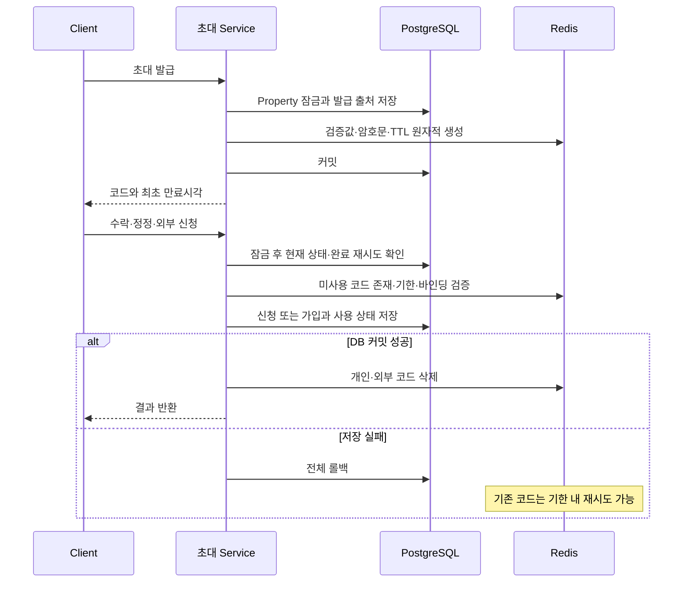

# Server 참여자 역할·가입 요청 관리

2026-10-25 상태 구분: 기존 절은 Redis 이전 전의 구현 설명입니다. 후속 확정 요구사항, 현재 작업 트리의 변경과 미완료 검증은 아래 [Redis 이전 상세 설계](#redis-이전-상세-설계와-진행-상태-2026-10-25)를 기준으로 합니다. 기존 1일 승인 제한·개인 24시간·DB 암호문 복원은 후속 설계로 대체하며, 작업 중 코드를 배포 완료로 기록하지 않습니다.

기준일: 2026-10-24. 아래는 역할·가입 요청·외부 초대와 주민 공통 코드·개인 초대의 현재 저장 처리입니다. 업무 정책은 [도메인 규칙](../../docs/domainRules.md#주민-참여-흐름), 요청·응답·오류는 [참여자 API](../../docs/memberManagementApi.md), 저장 구조는 [ERD](../../docs/erd.md#외부-관리자-초대역할-변경-저장-2026-10-17)를 따른다. 화면 배치는 [Client 역할·가입 설계](../../client/docs/memberManagement.md)에서 관리한다.

## 트랜잭션과 권한

MemberManagementService는 역할 변경·인계·외부 관리자 초대와 본인 명부 연결을 처리한다. 변경 요청은 Property 행 잠금 뒤 현재 정상 계정과 ADMIN / MANAGER 권한을 확인한다. 관리자 승격·외부 관리자 초대 발급/승인·인계는 별도로 ADMIN을 확인한다. 명부 변경·가입 승인과 같은 잠금을 사용해 서로 다른 계정 연결이나 역할 변경을 직렬화한다.

일반 역할 변경은 예상 역할과 현재 역할의 일치를 검증하고 ADMIN 지정·해제와 자신의 역할 변경을 거부한다. 주민 역할 변경은 현재 승인된 주민 연결을 요구한다. ResidentManagementService의 일반 명부 수정과 역할 변경은 같은 트랜잭션이며 후속 명부 검증 실패 시 역할·이벤트도 롤백한다. 미거주 부담당자의 참여 종료는 주민 명부 삭제와 구분한다.

## 관리소장 인계

활성 관리소장 한 명과 인계 대상의 정상 계정·단일 현재 참여·예상 역할을 검증한다. 기존 관리소장을 MANAGER로 변경하고 flush한 뒤 인계 대상을 ADMIN으로 변경한다. 부분 유일 인덱스의 한 명 제한을 지키며 역할 변경과 member_role_events를 같은 트랜잭션으로 저장한다. 후반 저장 실패 시 기존 관리소장의 역할도 복원된다.

## 외부 부담당자 초대

초대는 주민 명부 없는 MANAGER 참여용이며 24바이트 무작위 값을 URL 안전 문자열로 발급한다. 원문은 최초 응답에만 반환하고 DB에는 SHA-256 해시만 저장한다. 발급 후 1일 안에 한 계정이 신청하고 관리소장이 승인해야 권한을 얻는다. 만료·철회·승인 상태와 revision을 검증하며 같은 완료 요청은 중복 변경하지 않는다. 승인 시 참여·역할 이벤트·초대 상태를 함께 저장한다.

이미 적용된 초기 초대 Migration은 보존한다. 적용된 후속 Migration은 미완료 주민용 코드를 철회하고 member_invitations의 신규 주민 초대를 차단하며 과거 승인 이력은 유지한다. 현재 주민 가입은 다음의 membership_requests로 처리한다. 새로운 주민 초대는 이 제약을 제거하거나 과거 코드를 되살리는 방식으로 구현하지 않는다.

## 가입 요청 대상과 승인 관리 조회

`MembershipRequestService.unlinkedResidents`는 현재 관리소장·부관리자 참여 확인 후 `ResidentRepository.findUnlinkedResidents`로 같은 관리대상의 미삭제·계정 미연결 주민을 조회합니다. 승인 상태 조회와 분리하고 이름·끝 네 자리·현재 동·호수·주민 구분만 읽습니다. 현재 세대가 없어도 LEFT JOIN으로 주민 행을 유지하며 계정 ID·전화번호 암호문을 읽거나 복호화하지 않습니다.

실제 신청 workspace와 승인·거절 트랜잭션은 그대로 사용합니다. 미연결 주민을 승인 대기 요청으로 생성하지 않으며 검색·페이지네이션은 Client에서 수행합니다. 개인 초대·공통 코드 저장은 아래 별도 서비스와 Migration에서 처리합니다.

## 주민 가입 요청

MembershipRequestService는 Property 잠금 아래 공통 코드를 검증하고 필수 이름·세대와 선택 보호 연락처를 기록하며 이름·전화번호로 주민을 자동 연결하지 않는다. 신청만으로 권한을 만들지 않고 동일 계정·세대의 대기 재신청은 기존 요청을 반환한다. 관리소장·부담당자는 신청과 해당 세대의 명부 후보를 조회하고 직접 선택한 주민만 승인한다.

승인은 Property 잠금 아래 요청 버전·현재 세대·미삭제 명부·정상 계정과 기존 계정/역할 충돌을 다시 검증한다. residents.user_id·RESIDENT 참여·역할 이벤트·신청 승인과 검토자/시각을 같은 트랜잭션에서 저장한다. 거절은 요청 이력만 변경하고 명부·계정·권한을 만들지 않는다. 전화번호는 기존 ResidentRegistrationService와 PhoneSecurity로 정규화·암호화한다.

## 기존 관리소장 본인 명부 연결

MemberManagementService.linkOwnResident는 같은 Property 잠금 뒤 현재 ADMIN / MANAGER·정상 계정·현재 명부/세대와 expectedUnitId를 검증한다. 타인 계정·다른 명부 연결은 덮어쓰지 않으며 resident.user_id와 resident_account_links를 같은 트랜잭션에 저장한다. 후반 기록 실패는 주민 연결도 롤백한다. 같은 연결 재요청은 이력을 중복 생성하지 않는다.

ADMIN 참여·대표·연락처·이름·주민 구분은 변경하지 않으며 가짜 가입 요청이나 역할 변경 이벤트를 만들지 않는다. 새 관계 ID는 과거 본인 연결의 승인 근거를 재사용하지 않는다. 조회 기준은 [주민 API](../../docs/residentManagementApi.md#가입-상태-판정)를 따른다. Migration `V20261017044108__create_resident_account_links.sql`은 출처 테이블만 추가하고 기존 계정을 일괄 연결하지 않는다. 적용된 기존 Migration은 변경하지 않는다.

## 검증

PaymentPersistenceTest에서 기존 잔액과 함께 가입 승인·역할 변경·명부 수정 실패의 롤백·외부 초대 만료·한 명 인계를 검증한다. ChiefAccountLinkPersistenceTest는 본인 연결의 대표 보존·동일 재시도·계정 충돌·권한·현재 세대·동시 선택·출처 저장 실패 롤백과 기존 스키마 업그레이드를 검증한다. SecurityIntegrationTest와 OpenApiIntegrationTest는 인증된 본인 계정 사용·계약 밖 식별자 거부·필수 요청 필드와 문서 계약을 확인한다.

## 주민 초대 코드와 수락 처리

ResidentJoinCodeService는 공통 발급·재발급·폐기를 Property 잠금 아래 직렬화합니다. options와 최종 신청 모두 유효 코드를 검증해 코드 없는 우회 경로를 남기지 않습니다. ResidentInviteCode는 60비트 난수의 표시 구분자를 정규화하고 해시로 검증합니다. 공통 코드는 해시만 저장합니다. 저장 DDL은 [ERD](../../docs/erd.md#61-invitations)를 참조합니다.

ResidentInvitationService는 같은 Property 잠금 아래 개인 발급·재발급·철회·수락·검토를 처리합니다. 수락 전 찾은 초대는 잠금 획득 후 EntityManager.refresh로 다시 읽어 동시 수락의 이전 상태를 사용하지 않습니다. 발급 당시 주민 버전과 현재 세대 관계를 다시 확인하고 기존 다른 계정·관리자 역할을 덮어쓰지 않습니다.

일반 확인 수락은 주민 계정 연결·RESIDENT 참여·역할 이벤트·APPROVED 출처·초대 사용을 하나의 트랜잭션에 저장합니다. 정정 제출은 암호화된 변경 요청만 분리 보존합니다. 정정 승인에서는 기존 ResidentManagementService.update를 재사용해 중복 주민·전화번호 묶음·기존 신청 연락처 정책을 지킨 뒤 같은 트랜잭션에서 가입합니다. 실패는 전체 롤백합니다. 같은 계정의 기존 일반 PENDING 신청은 임의 종료하지 않고 충돌을 반환합니다.

개인 초대 재전달은 `ResidentInvitationService.share`에서 현재 관리자와 명부·현재 관계·만료를 다시 검사합니다. `InvitationCodeSecurity`는 기존 외부 계좌 암호화 키링을 사용하고, 별도 AAD에 용도·키 ID·대상·초대 ID를 바인딩한 AES-256-GCM으로 코드를 보호합니다. 원문을 로그·일반 목록에 반환하지 않고 수락·정정 제출·철회 시 암호문을 제거합니다. 재열기는 기존 코드와 최초 만료를 유지하고 재발급은 별도 작업입니다. 기존 해시만 저장한 행은 자동 폐기하지 않으며 share의 token:null로 원문이 없음을 전달합니다. restore는 보관한 기존 코드를 현재 해시와 대조한 뒤 같은 코드를 보호 저장하며 만료·상태·기존 링크는 유지합니다. 다른 코드를 저장하지 않습니다.

24시간 만료는 미사용 코드에 적용하며 만료 전에 제출된 정정은 이후 검토할 수 있습니다. 조회 모델은 승인 출처·현재 관계·계정·활성 참여를 함께 검사합니다. 과거 외부 초대와 기존 일반 신청은 보존합니다. 외부 메시지 자동 발송은 DB 트랜잭션에 포함하지 않습니다.

PaymentPersistenceTest에 전화번호 없는 개인 수락·타 계정 재사용 거부·정정 후 가입·재발급/만료·이름과 선택 연락처 저장을 검증합니다. 빈 DB의 전체 Migration과 기존 스키마 업그레이드는 기존 PostgreSQL 통합 테스트를 함께 사용합니다.

부담당자의 관리소장 명부 수정·삭제·대표 변경·재등록 복구는 ManagementAccessService.requireResidentWrite로 거부합니다. 현재 ADMIN 참여를 대상 로그인 계정과 대조하고 세대 일괄 삭제에서도 같은 검사를 사용합니다. 검사는 대상 잠금 아래 저장 전에 수행합니다.

## Redis 이전 상세 설계와 진행 상태 (2026-10-25)

### 범위와 근거

업무 확정 기준은 [도메인 규칙](../../docs/domainRules.md#초대-인증서비스-복귀역할-변경의-후속-확정-방향-2026-10-25), 필드·Migration은 [ERD](../../docs/erd.md#초대-인증의-redis-이전-설계-2026-10-25), 공유 계약은 [참여자 API](../../docs/memberManagementApi.md#redis-이전의-변경-계약-2026-10-25)를 참조합니다. 임시 인증을 Redis로 옮기며 DB는 영구 업무 기록을 유지합니다. 오류 복귀·동적 권한은 Client 설계와 [Server 접근 설계](managementAccess.md#동적-권한을-위한-조회-보완-설계-2026-10-25)에서 다룹니다. 입금 매칭은 변경하지 않습니다.

현재 확인한 실제 코드 위치는 `src/main/java/com/moahome/server/` 아래 다음과 같습니다.

| 파일·메서드 | 이전 전 동작 | 작업 중 변경·후속 검증 |
| --- | --- | --- |
| `membership/domain/ResidentInviteCode.java`의 create/hash | B/R 구분 60비트 난수, 구분자·대소문자 정규화 후 SHA-256 | 재사용. 주민 링크·직접 입력은 같은 해시 |
| `membership/service/ResidentJoinCodeService.java`의 issue/require/property/revoke | DB 공통 코드 발급·검증·철회 | Redis 생성·필수 검증·커밋 후 삭제 연결 |
| `membership/service/ResidentInvitationService.java`의 issue/share/restore/preview/accept/review/revoke | DB 개인 해시·암호문, 관계/명부 버전 확인, 수락·정정·검토 | 암호문 Redis 저장, 미사용 Redis 필수, 완료 재시도는 DB 결과, restore 우회 차단 |
| `membership/service/MemberManagementService.java`의 issue/claim/approve/revoke | 24바이트 난수·해시, 신청과 승인 모두 만료 전 | 신청 소진·검토 기한 분리, REQUESTED의 만료 표시 제거 |
| `membership/service/MembershipRequestService.java`의 options/request/approve | 신청 시 공통 코드 검증, 승인 시 명부 선택·권한 기록 | 기존 검증 경계 재사용, 공유 코드는 신청으로 삭제하지 않음 |
| `common/security/InvitationCodeSecurity.java`의 encrypt/decrypt | 초대·Property ID를 AAD로 사용하는 AES-256-GCM | 기존 키링·AAD를 재사용하며 암호문 저장 위치만 변경 |
| `membership/repo/ResidentInvitationRepository.java`, `ResidentJoinCodeRepository.java`, `MemberInvitationRepository.java` | DB 해시로 초대 출처 조회 | 미사용 인증을 이 조회만으로 허용하지 않음 |
| `auth/repo/RedisAuthSessionRepository.java`, `RedisOAuthStateRepository.java` | 세션·OAuth Redis 저장과 Lua | 연결·구현 관례 재사용, 키 공간은 분리 |
| `membership/repo/RedisInvitationCodeRepository.java` | 이전 전 없음 | 신규 작업 파일. 생성·검증 Lua와 DB 완료 콜백 |
| `payment/exception/PaymentExceptionHandler.java` | 기존 공통 업무 오류 처리 | Redis 초대 장애 503 분기 작업 중 |

Controller는 기존 `membership/controller/ResidentInvitationController.java`, `ResidentInvitationClaimController.java`, `MembershipRequestController.java`, `InvitationClaimController.java`, `MemberManagementController.java`의 HTTP 경계를 유지합니다. API 경로·본문·응답은 공통 계약을 기준으로 합니다.

### Redis 자료형·키·TTL

현재 작업안은 해시로 DB 출처를 찾은 뒤 초대 ID로 Redis 검증값을 조회합니다. 사용자 ID·주민 개인정보·원문 토큰을 키에 넣지 않습니다.

| 항목 | 설계 |
| --- | --- |
| 키 | `membership:invitation:{kind}:{invitationId}`. kind는 shared/resident/manager |
| 자료형 | Redis Hash |
| 필드 | property: Property UUID, hash: 정규화된 코드 SHA-256, expiresAt: 만료 epoch milliseconds, encrypted: 개인 코드 AES-GCM 암호문 또는 빈 문자열 |
| TTL | 발급 시 `expiresAt - 서버 현재 시각`의 milliseconds. 유형별 기한은 도메인 규칙 참조 |
| 생성 | Lua에서 EXISTS 검사·HSET·PEXPIRE를 함께 실행. 초대 ID는 발급마다 새 UUID |
| 검증 | Lua에서 키 존재·Property·해시·DB 만료시각 일치·현재시각 미만료를 함께 확인 |
| 재전달 | 현재 미사용 상태·명부 버전·관계와 Redis 검증 후 암호문 복호화. 기한·revision·TTL 연장 없음 |
| 삭제 | 수락·정정·외부 신청·철회·재발급의 DB 커밋 후 해당 ID 키만 삭제 |
| 비밀정보 | 이름·전화번호·세대 정보 미저장. 원문은 응답/입력 본문에서만 사용하고 로그에 남기지 않음 |

`auth:session:`·`auth:oauth:`와 충돌하지 않습니다. 현 작업 키에는 버전 접두사가 없으므로 운영 배포 전 `membership:invitation:v1:...` 도입 여부를 검토합니다. 형식 변경은 새 키 공간과 명시적 전환으로 처리하며 알 수 없는 형식은 인증에 사용하지 않습니다. 양식 변경으로 기존 키의 TTL을 연장하거나 DB 해시로 자동 복구하지 않습니다.

DB 해시는 초대 ID 조회와 완료 요청 식별용으로 유지하는 선택입니다. 이는 Redis를 캐시로 사용하는 구성이 아닙니다. 미사용 초대에서 Redis가 없으면 코드·DB 해시가 맞아도 인증을 거부합니다. DB 해시까지 제거하려면 Redis 해시→초대 ID 인덱스와 별도 완료 요청 식별자가 필요하므로 현재 단계에서는 추가하지 않습니다.

개인 재전달은 기존 암호화를 유지하는 방식을 권합니다. 평문 Redis 저장은 피하고, 재전달마다 자동 재발급하면 기존 링크를 바꾸므로 사용하지 않습니다. Redis가 유실되면 기존 암호문 복원 API로 검증값을 되살리지 않고 명시적으로 재발급합니다.

### DB와 Redis의 확정 순서

현재 Property 행 잠금을 일회용 사용의 직렬화 지점으로 유지합니다. 개인 초대는 잠금 획득 후 EntityManager.refresh로 초기 조회의 이전 상태를 폐기합니다. 외부 신청은 대상 ID를 찾은 후 잠금 아래 초대 상태를 다시 읽습니다. 모든 관련 쓰기는 같은 잠금 규칙을 지켜야 합니다.

Redis의 GETDEL을 먼저 실행하거나 임시 선점 키를 먼저 소진하지 않습니다. Redis 코드가 남아 있어도 DB의 현재 상태를 확인하며 Property 잠금과 상태 전이로 한 계정만 접수합니다. 이 선택은 Redis 선점과 DB 롤백 사이의 별도 보상 상태를 줄입니다. DB 잠금 없이 코드 인증만으로 가입시키는 경로가 없는지 전체 진입점을 검증해야 합니다.

공통 코드는 신청 커밋 후에도 유지합니다. 정정 검토·외부 승인은 이미 접수된 DB 요청으로 처리하며 Redis 코드가 없어도 검토할 수 있습니다. 새 권한·주민 연결·승인 출처는 각각 하나의 DB 트랜잭션으로 저장합니다.

| 장애·경합 | 처리와 보장 |
| --- | --- |
| 발급 중 Redis 생성 실패 | 발급 DB 전체 롤백. 생성 응답 유실로 남은 키는 대응 DB 행이 없어 사용할 수 없고 TTL로 정리 |
| Redis 생성 후 DB 롤백 | afterCompletion에서 새 키 정리. 정리도 실패하면 TTL, 대응 DB 발급 없음으로 차단 |
| 코드 검증 후 DB 저장 실패 | 소진 상태·가입·권한 전체 롤백. 기존 키를 미리 지우지 않아 같은 코드 재시도 가능 |
| DB 성공 후 Redis 삭제 실패 | 성공 응답 유지. DB 사용/철회 상태로 추가 사용 차단, 로그·TTL 정리. 같은 완료 재시도에서 삭제 재시도 |
| 서로 다른 계정 동시 사용 | 같은 Property 잠금 아래 첫 커밋만 인정. 후속 요청은 최신 상태로 거부 |
| 같은 계정 중복·응답 유실 | 개인 APPROVED/CHANGE_REQUESTED 및 외부 REQUESTED는 기존 결과 반환. Redis 존재로 새 결과를 만들지 않음 |
| 커밋 전 서버 재시작 | DB 복구에서 롤백, 아직 기한 내인 코드는 재시도 가능 |
| 커밋 후 삭제 전 서버 재시작 | DB 완료 상태로 재사용 차단, 잔여 키는 TTL 정리. 물리 삭제의 즉시 완료를 보장했다고 기록하지 않음 |
| Redis 연결 장애 | 503과 재시도. DB 인증 우회·사용 완료 처리 없음 |
| Redis 키 유실·재시작 | 미사용 코드 거부·재발급 안내. 접수된 요청과 완료 결과는 DB에 유지 |
| 만료와 수락 경합 | Redis 검증과 Entity의 최종 claim/request에서 각각 시각 확인. `now >= expiresAt`이면 신규 사용 거부 |
| 철회와 수락 경합 | 같은 DB 잠금으로 확정 순서 결정. 철회 커밋 이후 남은 Redis 키로 수락할 수 없음 |
| 소진 후 과거 요청 재전송 | 같은 계정의 허용된 완료 상태만 조회. 타 계정·철회·거절은 거부 |

삭제 실패 키를 TTL 이전에 반드시 제거해야 하는 운영 요구가 추가되면 DB Outbox 기반 삭제 재시도를 별도로 설계합니다. 현재 작업은 DB 재사용 차단·최초 TTL·완료 재시도 정리를 사용하며 지속 재시도 작업은 구현하지 않았습니다.

### 운영 배포 전 이전과 복구

저장소에서 로컬 Compose·환경변수 연결과 격리 테스트 구성을 확인했습니다. 다른 개발·테스트·공유 DB에 데이터가 존재하는지는 확인하지 않았습니다. 실제 DB·Redis·`.env`를 조회하거나 변경하지 않습니다.

1. 배포 대상의 DB 백업·활성 미사용 초대 수·접수 요청 수·Redis 접근 가능 여부를 운영자가 확인합니다. 값·코드를 문서에 복사하지 않습니다.
2. 신규 발급을 중지하고 구버전 서버를 종료합니다. 구버전과 신버전을 혼합하면 DB 전용 코드가 재발급될 수 있으므로 이번 전환에서는 함께 실행하지 않습니다.
3. 후속 Flyway 초안 `V20261025015144__move_invitation_credentials_to_redis.sql`을 검토합니다. 기존 ISSUED는 발급자 출처로 자동 철회하고 revision을 올리며, 접수된 REQUESTED/CHANGE_REQUESTED와 승인·거절 이력은 유지합니다. 만료시각을 소급 연장하지 않습니다.
4. 같은 Migration은 DB 재전달 암호문 제거와 외부 초대의 기존 1일 고정 CHECK 완화를 포함합니다. 이미 공유한 Migration은 수정하지 않습니다. 상세 컬럼 분류는 ERD를 따릅니다.
5. Redis 검증 필수 버전의 Server와 기간 안내를 바꾼 Client를 함께 준비합니다. 새 발급·재전달·소진·기한 후 검토·장애 시 거부를 격리 스모크 테스트로 확인합니다.
6. 이전 코드 재발급을 안내합니다. Redis 전체 삭제나 세션/OAuth 키 삭제를 전환 절차로 사용하지 않습니다.

롤백은 코드만 구버전으로 되돌리는 방식으로 처리하지 않습니다. 제거한 컬럼에 의존하는 구버전은 새 스키마와 호환되지 않습니다. 장애 시 발급/수락을 중단한 뒤 신버전 수정 또는 백업 기반 격리 복구를 검토합니다. 되살린 과거 DB 해시·암호문으로 신규 인증을 허용하지 않으며 DB 복구 시점 이후 업무 이력의 손실 범위를 먼저 확인합니다. 실제 운영 복구 명령은 배포 환경 확인 후 확정합니다.

### 설정과 운영 확인 필요

- 기존 `REDIS_HOST`·`REDIS_PORT`, 환경별 `SPRING_DATA_REDIS_*` 연결을 재사용합니다. 실제 로컬 설정은 추적 제외이며 참조는 [개발 가이드](../../docs/developmentGuide.md#server-환경변수)를 따릅니다. 현재 가이드는 연결·읽기 timeout을 각각 3초로 설명하며 변경하지 않았습니다.
- 로컬 `server/docker-compose.yml`은 Redis 8·포트 매핑·Named Volume·ping healthcheck를 정의합니다. Volume만으로 AOF·복제·백업이 구성됐다고 판단하지 않습니다. Compose에 명시적인 ACL/TLS/AOF 설정은 확인되지 않았습니다.
- 운영 Redis는 외부 공개를 제한하고 Server만 연결하도록 네트워크·ACL·인증·필요한 TLS를 배포 설정에서 검토합니다. 비밀값은 환경/비밀 저장소로만 주입합니다. 운영 인증·TLS·Persistence·고가용성·eviction·메모리 한도는 확인 필요입니다.
- 세션과 같은 Redis를 쓰면 키 유실·eviction이 로그인과 초대에 함께 영향을 줍니다. 임의 삭제 대신 메모리·연결·삭제 실패를 관측하고 noeviction 또는 별도 인스턴스 등 실제 운영 구성을 검토합니다. 도입했다고 기록하지 않습니다.
- 인증 시도 제한은 이번 작업에서 새로 구현되지 않았습니다. 기존 실제 Rate Limit 구현도 이번 조사로 확인하지 못했습니다. 사용자·네트워크 식별자별 제한과 TTL은 필요성·기준을 별도 결정합니다.

### 구현 순서와 검증 상태

| 단계 | 작업과 파일 | 상태 |
| --- | --- | --- |
| 1 | 도메인·ERD·API에 정책과 저장 역할 구분 | 이번 문서 정리 |
| 2 | RedisInvitationCodeRepository·초대 Service·Entity·장애 응답 | 앞선 요청으로 작업 중 |
| 3 | 후속 Migration과 기존 신청·승인 이력 보존 | SQL 초안 존재, 실제 환경 미적용 |
| 4 | Client 초대 안내·공유 문구·503 메시지 | 수정 및 기본 검증 통과. 실행 범위는 아래 커밋 전 검증 참조 |
| 5 | 동시 사용·롤백·Redis 삭제 장애·Migration 업그레이드 검증 | 추가 검증 필요 |
| 6 | Client·HTTP 별도 작업: signal 전달→최초/백그라운드 UI 분리→Query 소유 범위→공통 접근 검사→진입 시 역할 이동→통합 검증 | 두 선행 필수 과제 포함. 설계만 작성, 미구현 |
| 7 | 전체 빌드·스모크 테스트·운영 환경 확인 | Server·Client 기본 빌드 통과, 운영 스모크·환경 확인 미실행 |

단계 6은 Redis 초대 저장 구조와 별도의 Client·HTTP 개선 흐름입니다. 업무 화면/모달 보존과 AbortSignal 전달은 현재 미구현이며 착수 시 실제 코드를 재확인해야 합니다. 상세 변경 파일·구현 방법·계정/Property Query 범위·필수 구현 순서·검증 기준은 [Client 후속 필수 계획](../../client/docs/managementLayout.md#후속-필수-과제의-재확인-범위)을 따릅니다. 기본 동작은 새로고침·보호 화면 진입에서 현재 권한을 확인하는 것입니다. 30초 주기·포커스·재연결 자동 권한 조회는 필수 작업에서 제외하고 SSE와 함께 필요 시 후속 검토합니다. Redis 이전 선택 테스트 통과를 이 Client 작업이나 전체 배포 완료로 대신하지 않습니다.

문서 전용 요청 전 `PaymentPersistenceTest`의 personal/lostRedis/reopening/reissue/sharedCode/corrections/externalManagerInvitation 선택 테스트와 `ChiefAccountLinkPersistenceTest`는 실제 실행해 통과했습니다. 이는 전체 `./gradlew build`, Client 검사, 모든 장애·동시성·데이터 보존 검증의 완료를 뜻하지 않습니다. 문서 전용 단계에서는 테스트·빌드·Migration을 추가 실행하지 않았습니다. 이후 사용자 커밋 요청에 따른 검증은 다음과 같습니다.

- Server `./gradlew build` 통과: 전체 테스트 514개, 실패·오류·생략 없음. Migration 검증은 격리 테스트 DB에 한정하며 개발·공유·운영 DB에 적용하지 않았습니다.
- Client `npm run lint`, `npx --no-install tsc --noEmit`, `npm run test:api` 통과. API·구조·세션 등 108개 테스트 통과.
- Client `npm run build`의 기본 Turbopack 빌드는 완료되지 않아 중단했고 `npm run build -- --webpack` 프로덕션 빌드로 대체 검증해 통과했습니다.
- `PLAYWRIGHT_CHANNEL=chrome npm run test:e2e -- tests/onboardingFlow.spec.ts --grep '초대|정정'` 통과: 관련 브라우저 테스트 12개. Playwright 전용 Chromium 실행 파일이 없어 설치된 Chrome을 사용했습니다. 이 결과는 모의 API 기반 화면 회귀이며 운영 Redis·OAuth 연동 완료를 뜻하지 않습니다.

다음 구현 단계에서 기존 테스트를 확장합니다.

| 범주 | 재사용할 테스트·추가 시나리오 |
| --- | --- |
| TTL·경계 | `PaymentPersistenceTest`: 개인·외부 30분, 공유 24시간 Redis TTL, 만료 직전/동시각/직후, 재전달 후 TTL 미연장 |
| 소진·재시도 | 같은 코드·링크의 교차 사용, 타 계정 거부, 같은 계정 결과 재반환, 공유 코드 여러 계정 신청 |
| 철회·재발급 | 기존 키 무효화, 재발급 실패 시 기존 코드 유지, 철회·수락 동시 요청 |
| 원자성 | Redis 생성 후 DB 커밋 실패의 키 정리, 수락 후 저장 실패의 주민/권한/상태 롤백과 코드 재시도 |
| 장애 | Redis 실제 연결 실패의 503, DB 성공 후 삭제 실패에도 성공 보존, 키 유실 후 DB/restore 우회 금지 |
| 동시성 | 서로 다른 계정 동시 수락·정정·외부 신청, 같은 계정 중복, 커밋 후 응답 유실 재전송 |
| 검토 | 정정·외부 신청 접수 후 Redis 만료/삭제/장애에도 검토 가능, 신규 권한은 한 번만 생성 |
| Migration | 빈 DB 전체 적용과 이전 최신 스키마→신규 적용, 기존 미사용 코드 철회, 접수·승인·역할·현재 주민 연결·FK 보존, CHECK 변경 |
| 보안 | 원문/개인정보 로그·URL 미포함, 암호문 AAD 혼입·변조 거부, 타 Property·타 계정 접근 거부 |

Redis 장애 테스트 후보는 `membership/repo/RedisInvitationCodeRepositoryTest.java`이며 아직 작성하지 않았습니다. 격리 Redis·PostgreSQL은 기존 `auth/support/RedisTestServer.java`, `user/support/PostgresTestServer.java`를 재사용합니다. 데이터 삭제가 필요한 테스트는 테스트가 소유한 일회성 인스턴스에만 적용하며 운영 전환 절차에 포함하지 않습니다. 필수 명령은 구현 재개 후 Server에서 `./gradlew test`, 최종 `./gradlew build`입니다.
